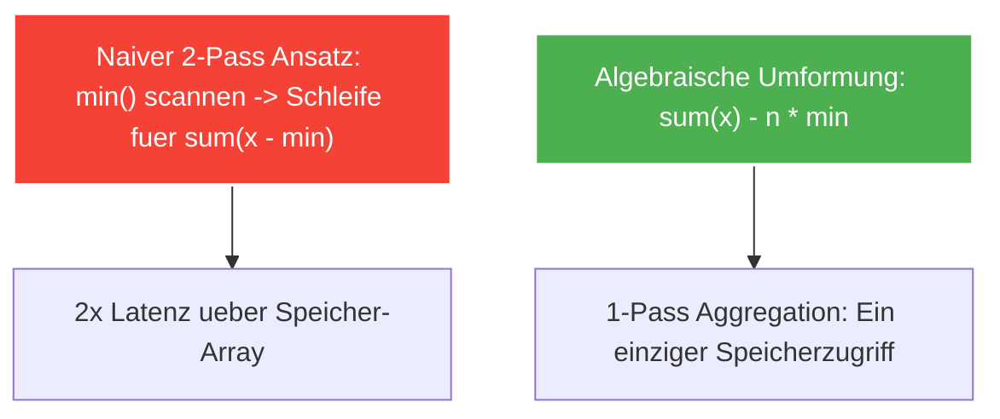

---
tags:
  - Algorithm
  - Math
  - Optimization
  - One-Pass
  - Performance
---

# Ein-Pass-Optimierung durch algebraische Umformung

Die **Ein-Pass-Optimierung durch algebraische Umformung** ist eine fundamentale Technik im Competitive Programming und der Algorithmenentwicklung. Sie transformiert Probleme, die scheinbar mehrere Schleifendurchläufe erfordern, durch mathematische Umformung in einen **einzigen linearen Durchlauf** ($\mathcal{O}(n)$ 1-Pass) oder sogar direkte Formelauswertungen.

---

## 1. Das Kernprinzip

Viele Aufgaben verlangen, alle Elemente $x_i$ eines Arrays bezüglich eines globalen Extremwerts (z. B. Minimum $\min$ oder Maximum $\max$) anzugleichen:

$$\text{Kosten} = \sum_{i=1}^{n} (x_i - \min(nums))$$

### Der naive Ansatz (2 Durchläufe):
1. Finde das Minimum in einem ersten Durchlauf: $m = \min(nums)$.
2. Berechne die Summe der Differenzen in einem zweiten Durchlauf:
   ```python
   min_val = min(nums)
   ans = sum(x - min_val for x in nums)
   ```
- Nachteil: Zwei vollständige Iterationen über das Array, Cache-Ladezyklen und Funktionsaufruf-Overhead.

---

## 2. Die algebraische Umformung

Durch Ausmultiplizieren und Aufspalten der Summe lässt sich die Berechnung mathematisch vereinfachen:

$$\sum_{i=1}^{n} (x_i - m) = \left( \sum_{i=1}^{n} x_i \right) - \left( \sum_{i=1}^{n} m \right) = \sum_{i=1}^{n} x_i - n \cdot m$$

Analog für das Angleichen an das Maximum $M = \max(nums)$:

$$\sum_{i=1}^{n} (M - x_i) = n \cdot M - \sum_{i=1}^{n} x_i$$

### Der optimierte Code:
```python
# Nur noch die Summe und das Minimum/Maximum werden benötigt:
total = sum(nums)
ans = total - len(nums) * min(nums)
```

Noch performanter in einem echten **Single-Pass**:
```python
total = 0
min_val = float("inf")
count = 0

for x in nums:
    total += x
    if x < min_val:
        min_val = x
    count += 1

ans = total - count * min_val
```



---

## 3. Typische Anwendungsfälle

1. **Minimale Operationen zum Angleichen eines Arrays:**  
   Wenn in jedem Schritt alle Elemente außer einem um 1 erhöht werden dürfen (äquivalent dazu, dass ein Element um 1 verringert wird).
2. **Abstandsberechnungen zu einem Referenzwert:**  
   Berechnung kumulierter Abweichungen ohne wiederholte Subtraktionsschleifen.
3. **Flächen- und Wasserstandsprobleme:**  
   Vermeidung verschachtelter Aggregationen bei Histogrammen und Treppenfunktionen.

---

## 4. Komplexitätsanalyse

| Dimension | Naiver Ansatz | Algebraischer 1-Pass |
| :--- | :--- | :--- |
| **Zeitkomplexität** | $\mathcal{O}(2n) = \mathcal{O}(n)$ | $\mathcal{O}(n)$ (halbiert die realen CPU-Zyklen) |
| **Speicherkomplexität** | $\mathcal{O}(1)$ | $\mathcal{O}(1)$ |
| **Cache-Misses** | Doppeltes Streaming durch den RAM | Einmaliges sequenzielles Streaming |
