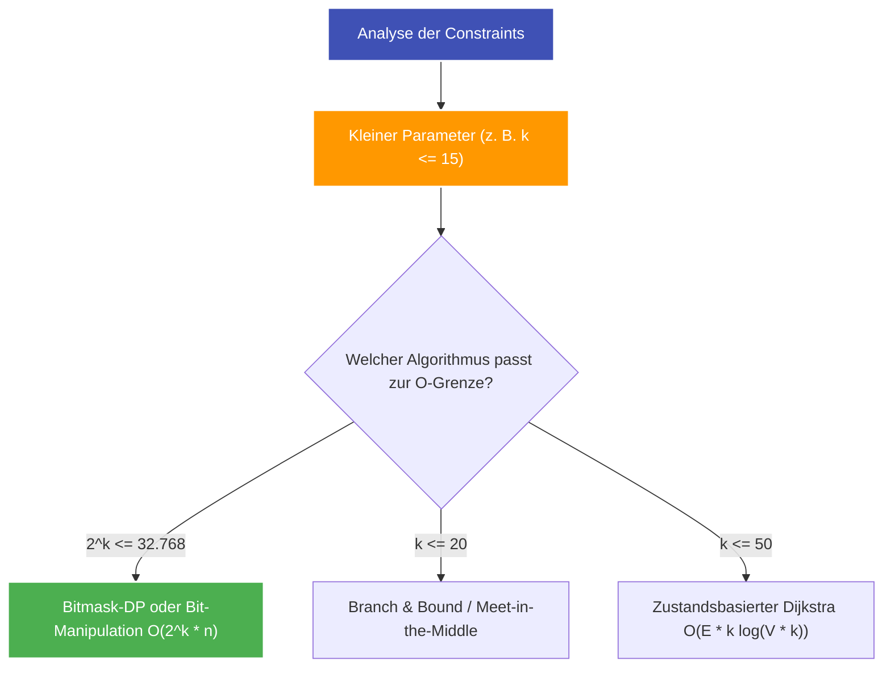

---
tags:
  - Architecture
  - Design Pattern
  - Constraints
  - Optimization
  - Complexity
---

# Constraint-Driven Design: Kleine Parameter als Architektur-Hinweis

**Constraint-Driven Design** ist die Kunst, die mathematischen Grenzen (*Constraints*) einer Problemstellung vor dem Schreiben von Code systematisch zu analysieren. In Coding-Interviews und Competitive Programming sind ungewöhnlich kleine oder asymmetrische Grenzwerte der **direkte Hinweis auf den geforderten Algorithmus**.

---

## 1. Das Kernprinzip: Die Grenzen verraten den Algorithmus

Oft besteht ein Problem aus mehreren Parametern mit drastisch unterschiedlichen Größenordnungen:
- $n = 10^5$ (riesige Datenmenge)
- $k \le 15$ oder $\Sigma \le 26$ (ein extrem kleiner Teilparameter)

Ein naiver Algorithmus, der in allen Dimensionen skaliert, scheitert an einem *Time Limit Exceeded (TLE)*. Das Design muss sich daher **strikt an den kleinsten Dimensionen orientieren**:

---

## 2. Der Constraint-Entschlüsselungs-Leitfaden

Anhand der Obergrenzen lässt sich die erwartete Komplexität direkt ablesen:

| Parametergrenze | Typischer Wert | Erlaubte Komplexität | Ziel-Architektur / Algorithmus |
| :--- | :--- | :--- | :--- |
| **$n \le 10 \dots 12$** | Extrem klein | $\mathcal{O}(n!)$ oder $\mathcal{O}(2^n \cdot n^2)$ | Permutationen, Rekursion mit Backtracking, TSP |
| **$n \le 15 \dots 20$** | Sehr klein | $\mathcal{O}(2^n)$ oder $\mathcal{O}(2^n \cdot n)$ | **Bitmask-DP**, Untermengen, Meet-in-the-Middle |
| **$k \le 26$** (Alphabet) | Konstante Größe | $\mathcal{O}(26 \cdot n) = \mathcal{O}(n)$ | [Bitmasken](bit-manipulation.md) (26-Bit-Integer), [Prefix-XOR](advanced-tree-techniques.md), Frequenz-Arrays |
| **$k \le 50 \dots 100$** | Begrenzter Zustand | $\mathcal{O}(n \cdot k)$ oder $\mathcal{O}((E \cdot k) \log(V \cdot k))$ | [Zustandsbasierter Dijkstra](state-space-dijkstra.md), Knapsack-DP |
| **$n \le 10^3$** | Moderat | $\mathcal{O}(n^2)$ | 2D Dynamic Programming, Matrix-Multiplikation, All-Pairs Shortest Path |
| **$n \le 10^5$** | Standardgröße | $\mathcal{O}(n \log n)$ oder $\mathcal{O}(n)$ | Sortieren, [Min-Heap / Sweep-Line](min-heap-sweep-line.md), [Binäre Suche](binary-search.md), [Sliding Window](sliding-window.md) |
| **$n \ge 10^9$** | Riesig | $\mathcal{O}(\log n)$ oder $\mathcal{O}(1)$ | Reine Mathematik, Modulo-Arithmetik, Matrix-Exponentiation |

---

## 3. Fallbeispiele aus der Praxis

### Fall 1: LeetCode 3970 – Shortest Path With At Most K Consecutive Characters
- $n = 10^4$, aber $k \le 10$.
- **Architektur-Schlussfolgerung:** Da $k$ winzig ist, kann die Zustandsraum-Dimension gefahrlos mit $k$ multipliziert werden:
  $$\text{Zustand} = (u, \text{char}, \text{count}) \implies \mathcal{O}(V \cdot k) \text{ Zustände}$$
  Ein [zustandsbasierter Dijkstra](state-space-dijkstra.md) terminiert in $\mathcal{O}((E \cdot k) \log(V \cdot k))$ problemlos!

### Fall 2: LeetCode 2791 – Palindrome Paths in a Tree
- $n = 10^5$, aber nur 26 Kleinbuchstaben (`'a'` bis `'z'`).
- **Architektur-Schlussfolgerung:** Ein 26-Bit-Integer fasst die Paritäten aller Buchstaben zusammen. Anstelle teurer String-Vergleiche genügen [bitweises XOR](bit-manipulation.md) und der [Palindrom-Bit-Trick](bit-manipulation.md) `mask & (mask - 1) == 0` in $\mathcal{O}(1)$.

---

## 4. Checkliste für das Interview

1. **Welcher Parameter ist asymmetrisch klein?** (z. B. $k, \text{Tiefe}, |\Sigma|$).
2. **Kann dieser Parameter als Bitmaske in einem Integer gespeichert werden?** (bis zu 32 oder 64 Bits).
3. **Kann der kleine Parameter den Zustandsraum einer DP oder eines Dijkstras erweitern?**
4. **Schließt ein Constraint von $n = 10^5$ quadratische Ansätze $\mathcal{O}(n^2)$ strikt aus?** (Ja, da $10^{10} > 10^8$ Operationsgrenze pro Sekunde).
