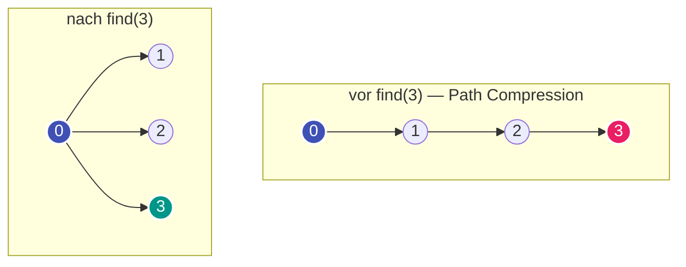

---
tags:
  - Algorithm
  - Graph
  - Data Structure
  - Union-Find
  - DSU
  - Rust
---

# Disjoint Set Union (DSU) / Union-Find

**Kategorie:** Graph Theory & Dynamic Connectivity

Sehr schnelles Erkennen und Zusammenführen von Zusammenhangskomponenten oder Clustern – z. B. bei Netzwerken, [Insel-Problemen](flood-fill.md) oder Kruskals Algorithmus für minimale Spannbäume.

---

## Intuition & Kernidee

Statt bei jeder Operation aufwendig rekursiv (per [BFS/DFS](traversierung-bfs-dfs.md)) das ganze Netz zu durchsuchen, merkt sich eine DSU-Struktur die **Wurzel jeder Komponente** in fast konstanter Zeit:

- **`find(x)`** liefert die Wurzel (den Repräsentanten) der Komponente von `x`.
- **`union(a, b)`** verschmilzt die Komponenten von `a` und `b`, indem eine Wurzel unter die andere gehängt wird.

Zwei Optimierungen machen die Struktur praktisch $\mathcal{O}(1)$:

1. **Path Compression:** Beim `find` hängt jeder besuchte Knoten direkt an die Wurzel um – der Baum flacht mit jedem Zugriff ab.
2. **Union by Rank/Size:** Die kleinere der beiden Komponenten wird unter die größere gehängt, damit der Baum nicht entartet.



---

## Referenzimplementierung (Python)

```python
class DSU:
    def __init__(self, n: int) -> None:
        self.parent = list(range(n))
        self.size = [1] * n          # Union by Size
        self.components = n

    def find(self, x: int) -> int:
        root = x
        while self.parent[root] != root:
            root = self.parent[root]
        # Path Compression: alle besuchten Knoten direkt an die Wurzel
        while self.parent[x] != root:
            self.parent[x], x = root, self.parent[x]
        return root

    def union(self, a: int, b: int) -> bool:
        ra, rb = self.find(a), self.find(b)
        if ra == rb:
            return False             # bereits verbunden
        if self.size[ra] < self.size[rb]:
            ra, rb = rb, ra
        self.parent[rb] = ra
        self.size[ra] += self.size[rb]
        self.components -= 1
        return True

    def connected(self, a: int, b: int) -> bool:
        return self.find(a) == self.find(b)
```

---

## Referenzimplementierung (Rust)

```rust
pub struct Dsu {
    parent: Vec<usize>,
    size: Vec<usize>,
    components: usize,
}

impl Dsu {
    pub fn new(n: usize) -> Self {
        Self {
            parent: (0..n).collect(),   // Vec<usize>, i-ter Eintrag = i
            size: vec![1; n],           // Union by Size
            components: n,
        }
    }

    /// Wurzel der Komponente von x (iterativ, mit Path Compression).
    pub fn find(&mut self, x: usize) -> usize {
        let mut root = x;
        while self.parent[root] != root {
            root = self.parent[root];
        }
        let mut x = x;
        while self.parent[x] != root {
            let next = self.parent[x];
            self.parent[x] = root;
            x = next;
        }
        root
    }

    /// Verschmilzt zwei Komponenten; `false`, wenn sie schon verbunden waren.
    pub fn union(&mut self, a: usize, b: usize) -> bool {
        let (ra, rb) = (self.find(a), self.find(b));
        if ra == rb {
            return false;
        }
        let (big, small) = if self.size[ra] < self.size[rb] {
            (rb, ra)
        } else {
            (ra, rb)
        };
        self.parent[small] = big;
        self.size[big] += self.size[small];
        self.components -= 1;
        true
    }

    pub fn connected(&mut self, a: usize, b: usize) -> bool {
        self.find(a) == self.find(b)
    }
}
```

### Rust-Notizen zur DSU

- **`&mut self` bei `find`:** Path Compression schreibt die Elterntabelle um – deshalb braucht `find` eine mutable Referenz. Das ist die wichtigste Rust-Lektion an dieser Struktur.
- **`(0..n).collect()`:** Ersetzt Pythons `list(range(n))` idiomatisch und ohne Heap-Reallokation (\_capacity ist bekannt).
- **Keine Rekursion:** Der iterative `find` mit zweitem Durchlauf ist borrow-checker-freundlich (kein rekursiver `&mut`-Durchgriff) und zusätzlich stack-sicher.
- **Kanten-Mengen:** Für Kruskal sortiert man Kanten in einem `Vec<(u64, usize, usize)>` (Gewicht, u, v) und ruft `union` in einer Schleife auf.

---

## Typische Einsatzgebiete

| Problemklasse                       | DSU-Rolle                                                            |
| :---------------------------------- | :------------------------------------------------------------------- |
| **Kruskal MST**                     | Kanten sortieren, `union` – Zyklus, wenn `find(u) == find(v)`        |
| **Inseln / Cluster auf Gittern**    | Nachbarzellen unionen statt [Flood Fill](flood-fill.md) pro Zelle    |
| **Dynamic Connectivity**            | Online-Anfragen „sind a und b verbunden?“ während Kanten hinzukommen |
| **Perkolations-/Equivalenzklassen** | Elemente, die dieselbe Änderungs-Regel teilen, zusammenfassen        |

---

## Komplexität

| Dimension                | Komplexität                                                                                                                                    |
| :----------------------- | :--------------------------------------------------------------------------------------------------------------------------------------------- |
| **Zeit (pro Operation)** | Fast $\mathcal{O}(1)$ – genauer $\mathcal{O}(\alpha(n))$ mit der **inversen Ackermann-Funktion** ($\alpha(n) \le 4$ für alle praktischen $n$). |
| **Speicher**             | $\mathcal{O}(n)$ für die Eltern- und Größen-Tabellen.                                                                                          |

---

## Verwandte Muster

- [Graph-Traversierung (BFS & DFS)](traversierung-bfs-dfs.md) – die Alternative für statische Komponenten.
- [Flood Fill & Gitter-Traversierung](flood-fill.md) – Insel-Probleme mit DSU statt Flutung.
- [Speicher & Garbage Collection](memory-management.md) – warum flache `Vec`-Tabellen cache-freundlich sind.
