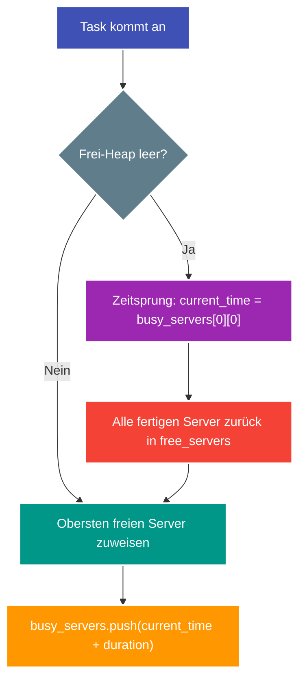

---
tags:
  - Algorithm
  - Simulation
  - Priority Queue
  - Scheduling
  - Event-Driven
---

# Event-Driven Simulation mit zwei Priority Queues (Zeitsprünge)

Das **Event-Driven-Simulation-Pattern** modelliert Scheduling- und Ressourcen-Zuweisungsprobleme (Aufgaben-, Task-, Serververwaltung) mit zwei getrennten Heaps und springt bei Engpässen direkt zum nächsten Ereignis — statt jede Sekunde einzeln durchzuzählen.

---

## Wann einsetzen?

- **Scheduling & Ressourcen-Zuweisung:** Server, Maschinen oder Worker werden durchgehend belegt und wieder freigegeben (z. B. Aufgaben an $k$ Maschinen verteilen, [LeetCode 3841](../solutions/leetcode-3841.md)).
- **Zeitsprünge statt Tick-Loop:** Ein sekundenweises `while current_time += 1` führt bei großen Zeithorizonten ($10^9$+) zu Timeouts. Die Simulation springt stattdessen zum Zeitpunkt des nächsten eintreffenden Ereignisses.

---

## Kernmechanik

### Zwei getrennte Heaps

| Heap                              | Sortierung nach                        | Inhalt                |
| :-------------------------------- | :------------------------------------- | :-------------------- |
| `free_servers` (Frei-Heap)        | Priorität: z. B. Gewicht, dann Index   | Verfügbare Ressourcen |
| `busy_servers` (Beschäftigt-Heap) | Fertigstellungszeit `(finish_time, …)` | Aktive Ressourcen     |

- **Zuweisung:** Sobald ein Task ankommt, wird der oberste Eintrag aus `free_servers` gepoppt, mit der Tasklast versehen und mit `current_time + duration` in `busy_servers` gelegt.
- **Freigabe:** Alle Einträge in `busy_servers`, deren Fertigstellungszeit $\le$ aktueller Zeitpunkt ist, wandern zurück in `free_servers`.

### Der Zeitsprung

```python
# Kein freiwilliges Sekunden-Ticken:
# Bei Engpass direkt zum nächsten Ereignis springen
if not free_servers:
    current_time = busy_servers[0][0]   # Fertigstellungszeit des frühesten Servers

# Alle bis dahin fertigen Ressourcen auf einmal freigeben
while busy_servers and busy_servers[0][0] <= current_time:
    _, server = heapq.heappop(busy_servers)
    heapq.heappush(free_servers, server)
```

Der Sprung `current_time = busy_servers[0][0]` reduziert die Iterationsanzahl von $\mathcal{O}(T)$ (Zeithorizont) auf $\mathcal{O}(n \log n)$ (Anzahl Ereignisse).



---

## Python-Skelett

```python
import heapq

free_servers: list = []   # (weight, index)  → Priorität
busy_servers: list = []   # (finish_time, weight, index)

def assign(tasks: list[int]) -> list[int]:
    assignment = []
    for start, duration, load in tasks:
        # Fertige Ressourcen freigeben
        while busy_servers and busy_servers[0][0] <= start:
            _, weight, idx = heapq.heappop(busy_servers)
            heapq.heappush(free_servers, (weight, idx))

        # Engpass? Zeitsprung zum nächsten Ereignis
        if not free_servers:
            release = busy_servers[0][0]
            while busy_servers and busy_servers[0][0] <= release:
                _, weight, idx = heapq.heappop(busy_servers)
                heapq.heappush(free_servers, (weight, idx))

        weight, idx = heapq.heappop(free_servers)
        heapq.heappush(busy_servers, (start + duration, weight, idx))
        assignment.append(idx)
    return assignment
```

---

## Pitfalls

- **Freigabe- und Zuweisungsreihenfolge:** Erst fertige Ressourcen zurückholen, dann zuweisen — sonst werden freie Kapazitäten übersehen.
- **Tupel-Sortierung nutzen:** `(weight, index)` gibt automatisch deterministische Tie-Breaks; der sekundäre Index verhindert Willkür bei gleichem Gewicht.
- **Konsistente Zeitbasis:** Die Fertigstellungszeit im `busy_servers`-Heap muss in derselben Einheit wie die Task-Startzeiten liegen, sonst springt der Zeitsprung falsch.

---

## Komplexität

| Operation          | Komplexität                         | Begründung                                                                   |
| :----------------- | :---------------------------------- | :--------------------------------------------------------------------------- |
| **Task zuweisen**  | $\mathcal{O}(\log m)$               | Pop aus Frei-Heap, Push in Beschäftigt-Heap ($m$ = Anzahl Ressourcen).       |
| **Freigabe-Batch** | $\mathcal{O}(r \log m)$ amortisiert | Jede Ressource wird insgesamt maximal oft freigegeben, wie sie belegt wurde. |
| **Gesamtlaufzeit** | $\mathcal{O}(n \log m)$             | statt $\mathcal{O}(T \cdot m)$ beim Sekunden-Tick.                           |
| **Speicherplatz**  | $\mathcal{O}(m + n)$                | Beide Heaps + Zuweisungsarray.                                               |
