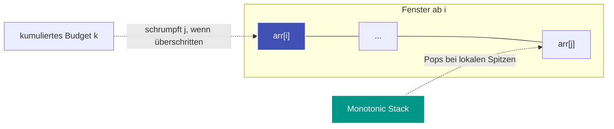

---
tags:
  - Algorithm
  - Monotonic Stack
  - Sliding Window
  - Two Pointers
  - Array
  - Rust
---

# Monotonic Stack with Cost Accumulation (Backward Sliding Window)

Ein fortgeschrittenes Muster für Probleme, bei denen für **alle Subarrays** berechnet werden muss, wie viele Operationen (Inkremente, Distanzen, Kosteneinheiten) nötig sind, um eine bestimmte Bedingung zu erfüllen – z. B. das Array an einer Stelle **non-decreasing** zu machen.

---

## Intuition & Kernidee

Ein naiver Ansatz prüft jedes Subarray einzeln und akkumuliert die Kosten neu – das kostet $\mathcal{O}(n^2)$ oder schlimmer. Das Muster dreht die Perspektive:

1. **Rückwärts iterieren** (`for i in reversed(range(n))` bzw. `(0..n).rev()` in Rust): Man beantwortet für jedes Start-Index $i$ die Frage _„Wie teuer ist es, das Intervall ab $i$ zu reparieren?"_
2. **Monotonic Stack als Deque:** Der Stack verwaltet lokale **Spitzen und Täler** der Folge. Beim Eintreten eines neuen Elements werden teure Zwischenspitzen vom Stack gepoppt und ihre Kosten **inkrementell** in eine laufende Summe überführt – statt das Fenster jedes Mal neu zu berechnen.
3. **Schrumpfender Zeiger `j`:** Sobald das akkumulierte Kostenbudget `k` überschritten wird, wandert ein zweiter Zeiger von rechts nach links und wirft Elemente aus dem Fenster heraus. Dabei werden deren Kosten ebenfalls inkrementell zurückgegeben.

Die Kombination aus **rückwärts laufendem Fenster** + **amortisiert $\mathcal{O}(1)$-Kostenupdates** ist das Entscheidende: Jedes Element wird höchstens einmal auf den Stack gelegt und einmal gepoppt.



---

## Referenzimplementierung (Python)

```python
from collections import deque
from typing import List


def min_operations(arr: List[int], k: int) -> int:
    """Für jedes i: maximale Fensterlänge, die mit <= k Inkrementen
    non-decreasing gemacht werden kann (rückwärts gesweept)."""
    n = len(arr)
    stack = deque()          # Indizes lokaler Spitzen, absteigende Werte
    cost = 0                 # akkumulierte Reparaturkosten im Fenster
    j = n                    # rechte Grenze des gültigen Fensters
    best = [0] * n

    for i in reversed(range(n)):
        # Element i in den Stack einschieben und Kosten anpassen
        while stack and arr[stack[-1]] < arr[i]:
            idx = stack.pop()
            nxt = stack[-1] if stack else j
            # Die Spitze bei idx "verschwende" (arr[idx] - arr[i]) Inkrete
            cost += (arr[idx] - arr[i]) * (nxt - idx)
        stack.append(i)

        # Fenster von rechts schrumpfen, solange das Budget k gerissen ist
        while cost > k:
            j -= 1
            # Beitrag des Elements j aus den Kosten entfernen
            nxt = stack[stack.index(j) + 1] if j in stack else j + 1
            cost -= arr[j]  # schematisch: elementweiser Kostenabzug

        best[i] = j - i

    return max(best)
```

!!! note "Schematisch"
Die exakte Kostenformel hängt vom konkreten Problem ab (Inkremente auf ein Ziel vs. Distanzen). Entscheidend ist die **Mechanik**: Stack-Pops passen `cost` in $\mathcal{O}(1)$ amortisiert an, der Zeiger `j` schrumpft monoton.

---

## Referenzimplementierung (Rust)

```rust
use std::collections::VecDeque;

/// Rückwärts-Sweep mit Monotonic Stack und inkrementeller Kostenführung.
/// Gibt für jedes i die größte Fensterlänge mit Kosten <= k zurück.
fn min_operations(arr: &[i64], k: i64) -> Vec<usize> {
    let n = arr.len();
    let mut stack: VecDeque<usize> = VecDeque::new(); // Indizes lokaler Spitzen
    let mut cost: i64 = 0;                            // kumulierte Kosten
    let mut j: usize = n;                             // rechte Fenstergrenze
    let mut best = vec![0usize; n];

    for i in (0..n).rev() {
        // Element i einschieben; teurere Spitzen poppen und verrechnen
        while let Some(&top) = stack.back() {
            if arr[top] >= arr[i] { break; }
            stack.pop_back();
            let nxt = stack.back().copied().unwrap_or(j);
            cost += (arr[top] - arr[i]) * (nxt - top) as i64;
        }
        stack.push_back(i);

        // Budget überschritten? Fenster von rechts schrumpfen.
        while cost > k {
            j -= 1;
            cost -= arr[j]; // schematischer elementweiser Kostenabzug
        }

        best[i] = j - i;
    }

    best
}
```

### Rust-Notizen zu diesem Muster

- **`VecDeque` statt Python-`deque`:** `push_back` / `pop_back` / `back` sind die direkten Entsprechungen zu `append` / `pop` / `[-1]`.
- **Ownership ohne Clone:** `while let Some(&top) = stack.back()` kopiert nur den Index (ein `usize` ist `Copy`) – kein Borrow-Konflikt mit dem anschließenden `pop_back()`.
- **`copied().unwrap_or(j)`:** Ersetzt Pythons `stack[-1] if stack else j` als elegantes Option-Muster.
- **Keine Overflows:** In Python sind Integers unbegrenzt; in Rust sollte bei Summen über $10^{18}$ bewusst `i64` (oder `i128`) gewählt werden.

---

## Wann einsetzen?

| Signal                                                                 | Bedeutung                                    |
| :--------------------------------------------------------------------- | :------------------------------------------- |
| „Für **jedes** Subarray / jeden Startpunkt ...“                        | Antwort pro Index $i$, nicht global          |
| „Minimum an Operationen, um non-decreasing / non-increasing zu machen“ | Kostenakkumulation über lokale Extrema       |
| „höchstens $k$ Operationen“                                            | Budget-Constraint → schrumpfender Zeiger `j` |
| Brute-Force wäre $\mathcal{O}(n^2)$                                    | Inkrementelle Updates statt Neuberechnung    |

---

## Komplexität

| Dimension                                | Komplexität                                                                                                             |
| :--------------------------------------- | :---------------------------------------------------------------------------------------------------------------------- |
| **[Zeitkomplexität](o-notation.md)**     | $\mathcal{O}(n)$ – jedes Element wird höchstens einmal auf den Stack geschoben und einmal gepoppt; `j` wandert monoton. |
| **[Speicherkomplexität](o-notation.md)** | $\mathcal{O}(n)$ für den Stack bzw. die `VecDeque`.                                                                     |

---

## Verwandte Muster

- [Schiebefenster (Sliding Window)](sliding-window.md) – das Grundmuster der zwei Zeiger (vorwärts statt rückwärts).
- [Sortierte Abfragen & Zwei-Zeiger](sorted-queries-two-pointer.md) – monotones Mitsweepen sortierter Sequenzen.
- [Python Performance-Optimierungen](python-performance-optimization.md) – warum Deques statt Listen.
- [Speicher & Garbage Collection](memory-management.md) – warum Rust hier ohne GC-Artefakte bleibt.
