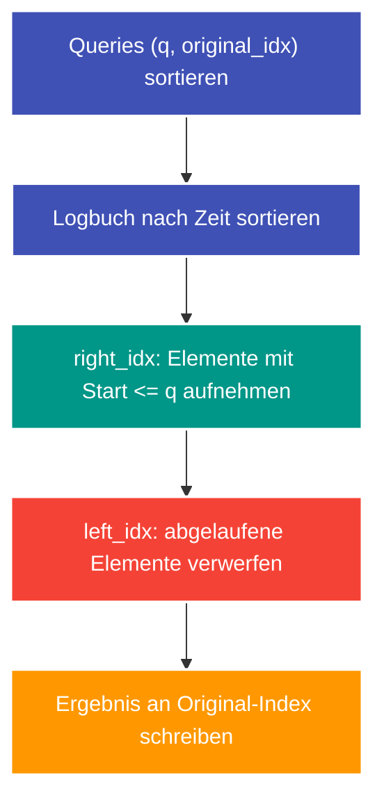

---
tags:
  - Algorithm
  - Two Pointers
  - Sliding Window
  - Sorted Queries
  - Offline Processing
---

# Sortierte Abfragen mit Zwei-Zeiger-Fenster (Event-Tracking)

Das **Sorted-Queries-Two-Pointer-Pattern** beantwortet Intervall- oder Zeitfenster-Abfragen offline, indem beide Datenströme sortiert und mit zwei Zeigern einmalig linear durchlaufen werden.

---

## Wann einsetzen?

- **Intervall- oder Zeitfenster-Abfragen:** Zu jeder Abfrage $q_j$ muss bekannt sein, welche Elemente (z. B. Server-Aktivitäten, Aufgaben, Logbuch-Einträge) innerhalb eines Bereichs $[q - x, q]$ liegen.
- **Offline-Verarbeitung erlaubt:** Die Abfragen müssen nicht in Echtzeit, sondern dürfen in beliebiger Reihenfolge beantwortet werden (Ergebnisse werden per Original-Index zurückgeschrieben).
- Naiv kostet jede Abfrage eine eigene Suche ($\mathcal{O}(n \cdot k)$); sortiertes Mitwandern reduziert das auf $\mathcal{O}(n \log n + k \log k)$.

---

## Kernmechanik

### 1. Queries mit Original-Index tupeln und sortieren

```python
indexed_queries = sorted((q, i) for i, q in enumerate(queries))
```

Das Sortieren sorgt dafür, dass sich die **Zeitachse nur vorwärts** bewegt — keine Abfrage „wandert zurück", keine bereits entfernten Elemente müssen wiedereinkommen.

### 2. Logbuch ebenfalls nach Zeit sortieren

Das Element-Log (Intervalle, Ereignisse, Aktivitäten) wird einmalig nach seinem Zeit-/Startattribut sortiert.

### 3. Zwei Zeiger wandern linear mit den Abfragen

| Zeiger      | Aufgabe                                                                                      |
| :---------- | :------------------------------------------------------------------------------------------- |
| `right_idx` | Nimmt alle Elemente auf, deren Start $\le$ aktueller Abfragezeitpunkt liegt.                 |
| `left_idx`  | Entfernt alle Elemente an der Struktur-Spitze, die das Fenster $[q - x, q]$ verlassen haben. |

```python
left_idx = right_idx = 0
results = [0] * len(queries)

for q, qi in indexed_queries:
    # Neu begonnene Aktivitäten aufnehmen
    while right_idx < len(log) and log[right_idx].start <= q:
        add(log[right_idx]); right_idx += 1

    # Abgelaufene Aktivitäten verwerfen (lazy am Ausgang)
    while struct and struct.peek().end < q - x + 1:
        remove_peek(); left_idx += 1

    results[qi] = best(struct)   # Original-Index!
```

Das verhindert **redundante Suchen**: Jedes Element wird von `right_idx` maximal einmal aufgenommen und von `left_idx` maximal einmal entfernt — die Zeiger bewegen sich insgesamt nur $\mathcal{O}(n + k)$ Mal (z. B. [LeetCode 1851](../solutions/leetcode-1851.md), [LeetCode 3841](../solutions/leetcode-3841.md)).



---

## Pitfalls

- **Original-Index nicht verlieren:** Nach dem Sortieren schreibt man Ergebnisse an `original_idx`, sonst ist die Reihenfolge des Output-Arrays zerstört.
- **Randbereiche präzise definieren:** Ob das Fenster inklusive (`[q - x + 1, q]`) oder exklusiv ist, entscheidet die Grenzbedingung beim Verwerfen.
- **Gleiche Abfragezeitpunkte:** Mehrere Queries mit identischem $q$ werden nacheinander bedient, ohne dass sich Zeiger zurückbewegen — der Sweep-Status bleibt gültig.

---

## Komplexität

| Operation                | Komplexität                        | Begründung                             |
| :----------------------- | :--------------------------------- | :------------------------------------- |
| **Sortieren**            | $\mathcal{O}(n \log n + k \log k)$ | $n$ Logbuch-Einträge, $k$ Abfragen.    |
| **Sweep (beide Zeiger)** | $\mathcal{O}(n + k)$ amortisiert   | Jeder Zeiger wandert monoton vorwärts. |
| **Gesamtlaufzeit**       | $\mathcal{O}(n \log n + k \log k)$ | vs. naivem $\mathcal{O}(n \cdot k)$.   |
| **Speicherplatz**        | $\mathcal{O}(n + k)$               | Sortierte Kopien + Ergebnis-Array.     |
