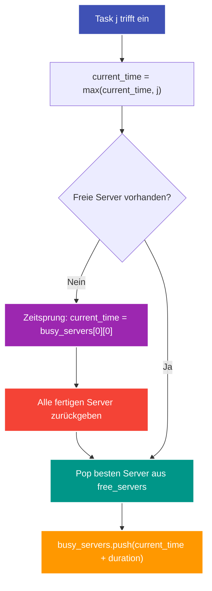

---
tags:
  - LeetCode
  - Array
  - Heap
  - Priority Queue
  - Simulation
  - Sorting
  - Medium
---

# LeetCode 1882: Process Tasks Using Servers

- **Plattform:** [LeetCode #1882](https://leetcode.com/problems/process-tasks-using-using-servers/)
- **Schwierigkeit:** Medium
- **Kategorien:** Array, Heap ([Priority Queue](../glossary/min-heap-sweep-line.md)), Simulation, Sorting
- **Verwandte Konzepte:** [Event-Driven Simulation mit zwei Priority Queues](../glossary/event-driven-simulation.md)

---

## Aufgabenstellung

Gegeben sind zwei Arrays gleicher Länge $n$: `servers` (Gewicht jedes Servers) und `tasks` (Dauer jedes Tasks). Der $j$-te Task trifft in Sekunde $j$ ein und muss **sofort** einem freien Server zugewiesen werden:

- Ein Server $i$ kann einen Task nur bearbeiten, wenn er in Sekunde $j$ frei ist ($i \le j$ reicht nicht — es zählt die Verfügbarkeit, nicht der Index).
- Freie Server wählen: der Server mit dem **kleinsten Gewicht**; bei Gleichstand der mit dem **kleinsten Index**.
- Ein besetzter Server ist für $\text{tasks}[j]$ Sekunden blockiert und wird danach automatisch frei.

Gib für jeden Task den **Index seines Servers** zurück.

### Beispiele

```text
Input:  servers = [3, 1, 4], tasks = [1, 2, 1]
Output: [1, 0, 2]
Erklärung:
- Sekunde 0: Server 1 (Gewicht 1) ist am leichtesten → Task 0.
- Sekunde 1: Server 0 (Gewicht 3) ist am leichtesten freien → Task 1.
- Sekunde 2: Server 2 (Gewicht 4) ist am leichtesten freien → Task 2.
```

---

## Intuition & Lösungsansatz

### 1. Naive Idee (Zeitschleife)

Jede Sekunde durchlaufen, alle Server auf Freigabe prüfen.

- Bei Zeit-Horizonten bis $10^9$ führt das zu **Timeouts** — die Schleife zählt Milliarden leerer Sekunden.

### 2. Optimierte Kernidee (zwei Heaps + Zeitsprung)

Modelliere die Simulation als Ereignis-System mit zwei getrennten [Priority Queues](../glossary/event-driven-simulation.md):

| Heap           | Tupel                          | Semantik                                   |
| :------------- | :----------------------------- | :----------------------------------------- |
| `free_servers` | `(weight, index)`              | Frei, sortiert nach Priorität.             |
| `busy_servers` | `(finish_time, weight, index)` | Beschäftigt, sortiert nach Fertigstellung. |

Für jeden Task `j` gilt:

1. **Zeitbasis:** `current_time = max(current_time, j)` — der Task kann nicht vor seinem Eintreffen starten.
2. **Schritt A — Freigaben:** Alle Server in `busy_servers` mit `finish_time <= current_time` wandern zurück in `free_servers`.
3. **Schritt B — Zeitsprung:** Ist `free_servers` leer, springe direkt zu `current_time = busy_servers[0][0]` und wiederhole Schritt A. **Das ist der Kern:** statt jede Sekunde einzeln zu ticken, springt die Simulation zum nächsten Ereignis.
4. **Schritt C — Zuweisung:** Pop vom `free_servers`, Index notieren.
5. **Schritt D — Belegen:** Push `(current_time + duration, weight, index)` in `busy_servers`.



---

## Implementierung (Python 3)

```python
import heapq
from typing import List


class Solution:
    def assignTasks(self, servers: List[int], tasks: List[int]) -> List[int]:
        """Weist jedem Task den prioritätsbesten freien Server zu.

        Args:
            servers: Gewicht jedes Servers
            tasks: Dauer jedes Tasks (Task j trifft in Sekunde j ein)

        Returns:
            Server-Index je Task, in Task-Reihenfolge
        """
        # 1. Frei-Heap: alle Server als (Gewicht, Index) — Tupel-Sortierung
        #    liefert automatisch "kleinstes Gewicht, dann kleinster Index".
        free_servers = [(weight, i) for i, weight in enumerate(servers)]
        heapq.heapify(free_servers)

        # 2. Beschäftigt-Heap: (Fertigstellungszeit, Gewicht, Index)
        busy_servers: list = []

        ans: List[int] = []
        current_time = 0

        for j, task_duration in enumerate(tasks):
            # Die Zeit springt mindestens zum Eintreffen des aktuellen Tasks.
            current_time = max(current_time, j)

            # --- SCHRITT A: Alle fertig gewordenen Server freigeben ---
            while busy_servers and busy_servers[0][0] <= current_time:
                _, weight, idx = heapq.heappop(busy_servers)
                heapq.heappush(free_servers, (weight, idx))

            # --- SCHRITT B: Engpass? Zeitsprung zum nächsten Ereignis ---
            if not free_servers:
                current_time = busy_servers[0][0]
                while busy_servers and busy_servers[0][0] <= current_time:
                    _, weight, idx = heapq.heappop(busy_servers)
                    heapq.heappush(free_servers, (weight, idx))

            # --- SCHRITT C: Besten freien Server wählen ---
            weight, idx = heapq.heappop(free_servers)
            ans.append(idx)

            # --- SCHRITT D: Server mit neuer Fertigstellungszeit belegen ---
            heapq.heappush(busy_servers, (current_time + task_duration, weight, idx))

        return ans
```

---

## Komplexitätsanalyse

| Dimension                                            | Komplexität             | Begründung                                                                                                                                                                                 |
| :--------------------------------------------------- | :---------------------- | :----------------------------------------------------------------------------------------------------------------------------------------------------------------------------------------- |
| **[Zeitkomplexität](../glossary/o-notation.md)**     | $\mathcal{O}(n \log n)$ | Jeder Task erzeugt konstant viele Heap-Operationen; jeder Server wechselt höchstens $n$ Mal den Heap. Der Zeitsprung eliminiert den Faktor $\mathcal{O}(T)$ des Zeithorizonts vollständig. |
| **[Speicherkomplexität](../glossary/o-notation.md)** | $\mathcal{O}(n)$        | Beide Heaps zusammen halten immer genau $n$ Server.                                                                                                                                        |

---

## Edge Cases & Fallstricke

- [x] **Alle Server besetzt:** Der Zeitsprung überspringt die komplette Leerphase auf einmal — kein Sekunden-Ticking.
- [x] **Gleichgewichtige Server:** Das Tupel `(weight, index)` bricht Gleichstände deterministisch nach Index.
- [x] **Task trifft während andere laufen:** `max(current_time, j)` stellt sicher, dass die Zeit nie rückwärts läuft.
- [x] **Freigabe-Reihenfolge:** Erst alle fertig gewordenen Server zurückholen, **dann** zuweisen — sonst werden kurzzeitig freie Kapazitäten übersehen.
