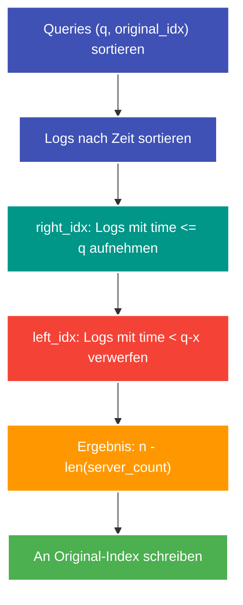

---
tags:
  - LeetCode
  - Array
  - Hash Table
  - Two Pointers
  - Sliding Window
  - Sorting
  - Medium
---

# LeetCode 2747: Count Zero Request Servers

- **Plattform:** [LeetCode #2747](https://leetcode.com/problems/count-zero-request-servers/)
- **Schwierigkeit:** Medium
- **Kategorien:** Array, Hash Table, Two Pointers, [Sliding Window](../glossary/sliding-window.md), Sorting
- **Verwandte Konzepte:** [Sortierte Abfragen mit Zwei-Zeiger-Fenster](../glossary/sorted-queries-two-pointer.md) | [Min-Heap & Sweep-Line](../glossary/min-heap-sweep-line.md) | [LeetCode 1851](leetcode-1851.md)

---

## Aufgabenstellung

Gegeben sind $n$ Server (nummeriert $1 \dots n$), ein Logbuch `logs`, wobei $\text{logs}[i] = [\text{server}_i, \text{time}_i]$ eine Anfrage an Server $\text{server}_i$ zur Zeit $\text{time}_i$ beschreibt, eine Fenstergröße $x$ und ein Array `queries`.

Für jede Abfrage $q_j$ zähle die Server, die im Zeitfenster $[q_j - x, q_j]$ **keine** Anfrage erhalten haben.

Gib die Antworten in der **ursprünglichen Reihenfolge** der Abfragen zurück.

### Beispiele

```text
Input:  n = 3, logs = [[1,3],[2,6],[1,5]], x = 5, queries = [10, 11]
Output: [1, 2]
Erklärung:
- Fenster [5, 10]: Server 1 (t=3,5) und 2 (t=6) haben Anfragen, Server 3 nicht → 1.
- Fenster [6, 11]: Nur Server 2 hat eine Anfrage → 2 Server ohne Anfragen.
```

---

## Intuition & Lösungsansatz

### 1. Naive Idee

Für jede Abfrage alle Logs einzeln durchsuchen.

- Laufzeit $\mathcal{O}(|logs| \cdot |queries|)$ — bei $10^5$ je Eingabe TLE.

### 2. Optimierte Kernidee (Sortierte Abfragen + Zwei Zeiger)

Das exakte [Two-Pointer-Sweep-Pattern](../glossary/sorted-queries-two-pointer.md) — die Zeitachse bewegt sich **nur vorwärts**:

1. **Queries als `(q, original_index)`-Tupel sortieren** — der Original-Index ist überlebenswichtig, sonst stimmt die Output-Reihenfolge nicht.
2. **Logs ebenfalls nach Zeit sortieren.**
3. **Häufigkeits-Tabelle** `server_count` führt pro Server, wie oft er im aktuellen Fenster eine Anfrage hatte.
4. **Zwei Zeiger wandern mit jeder Abfrage mit:**
   - `right_idx`: nimmt alle Logs mit `time <= q` ins Fenster auf.
   - `left_idx`: wirft alle Logs mit `time < q - x` aus dem Fenster (Dekrement, bei 0 löschen).
5. **Ergebnis:** $\text{inactive} = n - \text{len}(server\_count)$ — die Anzahl der Server mit mindestens einer Anfrage ist einfach die Dictionary-Größe.



---

## Implementierung (Python 3)

```python
from collections import defaultdict
from typing import List


class Solution:
    def countServers(
        self, n: int, logs: List[List[int]], x: int, queries: List[int]
    ) -> List[int]:
        """Zählt für jede Abfrage die Server ohne Anfragen im Zeitfenster.

        Args:
            n: Anzahl der Server (nummeriert 1..n)
            logs: [server_id, time] je Log-Eintrag
            x: Fensterbreite, betrachtet wird [q - x, q]
            queries: Abfrage-Zeitpunkte

        Returns:
            Anzahl anfragefreier Server je Abfrage, in Original-Reihenfolge
        """
        # 1. Queries sortieren, aber den Original-Index mitnehmen
        indexed_queries = sorted((q, i) for i, q in enumerate(queries))

        # 2. Logs ebenfalls nach Zeit sortieren
        logs.sort(key=lambda entry: entry[1])

        result = [0] * len(queries)

        # 3. Häufigkeits-Tabelle: wie oft hatte ein Server im Fenster eine Anfrage
        server_count = defaultdict(int)

        left_idx = 0
        right_idx = 0
        num_logs = len(logs)

        # 4. Gehe alle sortierten Abfragen durch
        for q, original_index in indexed_queries:
            window_start = q - x
            window_end = q

            # --- SCHRITT A: Neue Logs rechts ins Fenster holen ---
            while right_idx < num_logs and logs[right_idx][1] <= window_end:
                server_count[logs[right_idx][0]] += 1
                right_idx += 1

            # --- SCHRITT B: Alte Logs links aus dem Fenster werfen ---
            while left_idx < num_logs and logs[left_idx][1] < window_start:
                server_id = logs[left_idx][0]
                server_count[server_id] -= 1
                if server_count[server_id] == 0:
                    del server_count[server_id]  # Server ist wieder anfragefrei
                left_idx += 1

            # --- SCHRITT C: Ergebnis eintragen ---
            # Gesamte Server minus die Server mit mindestens 1 Anfrage
            result[original_index] = n - len(server_count)

        return result
```

---

## Komplexitätsanalyse

| Dimension                                            | Komplexität                        | Begründung                                                                                                             |
| :--------------------------------------------------- | :--------------------------------- | :--------------------------------------------------------------------------------------------------------------------- |
| **[Zeitkomplexität](../glossary/o-notation.md)**     | $\mathcal{O}(m \log m + k \log k)$ | Sortieren von $m$ Logs und $k$ Queries. Jeder Zeiger wandert monoton vorwärts, also $\mathcal{O}(m + k)$ Sweep-Kosten. |
| **[Speicherkomplexität](../glossary/o-notation.md)** | $\mathcal{O}(n + k)$               | Häufigkeits-Tabelle (max. $n$ Server) + sortierte Queries/Ergebnisarray.                                               |

---

## Edge Cases & Fallstricke

- [x] **Original-Index nicht verlieren:** Nach dem Sortieren wird an `original_index` geschrieben, sonst ist die Output-Reihenfolge zerstört.
- [x] **Dictionary-Pflege beim Dekrement:** Erst auf 0 dekrementieren, dann `del` — sonst zählt der Server weiter als "aktiv" (mit Wert 0).
- [x] **Grenzen des Fensters:** `[q - x, q]` ist beidseitig geschlossen; ein Log mit `time == q - x` bleibt im Fenster, `time < q - x` fällt raus.
- [x] **Gleiche Query-Zeitpunkte:** Mehrere Queries mit identischem $q$ werden nacheinander bedient, ohne dass Zeiger zurückwandern.
