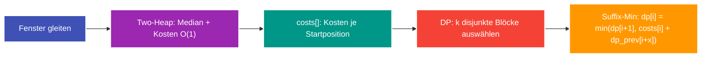

---
tags:
  - LeetCode
  - Array
  - Dynamic Programming
  - Heap
  - Sliding Window
  - Median
  - Hard
---

# LeetCode 3505: Minimum Operations to Make Elements Within K Subarrays Equal

- **Plattform:** [LeetCode #3505](https://leetcode.com/problems/minimum-operations-to-make-elements-within-k-subarrays-equal/)
- **Schwierigkeit:** Hard
- **Kategorien:** Array, Dynamic Programming, Heap ([Priority Queue](../glossary/min-heap-sweep-line.md)), [Sliding Window](../glossary/sliding-window.md), Median
- **Verwandte Konzepte:** [Two-Heap mit Lazy Deletion & Median-Kosten](../glossary/two-heap-lazy-deletion.md)

---

## Aufgabenstellung

Gegeben sind ein Array `nums` der Länge $n$, eine Fenstergröße $x$ und eine Anzahl $k$. Wähle $k$ **disjunkte** Subarrays der Länge $x$ so, dass die Summe der Operationen minimal ist, um jedes dieser Subarrays in lauter gleiche Elemente zu überführen. In einer Operation darf ein Element um $\pm 1$ geändert werden.

Gib die minimale Gesamtzahl an Operationen zurück.

### Beispiele

```text
Input:  nums = [5,-2,1,3,7,3,6,4,-1], x = 3, k = 2
Output: 4
Erklärung: Die Subarrays [1,3,7] → Ziel 3 (Kosten 4) und [3,6,4] → Ziel 4 (Kosten 2)
könnten gewählt werden; die optimale Kombination ergibt insgesamt 4 Operationen.
```

---

## Intuition & Lösungsansatz

### Warum der Median, nicht der Durchschnitt?

Große Ausreißer verzerren den Durchschnitt und blähen die $L_1$-Kosten auf. Der **Median minimiert** die Summe der absoluten Abstände $\sum |a_i - m|$ — genau das Kriterium der Aufgabe ([Glossar: Two-Heap & Median-Kosten](../glossary/two-heap-lazy-deletion.md)).

### 1. Optimierte Kernidee — Phase 1: Fensterkosten via Two-Heap

Alle Fensterkosten der Länge $x$ in einem einzigen Sweep berechnen:

- Zwei balancierte Heaps (`small` als Max-Heap, `large` als Min-Heap) halten das gleitende Fenster.
- **Lazy Deletion:** Herausrutschende Elemente werden nur in der Häufigkeits-Tabelle `invalid` markiert und erst an der Heap-Spitze aufgeräumt.
- Laufende Summen `sum_small`/`sum_large` liefern die Kosten in $\mathcal{O}(1)$:
  $$\text{cost} = \text{median} \cdot s_{small} - \Sigma_{small} + \Sigma_{large} - \text{median} \cdot s_{large}$$

### 2. Phase 2: Speicheroptimierte Bottom-Up-DP

Wähle $k$ disjunkte Blöcke der Länge $x$ mit minimaler Kostensumme:

$$dp[r][i] = \min(dp[r][i+1],\ \text{costs}[i] + dp[r-1][i+x])$$

- **Kombiniert Rolling-Array mit Suffix-Minimum:** `current_min` hält das laufende Minimum der "Take"-Kandidaten, sodass `curr_dp[index]` in $\mathcal{O}(1)$ entsteht.
- Nur zwei $n$-Arrays sind nötig — kein $k \times n$-DP-Grid.



---

## Implementierung (Python 3)

```python
import heapq
from collections import defaultdict
from typing import List


class Solution:
    def minOperations(
        self, nums: List[int], x: int, k: int
    ) -> int:
        """Minimiert die Gesamtoperationen für k disjunkte, gleichförmige Subarrays.

        Args:
            nums: Eingabearray
            x: Länge jedes gewählten Subarrays
            k: Anzahl der zu wählenden Subarrays

        Returns:
            Minimale Summe der L1-Operationen
        """
        n = len(nums)

        # --- PHASE 1: Two-Heap mit Lazy Deletion ---
        small: list = []   # Max-Heap für die untere Hälfte (negiert)
        large: list = []   # Min-Heap für die obere Hälfte
        sum_small = sum_large = 0
        size_small = size_large = 0
        invalid = defaultdict(int)

        def clean_heaps() -> None:
            while small and invalid[-small[0]] > 0:
                invalid[-heapq.heappop(small)] -= 1
            while large and invalid[large[0]] > 0:
                invalid[heapq.heappop(large)] -= 1

        def rebalance() -> None:
            nonlocal sum_small, sum_large, size_small, size_large
            total_size = size_small + size_large
            if total_size == 0:
                return
            target_small = (total_size + 1) // 2
            clean_heaps()
            while size_small > target_small:
                val = -heapq.heappop(small)
                heapq.heappush(large, val)
                sum_small -= val; size_small -= 1
                sum_large += val; size_large += 1
                clean_heaps()
            while size_small < target_small and large:
                val = heapq.heappop(large)
                heapq.heappush(small, -val)
                sum_large -= val; size_large -= 1
                sum_small += val; size_small += 1
                clean_heaps()

        def add_num(val: int) -> None:
            nonlocal sum_small, sum_large, size_small, size_large
            clean_heaps()
            if not small or val <= -small[0]:
                heapq.heappush(small, -val); sum_small += val; size_small += 1
            else:
                heapq.heappush(large, val); sum_large += val; size_large += 1
            rebalance()

        def remove_num(val: int) -> None:
            nonlocal sum_small, sum_large, size_small, size_large
            clean_heaps()
            if small and val <= -small[0]:
                sum_small -= val; size_small -= 1
            else:
                sum_large -= val; size_large -= 1
            invalid[val] += 1   # Lazy: erst markieren, später aufräumen
            rebalance()

        # Fensterkosten für jede Startposition berechnen
        costs = [0] * (n - x + 1)
        for i in range(x):
            add_num(nums[i])

        def window_cost() -> int:
            median = -small[0]
            return (size_small * median - sum_small) + (sum_large - size_large * median)

        costs[0] = window_cost()
        for i in range(1, n - x + 1):
            remove_num(nums[i - 1])
            add_num(nums[i + x - 1])
            costs[i] = window_cost()

        # --- PHASE 2: Speicheroptimierte Bottom-Up-DP (Rolling Array) ---
        prev_dp = [0] * (n + 1)   # Ergebnisse für r-1 Subarrays
        for r in range(1, k + 1):
            curr_dp = [float("inf")] * (n + 1)
            current_min = float("inf")
            # Rückwärts laufen: Suffix-Minimum akkumulieren
            for index in range(n - r * x, -1, -1):
                take = costs[index] + prev_dp[index + x]
                current_min = min(current_min, take)
                curr_dp[index] = current_min
            prev_dp = curr_dp

        return prev_dp[0]
```

---

## Komplexitätsanalyse

| Dimension                                            | Komplexität                         | Begründung                                                                                              |
| :--------------------------------------------------- | :---------------------------------- | :------------------------------------------------------------------------------------------------------ |
| **[Zeitkomplexität](../glossary/o-notation.md)**     | $\mathcal{O}(n \log x + n \cdot k)$ | Phase 1: amortisiert $\mathcal{O}(\log x)$ je Ein-/Austritt. Phase 2: $k$ DP-Pässe über $n$ Positionen. |
| **[Speicherkomplexität](../glossary/o-notation.md)** | $\mathcal{O}(n)$                    | Zwei Heaps ($x$), `costs` ($n$) und **zwei** DP-Zeilen statt $k \times n$-Grid.                         |

---

## Edge Cases & Fallstricke

- [x] **Ausreißer:** Der Median ist robust; ein Durchschnitts-Ansatz würde die Kosten aufblasen.
- [x] **Mehrfach vorkommende Werte im Fenster:** Die Häufigkeits-Tabelle `invalid` behandelt Duplikate korrekt.
- [x] **Nicht überlappende Blöcke:** Der DP-Sprung `index + x` erzwingt Disjunktheit automatisch.
- [x] **Speicher:** Das 2D-DP-Grid ($k \times n$) wurde durch ein Rolling-Array mit laufendem Suffix-Minimum ersetzt — entscheidend bei $n, k \le 10^4$.
