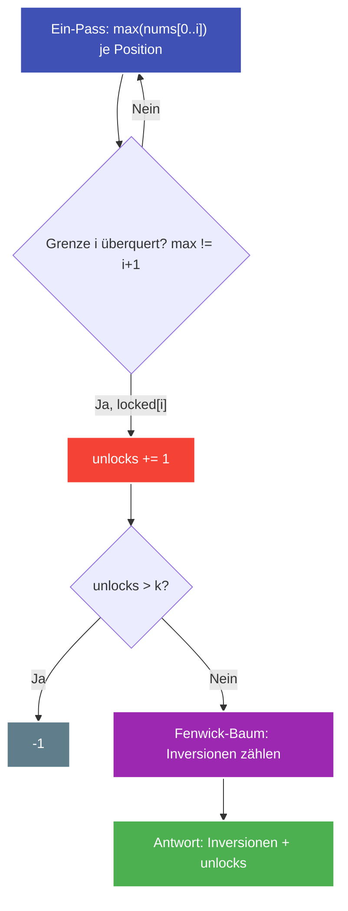

---
tags:
  - LeetCode
  - Array
  - Greedy
  - Sorting
  - Fenwick Tree
  - Medium
---

# LeetCode Weekly 526 Q3: Minimum Operations to Sort With Locked Indices

- **Plattform:** Weekly Contest 526, Q3
- **Schwierigkeit:** Medium
- **Kategorien:** Array, Greedy, Sorting, [Fenwick Tree](../glossary/advanced-tree-techniques.md)
- **Verwandte Konzepte:** [Fortgeschrittene Baum-Techniken (Fenwick/BIT)](../glossary/advanced-tree-techniques.md) | [Zyklische Permutationen](../glossary/cyclic-permutations.md)

---

## Aufgabenstellung

Gegeben sind eine Permutation `nums` von $[1, n]$, ein Binärarray `locked` und eine Zahl $k$:

- `locked[i] = 1` bedeutet: Index $i$ ist gesperrt.
- **Swap:** Wähle $i$ mit $i$ und $i+1$ **beide entsperrt** und tausche `nums[i]`, `nums[i+1]`.
- **Unlock:** Entsperre dauerhaft einen gesperrten Index.

Beliebig viele Swaps sind erlaubt, aber **höchstens $k$ Unlocks**. Gib die minimale Gesamtzahl an Operationen zum Sortieren zurück, oder $-1$, falls unmöglich.

### Beispiele

```text
Input:  nums = [2, 1, 3], locked = [1, 0, 0], k = 1
Output: 2
Erklärung: 1 Inversion (2 > 1) + 1 Unlock (Index 0 liegt an der Pflichtgrenze) = 2.
```

---

## Intuition & Lösungsansatz

### Optimierte Kernidee (Inversionen + Pflicht-Grenzen)

1. **Sortieren mit Nachbar-Swaps braucht mindestens so viele Swaps wie Inversionen** — und Bubble Sort erreicht genau diese Zahl.
2. **Welche Grenzen werden überquert?** Die Grenze zwischen $i$ und $i+1$ muss genau dann überquert werden, wenn $\max(\text{nums}[0..i]) \ne i + 1$ ist — sonst bliebe links ein Element "stecken", das nach rechts gehört.
3. **Entsperren exakt dort:** Wird eine Grenze überquert, müssen **beide** angrenzenden Indizes entsperrt sein. Alle anderen Grenzen werden nie benutzt, dort bleibt gesperrter Zustand gratis.
4. **Ergebnis:** $\text{Inversionen} + \text{gesperrte Pflicht-Indizes}$, oder $-1$, falls die Pflicht-Indizes $k$ übersteigen.

Für die Inversionszählung sorgt ein [Fenwick-Baum](../glossary/advanced-tree-techniques.md) in $\mathcal{O}(n \log n)$: Beim Linksdurchlauf fragt `inv += i - s` ab, wie viele kleinere Werte bereits links eingetragen sind.



---

## Implementierung (Python 3)

```python
from typing import List


class Solution:
    def minOperations(self, nums: List[int], locked: List[int], k: int) -> int:
        """Minimale Operationen, um nums mit begrenzten Unlocks zu sortieren.

        Args:
            nums: Permutation von [1, n]
            locked: 1 = gesperrter Index
            k: Budget an Unlocks

        Returns:
            Minimale Operationszahl, oder -1
        """
        n = len(nums)

        # --- Grenze i|i+1 muss überquert werden <=> max(nums[0..i]) != i + 1 ---
        unlocks = 0
        mx = 0
        need_prev = False
        for i in range(n):
            x = nums[i]
            if x > mx:
                mx = x
            need_cur = mx != i + 1
            if locked[i] and (need_prev or need_cur):
                unlocks += 1
            need_prev = need_cur

        if unlocks > k:
            return -1

        # --- Anzahl Swaps = Anzahl Inversionen (Fenwick-Baum) ---
        tree = [0] * (n + 1)
        inv = 0
        for i in range(n):
            x = nums[i]
            s = 0
            j = x
            while j:
                s += tree[j]       # Summe aller eingetragenen Werte <= x
                j &= j - 1
            inv += i - s           # größere Werte links von i
            j = x
            while j <= n:
                tree[j] += 1
                j += j & -j

        return inv + unlocks
```

---

## Komplexitätsanalyse

| Dimension                                            | Komplexität             | Begründung                                                                   |
| :--------------------------------------------------- | :---------------------- | :--------------------------------------------------------------------------- |
| **[Zeitkomplexität](../glossary/o-notation.md)**     | $\mathcal{O}(n \log n)$ | Ein linearer Grenz-Pass plus $\mathcal{O}(\log n)$ je Fenwick-Update/-Query. |
| **[Speicherkomplexität](../glossary/o-notation.md)** | $\mathcal{O}(n)$        | Fenwick-Baum.                                                                |

---

## Edge Cases & Fallstricke

- [x] **Beide Seiten der Grenze prüfen:** Index $i$ wird gebraucht, wenn die Grenze $i-1|i$ **oder** $i|i+1$ überquert wird — daher `need_prev or need_cur`.
- [x] **Perfekte Permutation:** $\max(nums[0..i]) = i+1$ an jeder Stelle → 0 Unlocks, nur Inversionen (falls überhaupt).
- [x] **Fenwick-1-Indexierung:** Der Baum läuft auf $1 \dots n$, Werte sind eine Permutation von $[1, n]$ — keine Off-by-one-Falle.
- [x] **Budgetüberschreitung:** Unlocks zählen vor der Inversionsberechnung — frühzeitiger $-1$-Ausstieg spart Arbeit.
