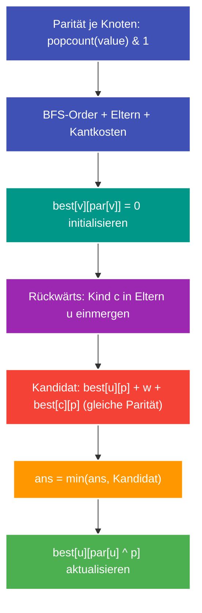

---
tags:
  - LeetCode
  - Tree
  - Graph
  - Dynamic Programming
  - Bit Manipulation
  - DFS
  - Hard
---

# LeetCode Weekly 526 Q4: Minimum Cost Path With Even XOR Parity

- **Plattform:** Weekly Contest 526, Q4
- **Schwierigkeit:** Hard
- **Kategorien:** Tree, Graph, Dynamic Programming, [Bit Manipulation](../glossary/bit-manipulation.md), DFS
- **Verwandte Konzepte:** [Adjazenzliste](../glossary/adjazenzliste.md) | [Bitweise Operationen](../glossary/bit-manipulation.md) | [Tiefensuche & Breitensuche](../glossary/traversierung-bfs-dfs.md)

---

## Aufgabenstellung

Gegeben ist ein Baum mit $n$ Knoten als `edges[i] = [u_i, v_i, c_i]` (Kante mit Kosten $c_i$) sowie `values[i]` (Wert von Knoten $i$).

Ein Pfad zwischen zwei verschiedenen Knoten heißt **Balanced-XOR**, wenn das bitweise XOR aller Knotenwerte (beide Endpunkte eingeschlossen) eine **gerade Anzahl gesetzter Bits** hat. Die Kosten eines Pfads sind die Summe seiner Kantkosten.

Gib die minimalen Kosten eines Balanced-XOR-Pfads zurück, oder $-1$, falls keiner existiert.

### Beispiele

```text
Input:  edges = [[0,1,2],[1,2,3]], values = [1,2,3]
Output: 5
Erklärung: Pfad 0-1-2: XOR = 1^2^3 = 0 (0 Bits, gerade) → Kosten 2 + 3 = 5.
```

---

## Intuition & Lösungsansatz

### Optimierte Kernidee (Paritätszerlegung + iteratives Tree-DP)

1. **Paritätszerlegung des Popcounts:** Da XOR bitweise-additiv modulo 2 ist, gilt
   $$\text{popcount}(a \oplus b) \bmod 2 = (\text{popcount}(a) + \text{popcount}(b)) \bmod 2.$$
   Jeder Knoten bekommt also **ein Paritätsbit**; gesucht ist ein Pfad mit **gerader Anzahl ungerader Knoten** — der Rest des XOR-Inhalts ist irrelevant.
2. **Tree-DP mit zwei Zuständen:** `best[v][p]` = minimale Kosten eines Abwärtspfads ab $v$ (inklusive $v$) mit Knoten-Parität $p$. Initial: `best[v][par[v]] = 0`.
3. **Zusammenführen beim Elternknoten $u$:** Beim Einmergen eines Kindes $c$ (Kantenkosten $w$) entsteht ein Pfad durch $u$ aus zwei Hälften:
   - Kandidat `best[u][p] + w + best[c][p]` — **gleiche Parität beider Hälften** ergibt insgesamt gerade Knotenanzahl.
   - Danach `best[u][par[u] ^ p]` mit dem Kinderanteil aktualisieren.
4. **Iterativ statt rekursiv:** BFS-Order vorberechnen (Eltern + Kantkosten), dann **rückwärts** in umgekehrter BFS-Reihenfolge abarbeiten — kein Rekursionslimit, kein Stack-Overflow bei $10^5$ Knoten.



---

## Implementierung (Python 3)

```python
from typing import List


class Solution:
    def minCost(self, edges: List[List[int]], values: List[int]) -> int:
        """Minimale Kosten eines Balanced-XOR-Pfads im Baum.

        Args:
            edges: [u, v, cost] je Kante
            values: Knotenwert je Knoten

        Returns:
            Minimale Pfadkosten, oder -1
        """
        n = len(values)
        if n < 2:
            return -1  # Pfad braucht zwei verschiedene Knoten

        adj = [[] for _ in range(n)]
        for u, v, c in edges:
            adj[u].append((v, c))
            adj[v].append((u, c))

        # Parität der XOR-Popcount = XOR der Popcount-Paritäten
        par = [x.bit_count() & 1 for x in values]

        # BFS-Reihenfolge mit Eltern und Kantkosten vorberechnen
        parent = [-1] * n
        pcost = [0] * n
        order = [0]
        seen = [False] * n
        seen[0] = True
        for u in order:
            for v, c in adj[u]:
                if not seen[v]:
                    seen[v] = True
                    parent[v] = u
                    pcost[v] = c
                    order.append(v)

        INF = float("inf")
        # best[v][p]: min. Kosten eines Abwärtspfads ab v (inkl. v), Parität p
        b0 = [0 if not par[v] else INF for v in range(n)]
        b1 = [0 if par[v] else INF for v in range(n)]

        ans = INF
        for i in range(n - 1, 0, -1):          # umgekehrte BFS-Reihenfolge
            v = order[i]
            u = parent[v]
            w = pcost[v]
            c0 = b0[v] + w
            c1 = b1[v] + w
            # Pfad durch u: gleiche Parität beider Hälften -> gerade
            t = b0[u] + c0
            if t < ans:
                ans = t
            t = b1[u] + c1
            if t < ans:
                ans = t
            # Kinderanteil in den Elternzuständen nachziehen
            if par[u]:
                if c0 < b1[u]:
                    b1[u] = c0
                if c1 < b0[u]:
                    b0[u] = c1
            else:
                if c0 < b0[u]:
                    b0[u] = c0
                if c1 < b1[u]:
                    b1[u] = c1

        return -1 if ans == INF else ans
```

---

## Komplexitätsanalyse

| Dimension                                            | Komplexität      | Begründung                                                                                                |
| :--------------------------------------------------- | :--------------- | :-------------------------------------------------------------------------------------------------------- |
| **[Zeitkomplexität](../glossary/o-notation.md)**     | $\mathcal{O}(n)$ | Jeder Knoten wird einmal in der BFS-Order besucht; jede Kante erzeugt konstant viele Kandidatenprüfungen. |
| **[Speicherkomplexität](../glossary/o-notation.md)** | $\mathcal{O}(n)$ | Adjazenzliste, Order/Parent-Arrays und zwei DP-Arrays.                                                    |

---

## Edge Cases & Fallstricke

- [x] **$n < 2$:** Ein Pfad braucht zwei verschiedene Knoten → sofort $-1$.
- [x] **Rekursionslimit umgehen:** Die iterative BFS-Order + Rückwärts-Abarbeitung verhindert Stack-Overflow bei tiefen Bäumen (Ketten bis $10^5$).
- [x] **Beide Paritäten je Knoten führen:** `b0` und `b1` werden getrennt gepflegt; das Einmergen eines Kindes aktualisiert nur den Zustand `par[u] ^ p`, nie beide blind.
- [x] **Parität ist lokale Invariante:** Der ganze XOR-Wert muss nie gebaut werden — nur `popcount & 1` zählt, das spiegelt die [LeetCode 2791](leetcode-2791.md)-Denke wider (Masken statt Strings).
