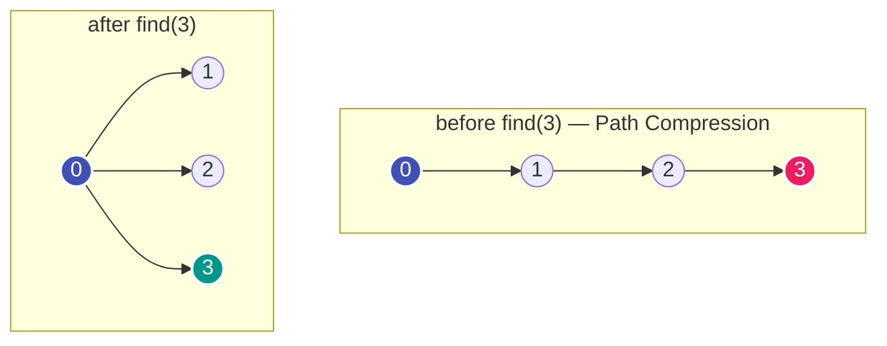

---
tags:
  - Algorithm
  - Graph
  - Data Structure
  - Union-Find
  - DSU
  - Rust
---

# Disjoint Set Union (DSU) / Union-Find

**Category:** Graph Theory & Dynamic Connectivity

Very fast detection and merging of connected components or clusters – e.g. in networks, [island problems](flood-fill.md), or Kruskal's algorithm for minimum spanning trees.

---

## Intuition & Core Idea

Instead of searching the whole network expensively and recursively (via [BFS/DFS](traversierung-bfs-dfs.md)) on every operation, a DSU structure remembers the **root of each component** in nearly constant time:

- **`find(x)`** returns the root (the representative) of the component containing `x`.
- **`union(a, b)`** merges the components of `a` and `b` by hanging one root beneath the other.

Two optimizations make the structure practically $\mathcal{O}(1)$:

1. **Path Compression:** On `find`, every visited node is re-hung directly onto the root – the tree flattens with each access.
2. **Union by Rank/Size:** The smaller of the two components is attached to the larger one, keeping the tree from degenerating.



---

## Reference Implementation (Python)

```python
class DSU:
    def __init__(self, n: int) -> None:
        self.parent = list(range(n))
        self.size = [1] * n          # Union by Size
        self.components = n

    def find(self, x: int) -> int:
        root = x
        while self.parent[root] != root:
            root = self.parent[root]
        # Path Compression: re-hang every visited node onto the root
        while self.parent[x] != root:
            self.parent[x], x = root, self.parent[x]
        return root

    def union(self, a: int, b: int) -> bool:
        ra, rb = self.find(a), self.find(b)
        if ra == rb:
            return False             # already connected
        if self.size[ra] < self.size[rb]:
            ra, rb = rb, ra
        self.parent[rb] = ra
        self.size[ra] += self.size[rb]
        self.components -= 1
        return True

    def connected(self, a: int, b: int) -> bool:
        return self.find(a) == self.find(b)
```

---

## Reference Implementation (Rust)

```rust
pub struct Dsu {
    parent: Vec<usize>,
    size: Vec<usize>,
    components: usize,
}

impl Dsu {
    pub fn new(n: usize) -> Self {
        Self {
            parent: (0..n).collect(),   // Vec<usize>, i-th entry = i
            size: vec![1; n],           // Union by Size
            components: n,
        }
    }

    /// Root of x's component (iterative, with path compression).
    pub fn find(&mut self, x: usize) -> usize {
        let mut root = x;
        while self.parent[root] != root {
            root = self.parent[root];
        }
        let mut x = x;
        while self.parent[x] != root {
            let next = self.parent[x];
            self.parent[x] = root;
            x = next;
        }
        root
    }

    /// Merges two components; `false` if they were already connected.
    pub fn union(&mut self, a: usize, b: usize) -> bool {
        let (ra, rb) = (self.find(a), self.find(b));
        if ra == rb {
            return false;
        }
        let (big, small) = if self.size[ra] < self.size[rb] {
            (rb, ra)
        } else {
            (ra, rb)
        };
        self.parent[small] = big;
        self.size[big] += self.size[small];
        self.components -= 1;
        true
    }

    pub fn connected(&mut self, a: usize, b: usize) -> bool {
        self.find(a) == self.find(b)
    }
}
```

### Rust Notes on the DSU

- **`&mut self` on `find`:** Path compression rewrites the parent table – that is why `find` needs a mutable reference. This is the key Rust lesson at this structure.
- **`(0..n).collect()`:** Idiomatic replacement for Python's `list(range(n))`, without reallocation (capacity is known).
- **No recursion:** The iterative `find` with a second pass is borrow-checker friendly (no recursive `&mut` traversal) and additionally stack-safe.
- **Edge sets:** For Kruskal, sort edges in a `Vec<(u64, usize, usize)>` (weight, u, v) and call `union` in a loop.

---

## Typical Use Cases

| Problem Class                         | DSU Role                                                                  |
| :------------------------------------ | :------------------------------------------------------------------------ |
| **Kruskal MST**                       | Sort edges, `union` – cycle iff `find(u) == find(v)`                      |
| **Islands / grid clusters**           | Union neighboring cells instead of a [flood fill](flood-fill.md) per cell |
| **Dynamic connectivity**              | Online queries „are a and b connected?" while edges arrive                |
| **Percolation / equivalence classes** | Group elements that share the same update rule                            |

---

## Complexity

| Dimension                | Complexity                                                                                                                                           |
| :----------------------- | :--------------------------------------------------------------------------------------------------------------------------------------------------- |
| **Time (per operation)** | Almost $\mathcal{O}(1)$ – more precisely $\mathcal{O}(\alpha(n))$ with the **inverse Ackermann function** ($\alpha(n) \le 4$ for all practical $n$). |
| **Space**                | $\mathcal{O}(n)$ for the parent and size tables.                                                                                                     |

---

## Related Patterns

- [Graph Traversal (BFS & DFS)](traversierung-bfs-dfs.md) – the alternative for static components.
- [Flood Fill & Grid Traversal](flood-fill.md) – island problems with DSU instead of flooding.
- [Memory Management & GC](memory-management.md) – why flat `Vec` tables are cache friendly.
