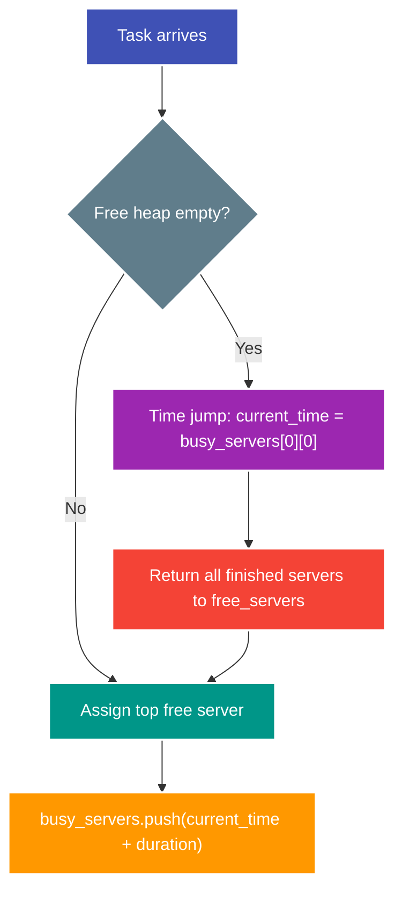

---
tags:
  - Algorithm
  - Simulation
  - Priority Queue
  - Scheduling
  - Event-Driven
---

# Event-Driven Simulation with Two Priority Queues (Time Jumps)

The **event-driven simulation pattern** models scheduling and resource-allocation problems (task, job, and server management) with two separate heaps and jumps directly to the next event on contention — instead of counting every single second.

---

## When to use it?

- **Scheduling & resource allocation:** Servers, machines, or workers are continuously occupied and released (e.g. distributing tasks across $k$ machines, [LeetCode 3841](../solutions/leetcode-3841.md)).
- **Time jumps instead of a tick loop:** A per-second `while current_time += 1` blows up with large time horizons ($10^9$+). The simulation instead jumps to the point in time where the next event arrives.

---

## Core mechanics

### Two separate heaps

| Heap                       | Sorted by                          | Contents            |
| :------------------------- | :--------------------------------- | :------------------ |
| `free_servers` (free heap) | Priority: e.g. weight, then index  | Available resources |
| `busy_servers` (busy heap) | Completion time `(finish_time, …)` | Active resources    |

- **Assignment:** As soon as a task arrives, pop the top entry of `free_servers`, attach the task load and push it into `busy_servers` with `current_time + duration`.
- **Release:** Every entry in `busy_servers` whose completion time is $\le$ the current time moves back into `free_servers`.

### The time jump

```python
# No voluntary per-second ticking:
# on contention, jump straight to the next event
if not free_servers:
    current_time = busy_servers[0][0]   # completion time of the earliest server

# release every resource finished by then in one batch
while busy_servers and busy_servers[0][0] <= current_time:
    _, server = heapq.heappop(busy_servers)
    heapq.heappush(free_servers, server)
```

The jump `current_time = busy_servers[0][0]` reduces the iteration count from $\mathcal{O}(T)$ (time horizon) to $\mathcal{O}(n \log n)$ (number of events).



---

## Python skeleton

```python
import heapq

free_servers: list = []   # (weight, index)  → priority
busy_servers: list = []   # (finish_time, weight, index)

def assign(tasks: list[int]) -> list[int]:
    assignment = []
    for start, duration, load in tasks:
        # release finished resources
        while busy_servers and busy_servers[0][0] <= start:
            _, weight, idx = heapq.heappop(busy_servers)
            heapq.heappush(free_servers, (weight, idx))

        # contention? time jump to the next event
        if not free_servers:
            release = busy_servers[0][0]
            while busy_servers and busy_servers[0][0] <= release:
                _, weight, idx = heapq.heappop(busy_servers)
                heapq.heappush(free_servers, (weight, idx))

        weight, idx = heapq.heappop(free_servers)
        heapq.heappush(busy_servers, (start + duration, weight, idx))
        assignment.append(idx)
    return assignment
```

---

## Pitfalls

- **Release-then-assign order:** Return finished resources first, then assign — otherwise idle capacity is overlooked.
- **Use tuple ordering:** `(weight, index)` yields deterministic tie-breaks automatically; the secondary index prevents arbitrariness on equal weights.
- **Consistent time base:** Completion times in `busy_servers` must be in the same unit as task start times, or the time jump fires at the wrong instant.

---

## Complexity

| Operation         | Complexity                        | Rationale                                                            |
| :---------------- | :-------------------------------- | :------------------------------------------------------------------- |
| **Assign task**   | $\mathcal{O}(\log m)$             | Pop from free heap, push into busy heap ($m$ = number of resources). |
| **Release batch** | $\mathcal{O}(r \log m)$ amortized | Each resource is released as often as it was occupied, at most.      |
| **Total runtime** | $\mathcal{O}(n \log m)$           | instead of $\mathcal{O}(T \cdot m)$ for per-second ticking.          |
| **Space**         | $\mathcal{O}(m + n)$              | Both heaps + assignment array.                                       |
