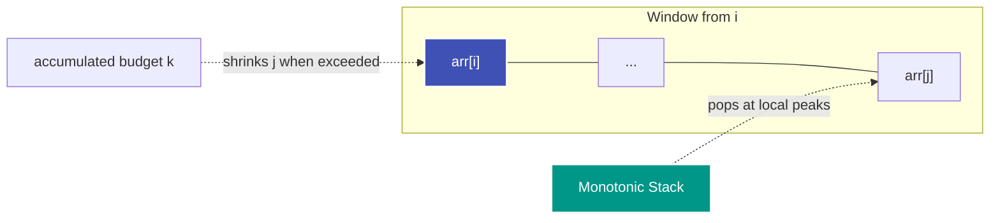

---
tags:
  - Algorithm
  - Monotonic Stack
  - Sliding Window
  - Two Pointers
  - Array
  - Rust
---

# Monotonic Stack with Cost Accumulation (Backward Sliding Window)

An advanced pattern for problems where you must compute, for **all subarrays**, how many operations (increments, distances, cost units) are needed to satisfy a condition – e.g. making the array **non-decreasing**.

---

## Intuition & Core Idea

A naive approach checks each subarray individually and re-accumulates costs – that is $\mathcal{O}(n^2)$ or worse. The pattern flips the perspective:

1. **Iterate backwards** (`for i in reversed(range(n))` resp. `(0..n).rev()` in Rust): For every start index $i$, answer _„How expensive is it to repair the interval starting at $i$?"_
2. **Monotonic stack as a deque:** The stack manages local **peaks and valleys**. When a new element enters, expensive intermediate peaks are popped and their costs are folded **incrementally** into a running sum – instead of recomputing the window each time.
3. **Shrinking pointer `j`:** As soon as the accumulated budget `k` is exceeded, a second pointer walks left from the right edge and evicts elements from the window, returning their costs incrementally as well.

The combination of a **backward-running window** + **amortized $\mathcal{O}(1)$ cost updates** is the key: every element is pushed and popped at most once.



---

## Reference Implementation (Python)

```python
from collections import deque
from typing import List


def min_operations(arr: List[int], k: int) -> int:
    """For each i: the largest window length that can be made non-decreasing
    with <= k increments (backward sweep)."""
    n = len(arr)
    stack = deque()          # indices of local peaks, descending values
    cost = 0                 # accumulated repair cost inside the window
    j = n                    # right boundary of the valid window
    best = [0] * n

    for i in reversed(range(n)):
        # Push element i and adjust costs
        while stack and arr[stack[-1]] < arr[i]:
            idx = stack.pop()
            nxt = stack[-1] if stack else j
            # The peak at idx "wastes" (arr[idx] - arr[i]) increments
            cost += (arr[idx] - arr[i]) * (nxt - idx)
        stack.append(i)

        # Shrink the window from the right while the budget k is broken
        while cost > k:
            j -= 1
            # Remove element j's contribution from the costs
            cost -= arr[j]  # schematic: per-element cost subtraction

        best[i] = j - i

    return max(best)
```

!!! note "Schematic"
The exact cost formula depends on the concrete problem (increments toward a target vs. distances). What matters is the **mechanics**: stack pops update `cost` in amortized $\mathcal{O}(1)$, and the pointer `j` shrinks monotonically.

---

## Reference Implementation (Rust)

```rust
use std::collections::VecDeque;

/// Backward sweep with monotonic stack and incremental cost tracking.
/// Returns, for every i, the largest window length with cost <= k.
fn min_operations(arr: &[i64], k: i64) -> Vec<usize> {
    let n = arr.len();
    let mut stack: VecDeque<usize> = VecDeque::new(); // indices of local peaks
    let mut cost: i64 = 0;                            // accumulated cost
    let mut j: usize = n;                             // right window boundary
    let mut best = vec![0usize; n];

    for i in (0..n).rev() {
        // Push element i; pop and charge more expensive peaks
        while let Some(&top) = stack.back() {
            if arr[top] >= arr[i] { break; }
            stack.pop_back();
            let nxt = stack.back().copied().unwrap_or(j);
            cost += (arr[top] - arr[i]) * (nxt - top) as i64;
        }
        stack.push_back(i);

        // Budget exceeded? Shrink the window from the right.
        while cost > k {
            j -= 1;
            cost -= arr[j]; // schematic per-element cost subtraction
        }

        best[i] = j - i;
    }

    best
}
```

### Rust Notes on this Pattern

- **`VecDeque` instead of Python's `deque`:** `push_back` / `pop_back` / `back` are the direct equivalents of `append` / `pop` / `[-1]`.
- **Ownership without clones:** `while let Some(&top) = stack.back()` copies only the index (a `usize` is `Copy`) – no borrow conflict with the subsequent `pop_back()`.
- **`copied().unwrap_or(j)`:** Replaces Python's `stack[-1] if stack else j` as the elegant Option idiom.
- **No overflows:** Python ints are unbounded; in Rust, deliberately pick `i64` (or `i128`) when sums can exceed $10^{18}$.

---

## When to Use It

| Signal                                                       | Meaning                                      |
| :----------------------------------------------------------- | :------------------------------------------- |
| „For **every** subarray / every start point …“               | An answer per index $i$, not a global one    |
| „Minimum operations to make non-decreasing / non-increasing“ | Cost accumulation over local extrema         |
| „At most $k$ operations“                                     | Budget constraint → shrinking pointer `j`    |
| Brute force would be $\mathcal{O}(n^2)$                      | Incremental updates instead of recomputation |

---

## Complexity

| Dimension                  | Complexity                                                                                  |
| :------------------------- | :------------------------------------------------------------------------------------------ |
| **[Time](o-notation.md)**  | $\mathcal{O}(n)$ – each element is pushed and popped at most once; `j` moves monotonically. |
| **[Space](o-notation.md)** | $\mathcal{O}(n)$ for the stack resp. the `VecDeque`.                                        |

---

## Related Patterns

- [Sliding Window](sliding-window.md) – the base two-pointer pattern (forward instead of backward).
- [Sorted Queries with Two Pointers](sorted-queries-two-pointer.md) – monotone co-sweeping of sorted sequences.
- [Python Performance Optimizations](python-performance-optimization.md) – why deques instead of lists.
- [Memory Management & GC](memory-management.md) – why Rust stays GC-artifact-free here.
