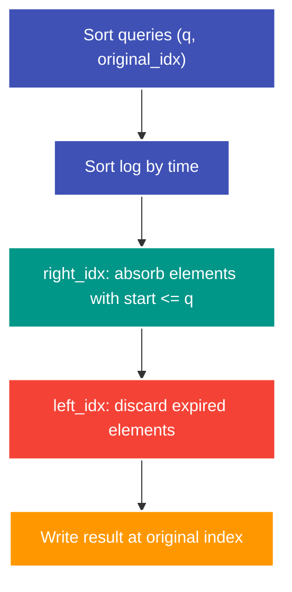

---
tags:
  - Algorithm
  - Two Pointers
  - Sliding Window
  - Sorted Queries
  - Offline Processing
---

# Sorted Queries with Two-Pointer Window (Event Tracking)

The **sorted-queries two-pointer pattern** answers interval or time-window queries offline by sorting both data streams and sweeping them linearly with two pointers, exactly once.

---

## When to use it?

- **Interval or time-window queries:** For every query $q_j$ you need to know which elements (e.g. server activities, tasks, log entries) fall inside a range $[q - x, q]$.
- **Offline processing is allowed:** The queries do not have to be answered in real time, only in some order (results are written back by original index).
- Naively, every query triggers its own search ($\mathcal{O}(n \cdot k)$); sorted co-sweeping reduces this to $\mathcal{O}(n \log n + k \log k)$.

---

## Core mechanics

### 1. Store queries as tuples with their original index and sort them

```python
indexed_queries = sorted((q, i) for i, q in enumerate(queries))
```

Sorting guarantees that the **time axis only moves forward** — no query ever "walks back", so removed elements never need to come back.

### 2. Sort the log by time as well

The element log (intervals, events, activities) is sorted once by its time / start attribute.

### 3. Two pointers move linearly along with the queries

| Pointer     | Duty                                                                                |
| :---------- | :---------------------------------------------------------------------------------- |
| `right_idx` | Absorbs every element whose start $\le$ the current query time.                     |
| `left_idx`  | Drops every element at the structure's front that has left the window $[q - x, q]$. |

```python
left_idx = right_idx = 0
results = [0] * len(queries)

for q, qi in indexed_queries:
    # absorb newly started activities
    while right_idx < len(log) and log[right_idx].start <= q:
        add(log[right_idx]); right_idx += 1

    # discard expired activities (lazily at the front)
    while struct and struct.peek().end < q - x + 1:
        remove_peek(); left_idx += 1

    results[qi] = best(struct)   # original index!
```

This prevents **redundant searches**: every element is absorbed by `right_idx` at most once and removed by `left_idx` at most once — the pointers move a total of $\mathcal{O}(n + k)$ times (e.g. [LeetCode 1851](../solutions/leetcode-1851.md), [LeetCode 3841](../solutions/leetcode-3841.md)).



---

## Pitfalls

- **Do not lose the original index:** After sorting you write results to `original_idx`, otherwise the output order is destroyed.
- **Define boundary semantics precisely:** Whether the window is inclusive (`[q - x + 1, q]`) or exclusive decides the discard condition.
- **Equal query times:** Multiple queries with the same $q$ are served back-to-back without any pointer moving backwards — the sweep state stays valid.

---

## Complexity

| Operation                 | Complexity                         | Rationale                                       |
| :------------------------ | :--------------------------------- | :---------------------------------------------- |
| **Sorting**               | $\mathcal{O}(n \log n + k \log k)$ | $n$ log entries, $k$ queries.                   |
| **Sweep (both pointers)** | $\mathcal{O}(n + k)$ amortized     | Both pointers only move forward, monotonically. |
| **Total runtime**         | $\mathcal{O}(n \log n + k \log k)$ | vs. naive $\mathcal{O}(n \cdot k)$.             |
| **Space**                 | $\mathcal{O}(n + k)$               | Sorted copies + result array.                   |
