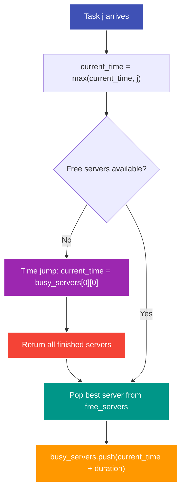

---
tags:
  - LeetCode
  - Array
  - Heap
  - Priority Queue
  - Simulation
  - Sorting
  - Medium
---

# LeetCode 1882: Process Tasks Using Servers

- **Platform:** [LeetCode #1882](https://leetcode.com/problems/process-tasks-using-using-servers/)
- **Difficulty:** Medium
- **Categories:** Array, Heap ([Priority Queue](../glossary/min-heap-sweep-line.md)), Simulation, Sorting
- **Related Concepts:** [Event-Driven Simulation with Two Priority Queues](../glossary/event-driven-simulation.md)

---

## Problem Statement

You are given two arrays of equal length $n$: `servers` (the weight of each server) and `tasks` (the duration of each task). The $j$-th task arrives at second $j$ and must be assigned to a free server **immediately**:

- A server can only take a task if it is free at second $j$ (availability, not index, decides).
- Among free servers, pick the one with the **smallest weight**; ties are broken by the **smallest index**.
- An occupied server is blocked for $\text{tasks}[j]$ seconds and becomes free automatically afterwards.

Return the **index of the assigned server** for every task.

### Example

```text
Input:  servers = [3, 1, 4], tasks = [1, 2, 1]
Output: [1, 0, 2]
Explanation:
- Second 0: Server 1 (weight 1) is the lightest → task 0.
- Second 1: Server 0 (weight 3) is the lightest free → task 1.
- Second 2: Server 2 (weight 4) is the lightest free → task 2.
```

---

## Intuition & Solution Approach

### 1. Naive idea (time loop)

Iterate second by second, checking each server for release.

- With time horizons up to $10^9$ this causes **Timeouts** — the loop spends billions of iterations on idle seconds.

### 2. Optimized core idea (two heaps + time jump)

Model the simulation as an event system with two separate [priority queues](../glossary/event-driven-simulation.md):

| Heap           | Tuple                          | Semantics                         |
| :------------- | :----------------------------- | :-------------------------------- |
| `free_servers` | `(weight, index)`              | Free, ordered by priority.        |
| `busy_servers` | `(finish_time, weight, index)` | Busy, ordered by completion time. |

For every task `j`:

1. **Time base:** `current_time = max(current_time, j)` — a task cannot start before it arrives.
2. **Step A — Releases:** Every server in `busy_servers` with `finish_time <= current_time` moves back to `free_servers`.
3. **Step B — Time jump:** If `free_servers` is empty, jump straight to `current_time = busy_servers[0][0]` and repeat step A. **This is the core:** instead of ticking every second, the simulation jumps to the next event.
4. **Step C — Assignment:** Pop from `free_servers`, record the index.
5. **Step D — Occupy:** Push `(current_time + duration, weight, index)` into `busy_servers`.



---

## Implementation (Python 3)

```python
import heapq
from typing import List


class Solution:
    def assignTasks(self, servers: List[int], tasks: List[int]) -> List[int]:
        """Assigns each task to the highest-priority free server.

        Args:
            servers: Weight of each server
            tasks: Duration of each task (task j arrives at second j)

        Returns:
            Server index per task, in task order
        """
        # 1. Free heap: all servers as (weight, index) — tuple ordering
        #    automatically yields "smallest weight, then smallest index".
        free_servers = [(weight, i) for i, weight in enumerate(servers)]
        heapq.heapify(free_servers)

        # 2. Busy heap: (finish_time, weight, index)
        busy_servers: list = []

        ans: List[int] = []
        current_time = 0

        for j, task_duration in enumerate(tasks):
            # The time jumps at least to the arrival of the current task.
            current_time = max(current_time, j)

            # --- STEP A: Release every server finished by now ---
            while busy_servers and busy_servers[0][0] <= current_time:
                _, weight, idx = heapq.heappop(busy_servers)
                heapq.heappush(free_servers, (weight, idx))

            # --- STEP B: Contention? Time jump to the next event ---
            if not free_servers:
                current_time = busy_servers[0][0]
                while busy_servers and busy_servers[0][0] <= current_time:
                    _, weight, idx = heapq.heappop(busy_servers)
                    heapq.heappush(free_servers, (weight, idx))

            # --- STEP C: Pick the best free server ---
            weight, idx = heapq.heappop(free_servers)
            ans.append(idx)

            # --- STEP D: Occupy the server with its new completion time ---
            heapq.heappush(busy_servers, (current_time + task_duration, weight, idx))

        return ans
```

---

## Complexity Analysis

| Dimension                              | Complexity              | Rationale                                                                                                                                                                    |
| :------------------------------------- | :---------------------- | :--------------------------------------------------------------------------------------------------------------------------------------------------------------------------- |
| **[Time](../glossary/o-notation.md)**  | $\mathcal{O}(n \log n)$ | Each task triggers a constant number of heap operations; each server swaps heaps at most $n$ times. The time jump removes the $\mathcal{O}(T)$ time-horizon factor entirely. |
| **[Space](../glossary/o-notation.md)** | $\mathcal{O}(n)$        | Both heaps together always hold exactly $n$ servers.                                                                                                                         |

---

## Edge Cases & Pitfalls

- [x] **All servers busy:** The time jump skips the whole idle phase in one go — no per-second ticking.
- [x] **Equal-weight servers:** The tuple `(weight, index)` breaks ties deterministically by index.
- [x] **Task arrives while others run:** `max(current_time, j)` ensures time never runs backwards.
- [x] **Release-then-assign order:** Return all finished servers **before** assigning — otherwise briefly free capacity is overlooked.
