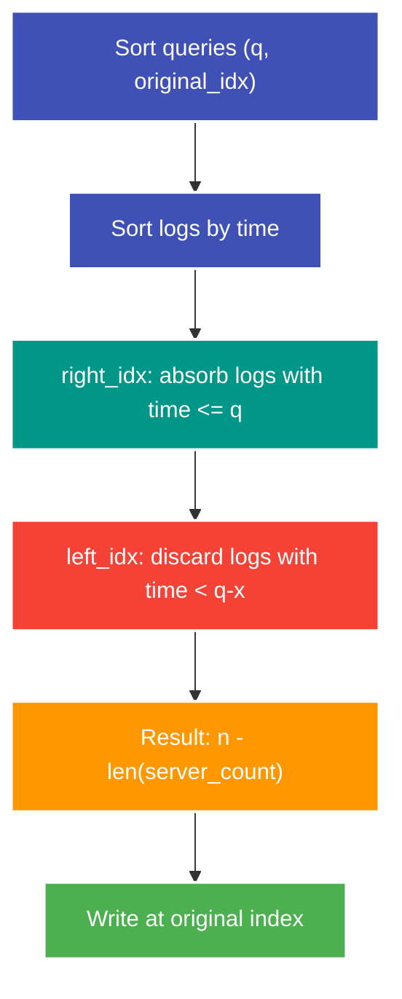

---
tags:
  - LeetCode
  - Array
  - Hash Table
  - Two Pointers
  - Sliding Window
  - Sorting
  - Medium
---

# LeetCode 2747: Count Zero Request Servers

- **Platform:** [LeetCode #2747](https://leetcode.com/problems/count-zero-request-servers/)
- **Difficulty:** Medium
- **Categories:** Array, Hash Table, Two Pointers, [Sliding Window](../glossary/sliding-window.md), Sorting
- **Related Concepts:** [Sorted Queries with Two-Pointer Window](../glossary/sorted-queries-two-pointer.md) | [Min-Heap & Sweep-Line](../glossary/min-heap-sweep-line.md) | [LeetCode 1851](leetcode-1851.md)

---

## Problem Statement

You are given $n$ servers (numbered $1 \dots n$), a logbook `logs` where $\text{logs}[i] = [\text{server}_i, \text{time}_i]$ describes a request to server $\text{server}_i$ at time $\text{time}_i$, a window size $x$, and an array `queries`.

For every query $q_j$, count the servers that received **no** request within the time window $[q_j - x, q_j]$.

Return the answers in the **original order** of the queries.

### Example

```text
Input:  n = 3, logs = [[1,3],[2,6],[1,5]], x = 5, queries = [10, 11]
Output: [1, 2]
Explanation:
- Window [5, 10]: servers 1 (t=3,5) and 2 (t=6) have requests, server 3 does not → 1.
- Window [6, 11]: only server 2 has a request → 2 servers without requests.
```

---

## Intuition & Solution Approach

### 1. Naive idea

Search all logs separately for every query.

- Runtime $\mathcal{O}(|logs| \cdot |queries|)$ — with $10^5$ each, that is a TLE.

### 2. Optimized core idea (sorted queries + two pointers)

The exact [two-pointer sweep pattern](../glossary/sorted-queries-two-pointer.md) — the time axis only moves **forward**:

1. **Sort queries as `(q, original_index)` tuples** — the original index is vital, otherwise the output order is wrong.
2. **Sort the logs by time as well.**
3. **Frequency table** `server_count` tracks how often each server received a request inside the current window.
4. **Two pointers move along with every query:**
   - `right_idx`: absorbs all logs with `time <= q` into the window.
   - `left_idx`: discards all logs with `time < q - x` (decrement, delete at 0).
5. **Result:** $\text{inactive} = n - \text{len}(server\_count)$ — the number of servers with at least one request is simply the dictionary size.



---

## Implementation (Python 3)

```python
from collections import defaultdict
from typing import List


class Solution:
    def countServers(
        self, n: int, logs: List[List[int]], x: int, queries: List[int]
    ) -> List[int]:
        """Counts servers without requests inside each query's time window.

        Args:
            n: Number of servers (numbered 1..n)
            logs: [server_id, time] per log entry
            x: Window width, window spans [q - x, q]
            queries: Query timestamps

        Returns:
            Number of request-free servers per query, in original order
        """
        # 1. Sort queries, but carry the original index along
        indexed_queries = sorted((q, i) for i, q in enumerate(queries))

        # 2. Sort the logs by time as well
        logs.sort(key=lambda entry: entry[1])

        result = [0] * len(queries)

        # 3. Frequency table: how often a server got a request in the window
        server_count = defaultdict(int)

        left_idx = 0
        right_idx = 0
        num_logs = len(logs)

        # 4. Walk through all sorted queries
        for q, original_index in indexed_queries:
            window_start = q - x
            window_end = q

            # --- STEP A: Absorb new logs on the right side ---
            while right_idx < num_logs and logs[right_idx][1] <= window_end:
                server_count[logs[right_idx][0]] += 1
                right_idx += 1

            # --- STEP B: Drop old logs on the left side ---
            while left_idx < num_logs and logs[left_idx][1] < window_start:
                server_id = logs[left_idx][0]
                server_count[server_id] -= 1
                if server_count[server_id] == 0:
                    del server_count[server_id]  # server is request-free again
                left_idx += 1

            # --- STEP C: Record the result ---
            # All servers minus those with at least one request
            result[original_index] = n - len(server_count)

        return result
```

---

## Complexity Analysis

| Dimension                              | Complexity                         | Rationale                                                                                                              |
| :------------------------------------- | :--------------------------------- | :--------------------------------------------------------------------------------------------------------------------- |
| **[Time](../glossary/o-notation.md)**  | $\mathcal{O}(m \log m + k \log k)$ | Sorting $m$ logs and $k$ queries. Both pointers only move forward monotonically, i.e. $\mathcal{O}(m + k)$ sweep cost. |
| **[Space](../glossary/o-notation.md)** | $\mathcal{O}(n + k)$               | Frequency table (up to $n$ servers) + sorted queries/result array.                                                     |

---

## Edge Cases & Pitfalls

- [x] **Do not lose the original index:** After sorting, results are written to `original_index`, otherwise the output order is destroyed.
- [x] **Dictionary maintenance on decrement:** Decrement to 0 first, then `del` — otherwise the server keeps counting as "active" (with value 0).
- [x] **Window boundaries:** `[q - x, q]` is closed on both sides; a log with `time == q - x` stays in the window, `time < q - x` falls out.
- [x] **Equal query timestamps:** Multiple queries with the same $q$ are served back-to-back without any pointer moving backwards.
