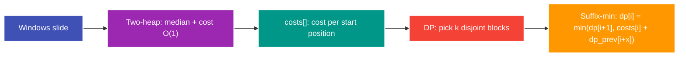

---
tags:
  - LeetCode
  - Array
  - Dynamic Programming
  - Heap
  - Sliding Window
  - Median
  - Hard
---

# LeetCode 3505: Minimum Operations to Make Elements Within K Subarrays Equal

- **Platform:** [LeetCode #3505](https://leetcode.com/problems/minimum-operations-to-make-elements-within-k-subarrays-equal/)
- **Difficulty:** Hard
- **Categories:** Array, Dynamic Programming, Heap ([Priority Queue](../glossary/min-heap-sweep-line.md)), [Sliding Window](../glossary/sliding-window.md), Median
- **Related Concepts:** [Two-Heap with Lazy Deletion & Median Cost](../glossary/two-heap-lazy-deletion.md)

---

## Problem Statement

You are given an array `nums` of length $n$, a window length $x$ and a count $k$. Choose $k$ **disjoint** subarrays of length $x$ so that the sum of operations needed to make each of them uniform is minimal. One operation changes an element by $\pm 1$.

Return the minimal total number of operations.

### Example

```text
Input:  nums = [5,-2,1,3,7,3,6,4,-1], x = 3, k = 2
Output: 4
Explanation: The subarrays [1,3,7] → target 3 (cost 4) and [3,6,4] → target 4 (cost 2)
could be chosen; the optimal combination yields 4 operations in total.
```

---

## Intuition & Solution Approach

### Why the median, not the mean?

Large outliers distort the mean and blow up the $L_1$ cost. The **median minimizes** the sum of absolute deviations $\sum |a_i - m|$ — exactly the criterion of this task ([Glossary: Two-Heap & Median Cost](../glossary/two-heap-lazy-deletion.md)).

### 1. Optimized core idea — Phase 1: window costs via two heaps

Compute all window costs of length $x$ in a single sweep:

- Two balanced heaps (`small` as max-heap, `large` as min-heap) hold the sliding window.
- **Lazy deletion:** departing elements are merely marked in the frequency table `invalid` and cleaned up only when they reach the heap top.
- Running sums `sum_small`/`sum_large` answer the cost in $\mathcal{O}(1)$:
  $$\text{cost} = \text{median} \cdot s_{small} - \Sigma_{small} + \Sigma_{large} - \text{median} \cdot s_{large}$$

### 2. Phase 2: memory-optimized bottom-up DP

Choose $k$ disjoint blocks of length $x$ with minimal total cost:

$$dp[r][i] = \min(dp[r][i+1],\ \text{costs}[i] + dp[r-1][i+x])$$

- **Rolling array combined with a suffix minimum:** `current_min` keeps the running minimum of the "take" candidates, so `curr_dp[index]` is built in $\mathcal{O}(1)$.
- Only two $n$-sized arrays are needed — no $k \times n$ DP grid.



---

## Implementation (Python 3)

```python
import heapq
from collections import defaultdict
from typing import List


class Solution:
    def minOperations(
        self, nums: List[int], x: int, k: int
    ) -> int:
        """Minimizes total operations for k disjoint uniform subarrays.

        Args:
            nums: Input array
            x: Length of every chosen subarray
            k: Number of subarrays to choose

        Returns:
            Minimal sum of L1 operations
        """
        n = len(nums)

        # --- PHASE 1: two-heap with lazy deletion ---
        small: list = []   # max-heap for the lower half (negated)
        large: list = []   # min-heap for the upper half
        sum_small = sum_large = 0
        size_small = size_large = 0
        invalid = defaultdict(int)

        def clean_heaps() -> None:
            while small and invalid[-small[0]] > 0:
                invalid[-heapq.heappop(small)] -= 1
            while large and invalid[large[0]] > 0:
                invalid[heapq.heappop(large)] -= 1

        def rebalance() -> None:
            nonlocal sum_small, sum_large, size_small, size_large
            total_size = size_small + size_large
            if total_size == 0:
                return
            target_small = (total_size + 1) // 2
            clean_heaps()
            while size_small > target_small:
                val = -heapq.heappop(small)
                heapq.heappush(large, val)
                sum_small -= val; size_small -= 1
                sum_large += val; size_large += 1
                clean_heaps()
            while size_small < target_small and large:
                val = heapq.heappop(large)
                heapq.heappush(small, -val)
                sum_large -= val; size_large -= 1
                sum_small += val; size_small += 1
                clean_heaps()

        def add_num(val: int) -> None:
            nonlocal sum_small, sum_large, size_small, size_large
            clean_heaps()
            if not small or val <= -small[0]:
                heapq.heappush(small, -val); sum_small += val; size_small += 1
            else:
                heapq.heappush(large, val); sum_large += val; size_large += 1
            rebalance()

        def remove_num(val: int) -> None:
            nonlocal sum_small, sum_large, size_small, size_large
            clean_heaps()
            if small and val <= -small[0]:
                sum_small -= val; size_small -= 1
            else:
                sum_large -= val; size_large -= 1
            invalid[val] += 1   # lazy: mark now, clean up later
            rebalance()

        # Compute window costs for every start position
        costs = [0] * (n - x + 1)
        for i in range(x):
            add_num(nums[i])

        def window_cost() -> int:
            median = -small[0]
            return (size_small * median - sum_small) + (sum_large - size_large * median)

        costs[0] = window_cost()
        for i in range(1, n - x + 1):
            remove_num(nums[i - 1])
            add_num(nums[i + x - 1])
            costs[i] = window_cost()

        # --- PHASE 2: memory-optimized bottom-up DP (rolling array) ---
        prev_dp = [0] * (n + 1)   # results for r-1 subarrays
        for r in range(1, k + 1):
            curr_dp = [float("inf")] * (n + 1)
            current_min = float("inf")
            # Walk backwards: accumulate the suffix minimum
            for index in range(n - r * x, -1, -1):
                take = costs[index] + prev_dp[index + x]
                current_min = min(current_min, take)
                curr_dp[index] = current_min
            prev_dp = curr_dp

        return prev_dp[0]
```

---

## Complexity Analysis

| Dimension                              | Complexity                          | Rationale                                                                                            |
| :------------------------------------- | :---------------------------------- | :--------------------------------------------------------------------------------------------------- |
| **[Time](../glossary/o-notation.md)**  | $\mathcal{O}(n \log x + n \cdot k)$ | Phase 1: amortized $\mathcal{O}(\log x)$ per enter/leave. Phase 2: $k$ DP passes over $n$ positions. |
| **[Space](../glossary/o-notation.md)** | $\mathcal{O}(n)$                    | Two heaps ($x$), `costs` ($n$) and **two** DP rows instead of a $k \times n$ grid.                   |

---

## Edge Cases & Pitfalls

- [x] **Outliers:** The median is robust; a mean-based approach would inflate the cost.
- [x] **Duplicate values in the window:** The frequency table `invalid` handles duplicates correctly.
- [x] **Non-overlapping blocks:** The DP jump `index + x` enforces disjointness automatically.
- [x] **Memory:** The 2D DP grid ($k \times n$) was replaced by a rolling array with a running suffix minimum — decisive for $n, k \le 10^4$.
