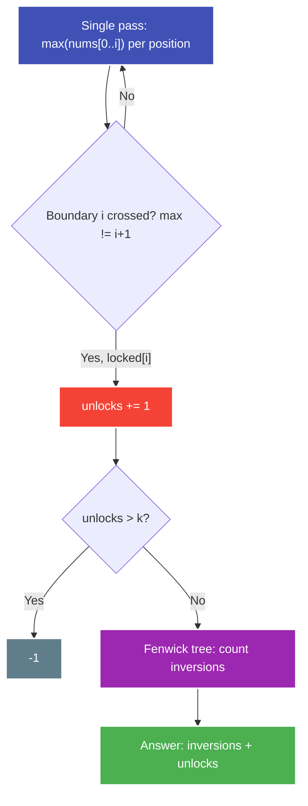

---
tags:
  - LeetCode
  - Array
  - Greedy
  - Sorting
  - Fenwick Tree
  - Medium
---

# LeetCode Weekly 526 Q3: Minimum Operations to Sort With Locked Indices

- **Platform:** Weekly Contest 526, Q3
- **Difficulty:** Medium
- **Categories:** Array, Greedy, Sorting, [Fenwick Tree](../glossary/advanced-tree-techniques.md)
- **Related Concepts:** [Advanced Tree Techniques (Fenwick/BIT)](../glossary/advanced-tree-techniques.md) | [Cyclic Permutations](../glossary/cyclic-permutations.md)

---

## Problem Statement

You are given a permutation `nums` of $[1, n]$, a binary array `locked`, and a number $k$:

- `locked[i] = 1` means index $i$ is locked.
- **Swap:** pick $i$ where both $i$ and $i+1$ are **unlocked** and swap `nums[i]`, `nums[i+1]`.
- **Unlock:** permanently unlock a locked index.

Any number of swaps is allowed, but **at most $k$ unlocks**. Return the minimal total number of operations to sort `nums`, or $-1$ if impossible.

### Example

```text
Input:  nums = [2, 1, 3], locked = [1, 0, 0], k = 1
Output: 2
Explanation: 1 inversion (2 > 1) + 1 unlock (index 0 borders a mandatory crossing) = 2.
```

---

## Intuition & Solution Approach

### Optimized core idea (inversions + mandatory boundaries)

1. **Sorting with adjacent swaps needs at least as many swaps as there are inversions** — and bubble sort achieves exactly that number.
2. **Which boundaries get crossed?** The boundary between $i$ and $i+1$ must be crossed exactly when $\max(\text{nums}[0..i]) \ne i + 1$ — otherwise an element that belongs to the right side stays stuck on the left.
3. **Unlock exactly there:** When a boundary is crossed, **both** adjacent indices must be unlocked. All other boundaries are never used; keeping them locked is free.
4. **Result:** $\text{inversions} + \text{locked mandatory indices}$, or $-1$ if the mandatory indices exceed $k$.

Inversion counting is delegated to a [Fenwick tree](../glossary/advanced-tree-techniques.md) in $\mathcal{O}(n \log n)$: during a left-to-right pass, `inv += i - s` queries how many smaller values have already been registered on the left.



---

## Implementation (Python 3)

```python
from typing import List


class Solution:
    def minOperations(self, nums: List[int], locked: List[int], k: int) -> int:
        """Minimal operations to sort nums under a limited unlock budget.

        Args:
            nums: Permutation of [1, n]
            locked: 1 = locked index
            k: Unlock budget

        Returns:
            Minimal operation count, or -1
        """
        n = len(nums)

        # --- Boundary i|i+1 must be crossed <=> max(nums[0..i]) != i + 1 ---
        unlocks = 0
        mx = 0
        need_prev = False
        for i in range(n):
            x = nums[i]
            if x > mx:
                mx = x
            need_cur = mx != i + 1
            if locked[i] and (need_prev or need_cur):
                unlocks += 1
            need_prev = need_cur

        if unlocks > k:
            return -1

        # --- Swap count = inversion count (Fenwick tree) ---
        tree = [0] * (n + 1)
        inv = 0
        for i in range(n):
            x = nums[i]
            s = 0
            j = x
            while j:
                s += tree[j]       # sum of all registered values <= x
                j &= j - 1
            inv += i - s           # larger values left of i
            j = x
            while j <= n:
                tree[j] += 1
                j += j & -j

        return inv + unlocks
```

---

## Complexity Analysis

| Dimension                              | Complexity              | Rationale                                                                     |
| :------------------------------------- | :---------------------- | :---------------------------------------------------------------------------- |
| **[Time](../glossary/o-notation.md)**  | $\mathcal{O}(n \log n)$ | One linear boundary pass plus $\mathcal{O}(\log n)$ per Fenwick update/query. |
| **[Space](../glossary/o-notation.md)** | $\mathcal{O}(n)$        | The Fenwick tree.                                                             |

---

## Edge Cases & Pitfalls

- [x] **Check both sides of a boundary:** Index $i$ is needed when either boundary $i-1|i$ **or** $i|i+1$ is crossed — hence `need_prev or need_cur`.
- [x] **Already-sorted permutation:** $\max(nums[0..i]) = i+1$ everywhere → 0 unlocks, only inversions (if any).
- [x] **Fenwick 1-indexing:** The tree runs on $1 \dots n$, values form a permutation of $[1, n]$ — no off-by-one trap.
- [x] **Budget overflow:** Unlocks are counted before the inversion computation — an early $-1$ exit saves work.
