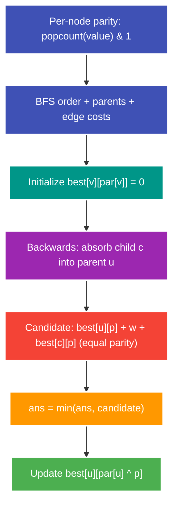

---
tags:
  - LeetCode
  - Tree
  - Graph
  - Dynamic Programming
  - Bit Manipulation
  - DFS
  - Hard
---

# LeetCode Weekly 526 Q4: Minimum Cost Path With Even XOR Parity

- **Platform:** Weekly Contest 526, Q4
- **Difficulty:** Hard
- **Categories:** Tree, Graph, Dynamic Programming, [Bit Manipulation](../glossary/bit-manipulation.md), DFS
- **Related Concepts:** [Adjacency List](../glossary/adjazenzliste.md) | [Bitwise Operations](../glossary/bit-manipulation.md) | [Depth-First & Breadth-First Search](../glossary/traversierung-bfs-dfs.md)

---

## Problem Statement

You are given a tree with $n$ nodes as `edges[i] = [u_i, v_i, c_i]` (an edge with cost $c_i$) plus `values[i]` (the value of node $i$).

A path between two distinct nodes is called **Balanced-XOR** when the bitwise XOR of all node values (including both endpoints) has an **even number of set bits**. The cost of a path is the sum of its edge costs.

Return the minimum cost of a Balanced-XOR path, or $-1$ if none exists.

### Example

```text
Input:  edges = [[0,1,2],[1,2,3]], values = [1,2,3]
Output: 5
Explanation: Path 0-1-2: XOR = 1^2^3 = 0 (0 bits, even) → cost 2 + 3 = 5.
```

---

## Intuition & Solution Approach

### Optimized core idea (parity decomposition + iterative tree DP)

1. **Popcount parity decomposition:** Since XOR is bitwise addition modulo 2,
   $$\text{popcount}(a \oplus b) \bmod 2 = (\text{popcount}(a) + \text{popcount}(b)) \bmod 2.$$
   Every node therefore carries **one parity bit**; what is sought is a path with an **even number of odd nodes** — the rest of the XOR content is irrelevant.
2. **Tree DP with two states:** `best[v][p]` = minimal cost of a downward path starting at $v$ (including $v$) with node parity $p$. Initialization: `best[v][par[v]] = 0`.
3. **Merging at the parent $u$:** When absorbing a child $c$ (edge cost $w$), a path through $u$ is formed from two halves:
   - Candidate `best[u][p] + w + best[c][p]` — **equal parity of both halves** yields an even node count overall.
   - Then update `best[u][par[u] ^ p]` with the child contribution.
4. **Iterative instead of recursive:** Precompute a BFS order (parents + edge costs), then process **backwards** in reverse BFS order — no recursion limit, no stack overflow at $10^5$ nodes.



---

## Implementation (Python 3)

```python
from typing import List


class Solution:
    def minCost(self, edges: List[List[int]], values: List[int]) -> int:
        """Minimum cost of a Balanced-XOR path in the tree.

        Args:
            edges: [u, v, cost] per edge
            values: Node value per node

        Returns:
            Minimal path cost, or -1
        """
        n = len(values)
        if n < 2:
            return -1  # a path needs two distinct nodes

        adj = [[] for _ in range(n)]
        for u, v, c in edges:
            adj[u].append((v, c))
            adj[v].append((u, c))

        # Parity of the XOR popcount = XOR of the popcount parities
        par = [x.bit_count() & 1 for x in values]

        # Precompute a BFS order with parents and edge costs
        parent = [-1] * n
        pcost = [0] * n
        order = [0]
        seen = [False] * n
        seen[0] = True
        for u in order:
            for v, c in adj[u]:
                if not seen[v]:
                    seen[v] = True
                    parent[v] = u
                    pcost[v] = c
                    order.append(v)

        INF = float("inf")
        # best[v][p]: min. cost of a downward path from v (incl. v), parity p
        b0 = [0 if not par[v] else INF for v in range(n)]
        b1 = [0 if par[v] else INF for v in range(n)]

        ans = INF
        for i in range(n - 1, 0, -1):          # reverse BFS order
            v = order[i]
            u = parent[v]
            w = pcost[v]
            c0 = b0[v] + w
            c1 = b1[v] + w
            # Path through u: equal parity of both halves -> even
            t = b0[u] + c0
            if t < ans:
                ans = t
            t = b1[u] + c1
            if t < ans:
                ans = t
            # Update the parent's states with the child contribution
            if par[u]:
                if c0 < b1[u]:
                    b1[u] = c0
                if c1 < b0[u]:
                    b0[u] = c1
            else:
                if c0 < b0[u]:
                    b0[u] = c0
                if c1 < b1[u]:
                    b1[u] = c1

        return -1 if ans == INF else ans
```

---

## Complexity Analysis

| Dimension                              | Complexity       | Rationale                                                                                               |
| :------------------------------------- | :--------------- | :------------------------------------------------------------------------------------------------------ |
| **[Time](../glossary/o-notation.md)**  | $\mathcal{O}(n)$ | Every node is visited once in the BFS order; every edge triggers a constant number of candidate checks. |
| **[Space](../glossary/o-notation.md)** | $\mathcal{O}(n)$ | Adjacency list, order/parent arrays and two DP arrays.                                                  |

---

## Edge Cases & Pitfalls

- [x] **$n < 2$:** A path needs two distinct nodes → immediate $-1$.
- [x] **Avoid the recursion limit:** Iterative BFS order + backwards processing prevents stack overflow on deep trees (chains up to $10^5$).
- [x] **Carry both parities per node:** `b0` and `b1` are maintained separately; absorbing a child updates only the state `par[u] ^ p`, never both blindly.
- [x] **Parity is a local invariant:** The full XOR value never needs to be built — only `popcount & 1` counts, mirroring the [LeetCode 2791](leetcode-2791.md) mindset (masks instead of strings).
