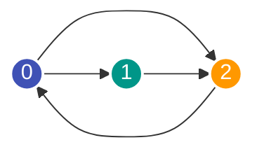

---
tags:
  - Data Structure
  - Graph
  - Matrix
---


# Adjazenzmatrix (Adjacency Matrix)

Die **Adjazenzmatrix** ist eine zweidimensionale Matrix der Größe $V \times V$, die angibt, ob und mit welchem Kantengewicht Knoten in einem Graphen direkt miteinander verbunden sind.

---

## Struktur & Definition

Sei $G = (V, E)$ ein Graph mit $V$ Knoten (nummeriert von $0$ bis $V-1$). Die Adjazenzmatrix $M$ ist ein $V \times V$ Array:

$$M[u][v] = \begin{cases} 1 \text{ (oder Kantengewicht } w\text{)}, & \text{wenn Kante } (u, v) \in E \\ 0 \text{ (oder } \infty\text{)}, & \text{wenn keine Kante existiert} \end{cases}$$

- Bei **ungerichteten Graphen** ist die Matrix symmetrisch zur Hauptdiagonale ($M[u][v] = M[v][u]$).
- Bei **gerichteten Graphen** steht Zeile $u$ für ausgehende Kanten von $u$ und Spalte $v$ für eingehende Kanten nach $v$.



Entsprechende Adjazenzmatrix:
```text
      Nach: 0  1  2
Von: 0   [ [0, 1, 1],
     1     [0, 0, 1],
     2     [1, 0, 0] ]
```

---

## Python-Implementierung

```python
# Initialisierung für V Knoten ohne Kanten
v = 4
matrix = [[0] * v for _ in range(v)]

# Kante (u, v) mit Gewicht w hinzufügen
edges = [(0, 1, 5), (0, 2, 3), (1, 2, 2), (2, 3, 7)]
for u, to, weight in edges:
    matrix[u][to] = weight
    # Bei ungerichteten Graphen zusätzlich:
    # matrix[to][u] = weight

# Kantenexistenz in O(1) prüfen:
has_edge = matrix[0][1] != 0  # True

# Alle Nachbarn von Knoten 0 finden:
neighbors = [
    node for node, weight in enumerate(matrix[0]) if weight != 0
]  # [1, 2]
```

---

## Vor- und Nachteile gegenüber der Adjazenzliste

| Kriterium | Adjazenzmatrix | [Adjazenzliste](adjazenzliste.md) |
| :--- | :--- | :--- |
| **Speicherplatz** | $\mathcal{O}(V^2)$ (unabhängig von $E$) | $\mathcal{O}(V + E)$ |
| **Kanten-Existenz $(u, v)$** | $\mathcal{O}(1)$ | $\mathcal{O}(\text{deg}(u))$ |
| **Alle Nachbarn von $u$** | $\mathcal{O}(V)$ (ganze Zeile muss iteriert werden) | $\mathcal{O}(\text{deg}(u))$ |
| **Kante hinzufügen/löschen** | $\mathcal{O}(1)$ | $\mathcal{O}(1)$ / $\mathcal{O}(\text{deg}(u))$ |
| **Eignung** | Dichte Graphen ($E \approx V^2$), Floyd-Warshall | Dünne Graphen ($E \ll V^2$), die meisten LeetCode-Probleme |

---

## Wann lohnt sich eine Adjazenzmatrix?

1. **Sehr dichte Graphen:** Wenn fast jeder Knoten mit fast jedem anderen verbunden ist ($E \to V^2$).
2. **Knotenanzahl $V$ ist sehr klein:** Bei $V \le 200$ (z. B. für den All-Pairs-Shortest-Path-Algorithmus von Floyd-Warshall mit Laufzeit $\mathcal{O}(V^3)$).
3. **Ständige Kantenabfragen:** Wenn der Algorithmus millionenfach abfragen muss, ob eine Kante $(u, v)$ existiert.
