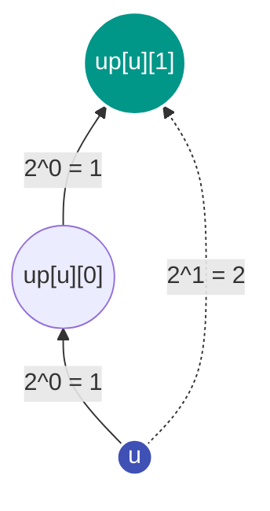

---
tags:
  - Data Structure
  - Tree
  - Binary Lifting
  - LCA
  - Fenwick Tree
  - Euler Tour
  - Hard
---


# Fortgeschrittene Baum-Techniken: LCA, Binary Lifting & Euler-Tour

Bei komplexen Pfad- und Bereichsabfragen auf ungerichteten Bäumen mit dynamischen Knoten-Updates reichen einfache Traversierungen nicht aus. Fortgeschrittene Techniken ermöglichen Abfragen und Updates in $\mathcal{O}(\log n)$.

---

## 1. Binary Lifting (Binäres Hochsteigen)

Binary Lifting berechnet für jeden Knoten $u$ seine Vorfahren im Abstand von Zweierpotenzen:
$$\text{up}[u][j] = 2^j\text{-ter Vorfahre von } u$$

Die Rekursionsgleichung lautet:
$$\text{up}[u][j] = \text{up}[\text{up}[u][j - 1]][j - 1]$$

Der $2^j$-te Vorfahre ist der $2^{j-1}$-te Vorfahre des $2^{j-1}$-ten Vorfahren.



### Lowest Common Ancestor (LCA) in $\mathcal{O}(\log n)$
1. Bringe beide Knoten $u$ und $v$ auf dieselbe Tiefe, indem der tiefere Knoten über Binary Lifting nach oben gehoben wird.
2. Wenn $u == v$, ist dies der LCA.
3. Hebe beide Knoten synchron nach oben, solange ihre $2^j$-ten Vorfahren ungleich sind. Am Ende ist $\text{up}[u][0]$ der gesuchte gemeinsame Vorfahre.

---

## 2. Euler-Tour-Technik (Tree Flattening)

Die Euler-Tour flacht einen Baum durch [Tiefensuche](traversierung-bfs-dfs.md) in ein 1D-Array ab:
- $\text{tin}[u]$: Eintrittszeitpunkt in Knoten $u$.
- $\text{tout}[u]$: Austrittszeitpunkt aus Knoten $u$.

Jeder Teilbaum von $u$ entspricht im abgeflachten Array genau dem Intervall $[\text{tin}[u], \text{tout}[u]]$.

---

## 3. Fenwick-Baum (Binary Indexed Tree / BIT)

Ein Fenwick-Baum verwaltet Präfix-Aggregationen (Summen oder XOR-Werte) und unterstützt Punkt-Updates in $\mathcal{O}(\log n)$.

```python
tree = [0] * (n + 1)


def update(i: int, delta: int):
    i += 1
    while i <= n:
        tree[i] ^= delta
        i += i & -i


def query(i: int) -> int:
    res = 0
    i += 1
    while i > 0:
        res ^= tree[i]
        i -= i & -i
    return res
```

### Pfad-XOR auf Bäumen mit dynamischen Updates
Um den XOR-Wert entlang des Pfades zwischen $u$ und $v$ zu berechnen (wie in [LeetCode 3841](../solutions/leetcode-3841.md)):
$$\text{Pfad}(u, v) = \text{query}(\text{tin}[u]) \oplus \text{query}(\text{tin}[v]) \oplus \text{Wert}(\text{LCA}(u, v))$$

---

## Komplexität

| Operation | Aufbau / Vorbereitung | Abfrage / Update |
| :--- | :--- | :--- |
| **Binary Lifting** | $\mathcal{O}(n \log n)$ | $\mathcal{O}(\log n)$ |
| **Euler-Tour + DFS** | $\mathcal{O}(n)$ | $\mathcal{O}(1)$ |
| **Fenwick-Baum (BIT)** | $\mathcal{O}(n \log n)$ | $\mathcal{O}(\log n)$ |
