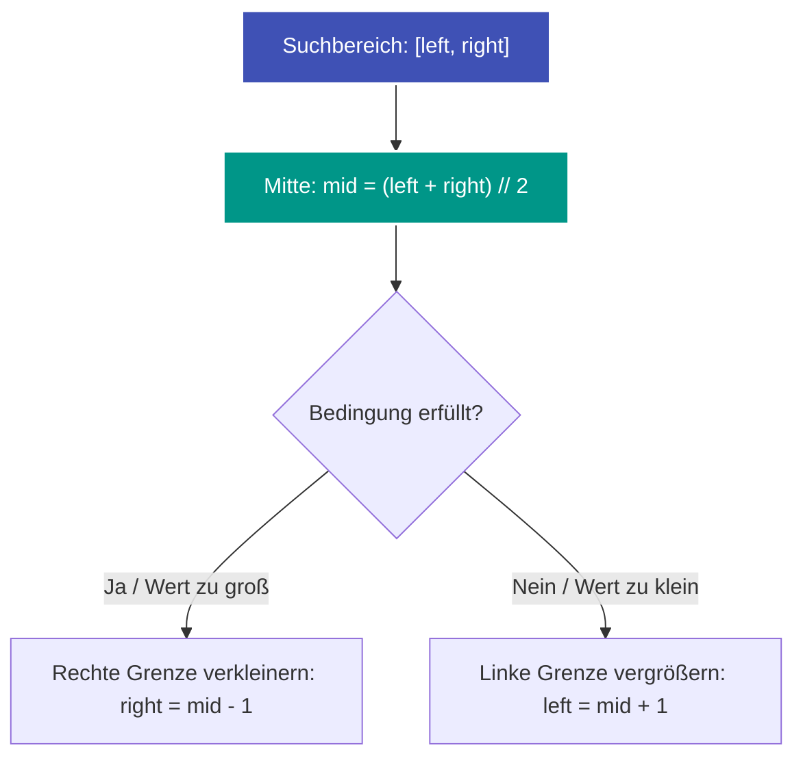

---
tags:
  - Algorithm
  - Binary Search
  - Array
  - Divide and Conquer
---


# Binäre Suche (Binary Search)

Die **binäre Suche** ist ein grundlegender Suchalgorithmus, der in einer sortierten Sequenz in logarithmischer Zeit $\mathcal{O}(\log n)$ ein bestimmtes Element findet oder einen optimalen Trennpunkt bestimmt.

---

## Kernprinzip

Durch den Vergleich des gesuchten Kriteriums mit dem mittleren Element eines Intervalls $[\text{left}, \text{right}]$ kann in jedem Schritt **die Hälfte des verbleibenden Suchraums** verworfen werden.



---

## Fortgeschrittene Anwendung: Binäre Suche auf zwei sortierten Arrays

Ein klassisches Härtebeispiel ist die Suche nach dem Median zweier sortierter Arrays in $\mathcal{O}(\log(\min(m, n)))$ (wie in [LeetCode 4](../solutions/leetcode-4.md)).

### Die Partitions-Idee
Statt die beiden Arrays aufwendig zusammenzuführen ($\mathcal{O}(m + n)$), wird die Gesamtmenge aller Elemente beider Arrays virtuell in zwei gleich große Hälften partitioniert:
- Eine linke Hälfte mit $\lfloor (m + n + 1) / 2 \rfloor$ Elementen.
- Eine rechte Hälfte mit den restlichen Elementen.

Wir führen die binäre Suche nur auf dem **kürzeren Array** durch ($i_1 \in [0, m]$). Der Schnitt im zweiten Array ergibt sich direkt deterministisch:
$$i_2 = \frac{m + n + 1}{2} - i_1$$

Die Schnittstelle ist perfekt balanciert, wenn:
$$\text{links}_1 \le \text{rechts}_2 \quad \text{und} \quad \text{links}_2 \le \text{rechts}_1$$

```text
Array 1: [ ... links1 | rechts1 ... ]
Array 2: [ ... links2 | rechts2 ... ]
```

Gilt $\text{links}_1 > \text{rechts}_2$, war der Schnitt in Array 1 zu weit rechts (`right = i1 - 1`). Andernfalls verschieben wir ihn nach rechts (`left = i1 + 1`).

---

## Komplexität

| Dimension | Standard-Suche | Partitionierung zweier Arrays |
| :--- | :--- | :--- |
| **[Zeitkomplexität](o-notation.md)** | $\mathcal{O}(\log n)$ | $\mathcal{O}(\log(\min(m, n)))$ |
| **[Speicherkomplexität](o-notation.md)** | $\mathcal{O}(1)$ | $\mathcal{O}(1)$ |

---

## Stolpersteine

1. **Ganzzahl-Überlauf bei der Mittenberechnung:** In Sprachen mit festen Ganzzahlgrenzen (C++, Java) kann `(left + right) // 2` überlaufen. Sicherer ist `left + (right - left) // 2`. In Python handhabt das Typsystem beliebig große Ganzzahlen automatisch.
2. **Endlosschleifen:** Bei `while left <= right` muss sichergestellt sein, dass in jedem Zweig `left` strikt steigt (`mid + 1`) oder `right` strikt fällt (`mid - 1`).
3. **Randelemente (Infinitäten):** Liegt der Schnitt ganz am linken oder rechten Rand ($i = 0$ oder $i = m$), werden $-\infty$ bzw. $+\infty$ als Wächterwerte eingesetzt, um IndexOutOfBounds-Fehler zu vermeiden.
