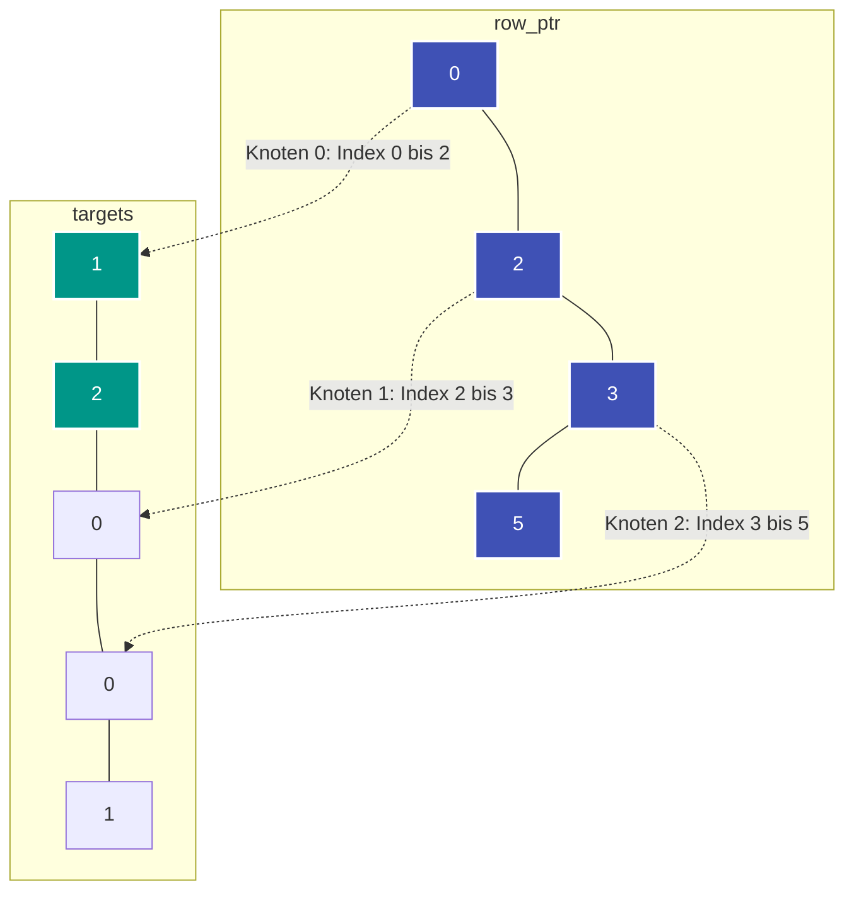

---
tags:
  - Data Structure
  - Graph
  - Matrix
  - Performance
  - Memory Optimization
---


# CSR-Format (Compressed Sparse Row)

Das **CSR-Format (Compressed Sparse Row)** ist eine hocheffiziente Repräsentation für dünn besetzte Matrizen und Graphen. Es ersetzt verschachtelte Listen oder Zeigerstrukturen durch **drei flache, zusammenhängende Arrays** im Speicher.

---

## Motivation: Warum verschachtelte Listen (`list[list]`) oft langsam sind

Eine klassische [Adjazenzliste](adjazenzliste.md) `adj = [[] for _ in range(n)]` erzeugt in Python:
- Ein Haupt-Array mit $n$ Zeigern auf Unter-Listen auf dem Heap.
- Jede Unterliste reserviert eigene Verwaltungsinformationen und wächst dynamisch mit zusätzlichem Speicher-Overhead.
- **Cache-Misses:** Die Nachbarknoten eines Knotens liegen an völlig zufälligen Adressen im RAM. Die CPU kann die Hardware-Cache-Lines nicht effizient nutzen.

Das CSR-Format löst dieses Problem: Alle Kanten werden in **einem einzigen zusammenhängenden Array** hintereinander abgelegt.

---

## Die drei CSR-Arrays

Gegeben sei ein Graph mit $V$ Knoten und $E$ Kanten. CSR speichert den Graphen in drei 1D-Arrays:

1. **`values` (Länge $E$):**  
   Die Gewichte oder Attribute der Kanten (bei ungewichteten Graphen optional).
2. **`column_indices` bzw. `head` (Länge $E$):**  
   Die Zielknoten $v$ der Kanten.
3. **`row_ptr` bzw. `offset` (Länge $V + 1$):**  
   Zeigt für jeden Knoten $u$ an, an welchem Index in `column_indices` seine Nachbarn beginnen und wo sie enden.
   - Die Nachbarn von Knoten $u$ liegen genau im Slice `column_indices[row_ptr[u] : row_ptr[u + 1]]`.
   - Der Ausgangsgrad (*Out-Degree*) von Knoten $u$ berechnet sich aus $\text{deg}(u) = \text{row\_ptr}[u+1] - \text{row\_ptr}[u]$.



---

## Aufbau eines CSR-Graphen in Python

Ein CSR lässt sich in $\mathcal{O}(V + E)$ aus einer Kantenliste erzeugen:

```python
from typing import List, Tuple


class CSRGraph:
    def __init__(self, n: int, edges: List[Tuple[int, int, int]]):
        """Erstellt einen Graph im CSR-Format.

        Args:
            n: Anzahl der Knoten
            edges: Liste von Kanten (u, v, weight)
        """
        self.n = n
        m = len(edges)

        # 1. Grad jedes Knotens zählen
        degree = [0] * n
        for u, _, _ in edges:
            degree[u] += 1

        # 2. Präfix-Summe für row_ptr berechnen
        self.row_ptr = [0] * (n + 1)
        for i in range(n):
            self.row_ptr[i + 1] = self.row_ptr[i] + degree[i]

        # 3. Kanten in flache Arrays einsortieren
        self.targets = [0] * m
        self.weights = [0] * m

        # Temporärer Schreib-Zeiger
        curr_pos = list(self.row_ptr)
        for u, v, w in edges:
            pos = curr_pos[u]
            self.targets[pos] = v
            self.weights[pos] = w
            curr_pos[u] += 1

    def neighbors(self, u: int):
        """Iteriert über alle Nachbarn von u mit optimaler Cache-Lokalität."""
        start = self.row_ptr[u]
        end = self.row_ptr[u + 1]
        for i in range(start, end):
            yield self.targets[i], self.weights[i]
```

---

## Vergleich: CSR vs. Adjazenzliste vs. Adjazenzmatrix

| Kriterium | CSR (Compressed Sparse Row) | [Adjazenzliste](adjazenzliste.md) (`list[list]`) | [Adjazenzmatrix](adjazenzmatrix.md) |
| :--- | :--- | :--- | :--- |
| **Speicherverbrauch** | $\mathcal{O}(V + E)$ (minimal, flache Arrays) | $\mathcal{O}(V + E)$ (hoch wegen Objekt-Overhead) | $\mathcal{O}(V^2)$ (verschwenderisch) |
| **Cache-Effizienz** | Hervorragend (zusammenhängender Speicher) | Mäßig bis schlecht (verstreuter Heap) | Sehr gut (2D-Block) |
| **Traversierung aller Nachbarn** | $\mathcal{O}(\text{deg}(u))$ | $\mathcal{O}(\text{deg}(u))$ | $\mathcal{O}(V)$ |
| **Dynamisches Einfügen neuer Kanten** | $\mathcal{O}(E)$ (erfordert Array-Reallokation) | $\mathcal{O}(1)$ (`append`) | $\mathcal{O}(1)$ |

---

## Typische Einsatzgebiete

1. **Statische Graphen mit hoher Knoten-/Kantenanzahl:** Wenn die Graphstruktur nach dem Einlesen unverändert bleibt und millionenfache Traversierungen stattfinden (z. B. Dijkstra, [PageRank](pagerank.md), [Graph Neural Networks](gnn.md)).
2. **SciPy & Scientific Computing:** `scipy.sparse.csr_matrix` ist der Standard für [Matrix-Vektor-Multiplikationen (SpMV)](scipy-matrix-vector.md).
3. **Competitive Programming mit engen Time/Memory Limits:** Vermeidung von [Garbage-Collection- und Pointer-Overhead](memory-management.md) in Sprachen wie Python, Java, C++ oder Rust.
