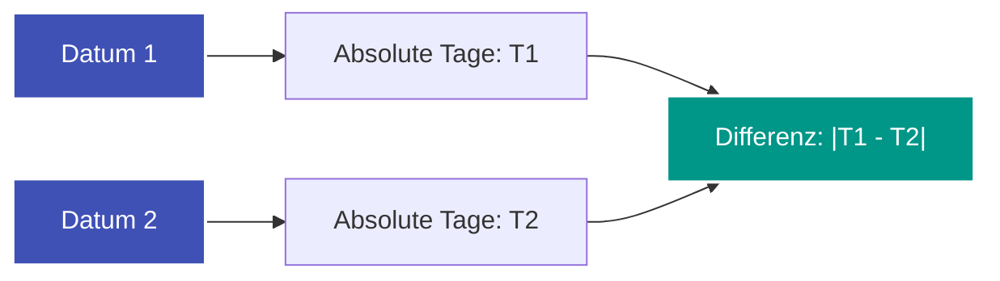

---
tags:
  - Math
  - Calendar
  - Interval
---


# Datums- & Kalender-Arithmetik

Die Berechnung von Tagen zwischen Daten oder die Ermittlung gemeinsamer Zeiträume ohne vorgefertigte Kalender-Bibliotheken ist ein klassisches Problem feldbezogener Arithmetik.

---

## 1. Schaltjahr-Regel (Gregorianischer Kalender)

Ein Jahr ist im gregorianischen Kalender ein Schaltjahr (366 statt 365 Tage), wenn:
- es durch $4$ teilbar ist, **außer**
- es ist durch $100$ teilbar, **es sei denn**,
- es ist auch durch $400$ teilbar.

```python
def is_leap_year(year: int) -> bool:
    return (year % 4 == 0 and year % 100 != 0) or (year % 400 == 0)
```

---

## 2. Umrechnung in absolute Tage (Epoch Days)

Statt Monatsübergänge mühsam schrittweise zu simulieren, wandelt man jedes Datum $\text{YYYY-MM-DD}$ in eine absolute Anzahl von Tagen bezüglich eines festen Referenzpunkts (z. B. 01.01.1971) um:

$$\text{Tage}(\text{Datum}) = \sum_{y=\text{Epoch}}^{\text{year}-1} \text{Tage}(y) + \sum_{m=1}^{\text{month}-1} \text{Tage}(m) + \text{day}$$

Die Differenz zweier Daten ist dann einfach:
$$\Delta = |\text{Tage}(\text{date}_1) - \text{Tage}(\text{date}_2)|$$



---

## 3. Schnittmenge zweier Intervalle (Overlap)

Gegeben seien zwei geschlossene Zeitintervalle $[s_1, e_1]$ und $[s_2, e_2]$ (z. B. Aufenthaltsdauer zweier Personen im selben Jahr wie in [LeetCode 2409](../solutions/leetcode-2409.md)):

- **Gemeinsamer Start:** $\text{start} = \max(s_1, s_2)$
- **Gemeinsames Ende:** $\text{end} = \min(e_1, e_2)$
- **Anzahl der überlappenden Tage:**
  $$\text{Tage} = \max(0, \text{end} - \text{start} + 1)$$

Ist $\text{end} < \text{start}$, überschneiden sich die Intervalle nicht (Ergebnis $0$).

---

## Komplexität

- **[Zeitkomplexität](o-notation.md):** $\mathcal{O}(1)$ (feste Anzahl von Monaten/Jahren).
- **[Speicherkomplexität](o-notation.md):** $\mathcal{O}(1)$.
