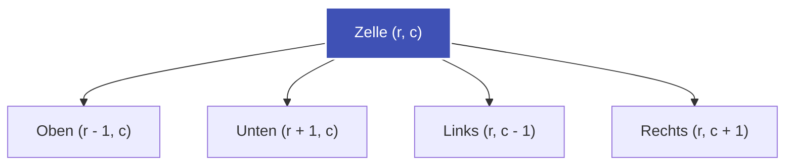

---
tags:
  - Algorithm
  - Graph
  - Matrix
  - DFS
  - BFS
---


# Flood Fill & Gitter-Traversierung (Grid Traversal)

Ein 2D-Gitter (*Matrix*) der Größe $m \times n$ kann als ungerichteter Graph interpretiert werden, bei dem jede Zelle $(r, c)$ ein Knoten ist und Kanten zu ihren 4 orthogonalen Nachbarn $((r+1, c), (r-1, c), (r, c+1), (r, c-1))$ verlaufen.

---

## Intuition: Fluten (Flood Fill)

Der **Flood-Fill-Algorithmus** ermittelt alle zusammenhängenden Zellen eines bestimmten Typs (z. B. Land = 0 oder 1) ausgehend von einem Startpunkt. Er arbeitet analog zum Farbeimer-Werkzeug in Bildbearbeitungsprogrammen.



---

## Kernmuster & Optimierungen

### 1. In-Place-Markierung (Visited-Array einsparen)
Statt ein zweites `visited`-Array der Größe $m \times n$ zu verwalten, kann das Ursprungsgitter direkt modifiziert werden (z. B. $0 \to 1$). Dies senkt den zusätzlichen Speicherbedarf von $\mathcal{O}(m \cdot n)$ auf $\mathcal{O}(1)$ (abgesehen vom Rekursions- bzw. Stack-Speicher).

### 2. Eliminierung von Randkomponenten (Boundary Invalidation)
Sollen Inseln gezählt werden, die vollständig von Wasser umschlossen sind (wie in [LeetCode 1254](../solutions/leetcode-1254.md)), ist die eleganteste Methode ein **Zwei-Phasen-Ansatz**:
1. **Phase 1 (Rand fluten):** Alle Randzellen ($r \in \{0, m-1\}$ oder $c \in \{0, n-1\}$) traversieren und alle damit verbundenen Inseln "fluten" (in Wasser umwandeln). Dadurch sind alle ungültigen Inseln neutralisiert.
2. **Phase 2 (Innere Inseln zählen):** Alle verbleibenden Landzellen im Inneren sind garantiert geschlossen. Jede weitere DFS zählt genau eine gültige Insel.

### 3. Iterative DFS mit Stack (Schutz vor RecursionError)
In Python liegt das Standard-Rekursionslimit bei $1000$. Bei großen Gittern ($m \times n > 1000$) kann eine rekursive DFS zum Programmabsturz führen. Eine iterative DFS mit expliziter Liste als Stack löst das Problem:

```python
def flood_fill(start_r: int, start_c: int, grid: list[list[int]]) -> None:
    stack = [(start_r, start_c)]
    grid[start_r][start_c] = 1

    while stack:
        r, c = stack.pop()
        for dr, dc in ((1, 0), (-1, 0), (0, 1), (0, -1)):
            nr, nc = r + dr, c + dc
            if 0 <= nr < len(grid) and 0 <= nc < len(grid[0]) and grid[nr][nc] == 0:
                grid[nr][nc] = 1
                stack.append((nr, nc))
```

---

## Komplexität

| Dimension | Komplexität |
| :--- | :--- |
| **[Zeitkomplexität](o-notation.md)** | $\mathcal{O}(m \cdot n)$ – Jede Zelle des Gitters wird höchstens eine konstante Anzahl von Malen besucht. |
| **[Speicherkomplexität](o-notation.md)** | $\mathcal{O}(m \cdot n)$ im Worst-Case für den Rekursions- bzw. Stack-Speicher (wenn das gesamte Gitter aus einer einzigen Komponente besteht). |
