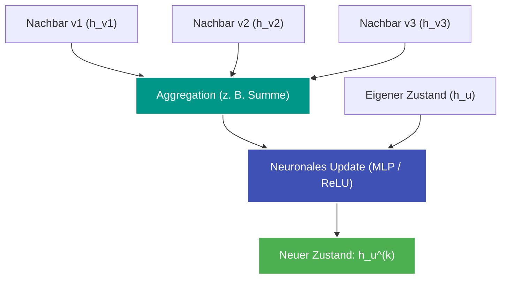

---
tags:
  - Machine Learning
  - Deep Learning
  - Graph
  - Neural Network
  - GNN
---

# Graph Neural Networks (GNN)

**Graph Neural Networks (GNNs)** sind Deep-Learning-Architekturen, die neuronale Netze direkt auf relationalen Graphstrukturen operieren lassen. Sie übertragen das Prinzip von Faltungen (Convolutions) aus der Bildverarbeitung auf unregelmäßige Graphen.

---

## Kernprinzip: Message Passing (Nachrichtenübertragung)

Ein GNN lernt für jeden Knoten $u$ einen hochdimensionalen Repräsentationsvektor (Feature Embedding) $\mathbf{h}_u \in \mathbb{R}^d$.

In jeder GNN-Schicht $k$ passiert Folgendes:
1. **Message Generation:** Jeder Nachbar $v \in \mathcal{N}(u)$ generiert eine Nachricht basierend auf seinem Vektor $\mathbf{h}_v^{(k-1)}$.
2. **Aggregation:** Knoten $u$ aggregiert die Nachrichten aller Nachbarn mit einer permutationsinvarianten Funktion (z. B. Summe, Mittelwert, Maximum).
3. **Update:** Der Knoten kombiniert seinen eigenen bisherigen Zustand mit der aggregierten Nachbarschaftsnachricht durch eine nichtlineare Transformation.

Die mathematische Formulierung einer Graph Convolutional Layer (GCN):

$$\mathbf{h}_u^{(k)} = \sigma \left( \mathbf{W}^{(k)} \sum_{v \in \mathcal{N}(u) \cup \{u\}} \frac{1}{\sqrt{\tilde{d}_u \tilde{d}_v}} \mathbf{h}_v^{(k-1)} \right)$$

---

## Rolle des CSR-Formats in modernen GNN-Frameworks

Frameworks wie PyTorch Geometric (PyG) und DGL müssen Graphoperationen über Millionen von Knoten und Milliarden von Kanten auf Grafikprozessoren (GPUs) ausführen.

- Verschachtelte Python-Listen sind auf GPUs unbrauchbar, da CUDA zwingend flache Speicherblöcke erfordert.
- Die Nachbarschafts-Aggregation entspricht exakt einer dünnbesetzten Matrixmultiplikation (SpMM: Sparse Matrix-Matrix Multiplication):
  $$\mathbf{H}^{(k)} = \sigma(\mathbf{\tilde{A}} \, \mathbf{H}^{(k-1)} \, \mathbf{W}^{(k)})$$
- Hierfür ist das [CSR-Format](csr-format.md) (oder das analoge CSC-Format) die Grundlage, um Threads auf der GPU optimal mit parallelen Kantenblöcken auszulasten.

---

## Typische Aufgaben & Einsatzbereiche

1. **Node Classification:** Vorhersage von Eigenschaften einzelner Knoten (z. B. Betrugserkennung im Finanzgraphen, Kategorisierung von Wikipedia-Artikeln).
2. **Link Prediction:** Vorhersage neuer oder fehlender Kanten (z. B. Freundes- oder Produktempfehlungen, Wirkstoff-Interaktionen in der Biochemie).
3. **Graph Classification:** Klassifikation des gesamten Graphen als Einheit (z. B. Vorhersage von Moleküleigenschaften oder Toxizität in der Pharmazie).
