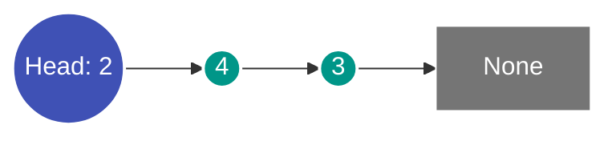

---
tags:
  - Data Structure
  - Linked List
  - Two Pointers
---


# Verkettete Liste (Linked List)

Eine **verkettete Liste** ist eine lineare Datenstruktur, bei der die Elemente (*Knoten*) nicht in zusammenhängenden Speicherzellen abgelegt sind, sondern über Referenzen (*Zeiger*) aufeinander verweisen.

---

## Aufbau

Jeder Knoten besteht aus zwei Komponenten:
1. **Wert / Datenfeld (`val`):** Der eigentliche Inhalt.
2. **Nachfolger-Zeiger (`next`):** Referenz auf den nachfolgenden Knoten (oder `None` am Listenende).



In Python:
```python
class ListNode:
    def __init__(self, val=0, next=None):
        self.val = val
        self.next = next
```

---

## Kerntechniken & Entwurfsmuster

### 1. Der Dummy-Knoten (Sentinel Node)
Ein Dummy-Knoten vereinfacht die Listenerstellung und vermeidet Sonderfallbehandlungen für den allerersten Knoten. Am Ende liefert `dummy.next` den Beginn der eigentlichen Ergebnisliste.

```python
dummy_head = ListNode(0)
current = dummy_head

# Knoten anfügen:
current.next = ListNode(new_val)
current = current.next

return dummy_head.next
```

### 2. Parallele Traversierung mit Übertrag (Carry)
Beim Ziffern-Addieren zweier Zahlen, die als verkettete Listen vorliegen (wie in [LeetCode 2](../solutions/leetcode-2.md)), läuft eine Schleife, solange mindestens eine Liste noch Knoten besitzt oder noch ein Übertrag $c \neq 0$ vorliegt:

$$\text{total} = \text{val}_1 + \text{val}_2 + \text{carry}$$
$$\text{carry} = \lfloor \text{total} / 10 \rfloor, \quad \text{digit} = \text{total} \pmod{10}$$

### 3. Fast & Slow Pointer (Floyd's Cycle-Finding)
Zwei Zeiger bewegen sich mit unterschiedlicher Geschwindigkeit (Slow = 1 Schritt, Fast = 2 Schritte). Damit lässt sich die Mitte einer Liste in einem Durchlauf finden oder ein Zyklus detektieren.

---

## Vergleich: Verkettete Liste vs. Array

| Kriterium | Verkettete Liste | Dynamisches Array (Python `list`) |
| :--- | :--- | :--- |
| **Index-Zugriff ($i$-tes Element)** | $\mathcal{O}(n)$ | $\mathcal{O}(1)$ |
| **Einfügen/Löschen am Kopf** | $\mathcal{O}(1)$ | $\mathcal{O}(n)$ |
| **Einfügen/Löschen mit Zeiger** | $\mathcal{O}(1)$ | $\mathcal{O}(n)$ |
| **Speicher-Lokalität (Cache)** | Schlecht (verstreute Heap-Objekte) | Exzellent (zusammenhängender Block) |
| **Zusätzlicher Speicher** | Zeiger pro Element | Reservierte Reservekapazität |

---

## Stolpersteine

1. **Verlorene Referenzen:** Wird `node.next` überschrieben, bevor eine Zwischenreferenz gespeichert wurde, geht die nachfolgende Kette unwiederbringlich verloren.
2. **Endlosschleifen:** Wenn ein Knoten auf einen früheren Knoten verweist, entsteht ein Zyklus.
3. **Leere Listen und NoneType-Fehler:** Vor dem Zugriff auf `node.val` oder `node.next` muss immer sichergestellt sein, dass `node is not None` gilt.
