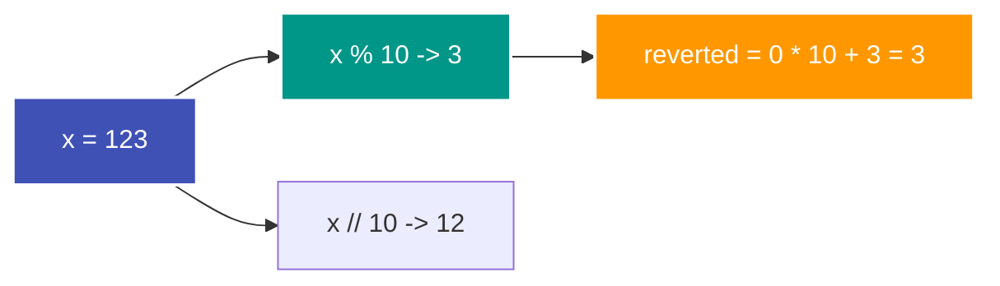

---
tags:
  - Math
  - Palindrome
  - Number Theory
---


# Mathematische Zahlenumkehr (Integer Reversal)

Die Zerlegung und Umkehrung von Zahlen auf rein mathematischem Weg ist eine Kerntechnik, um Probleme ohne rechen- und speicherintensive String-Konvertierungen zu lösen.

---

## Intuition & Kernidee

Jede positive Ganzzahl im Dezimalsystem lässt sich durch fortlaufende Division mit Rest ($/ 10$ und $\% 10$) von rechts nach links Ziffer für Ziffer abbauen:

- Die **letzte Ziffer** erhält man über $x \pmod{10}$.
- Das **Abschneiden der letzten Ziffer** erfolgt über $x \mathbin{/\!\!/} 10$.
- Das **Anhängen einer Ziffer** an eine neue Zahl geschieht über $\text{reverted} \cdot 10 + \text{digit}$.



---

## Palindrom-Prüfung ohne String-Konvertierung

Um zu testen, ob eine Zahl ein Palindrom ist (wie in [LeetCode 9](../solutions/leetcode-9.md)), muss man nicht einmal die gesamte Zahl umkehren. Es reicht aus, die **hintere Hälfte der Zahl** zu spiegeln, bis die gespiegelte Zahl mindestens so groß ist wie der verbleibende vordere Teil.

### Algorithmus
1. Negative Zahlen können niemals Palindrome sein (das Minuszeichen steht nur links).
2. Zahlen, die auf $0$ enden (außer der Zahl $0$ selbst), sind keine Palindrome.
3. Wir spiegeln, solange $x > \text{reverted\_number}$ gilt.
4. Bei gerader Ziffernanzahl gilt am Ende $x == \text{reverted\_number}$.
5. Bei ungerader Ziffernanzahl ignorieren wir die mittlere Ziffer via $\text{reverted\_number} \mathbin{/\!\!/} 10$.

```python
def is_palindrome(x: int) -> bool:
    if x < 0 or (x % 10 == 0 and x != 0):
        return False

    reverted = 0
    while x > reverted:
        reverted = reverted * 10 + x % 10
        x //= 10

    return x == reverted or x == reverted // 10
```

---

## Komplexität

| Dimension | Komplexität |
| :--- | :--- |
| **[Zeitkomplexität](o-notation.md)** | $\mathcal{O}(\log_{10} n)$ – Eine Zahl $n$ besitzt $\lfloor \log_{10} n \rfloor + 1$ Ziffern. Das Spiegeln der halben Zahl benötigt entsprechend nur $\frac{1}{2} \log_{10} n$ Schritte. |
| **[Speicherkomplexität](o-notation.md)** | $\mathcal{O}(1)$ – Es werden lediglich wenige Ganzzahl-Variablen alloziert. |
