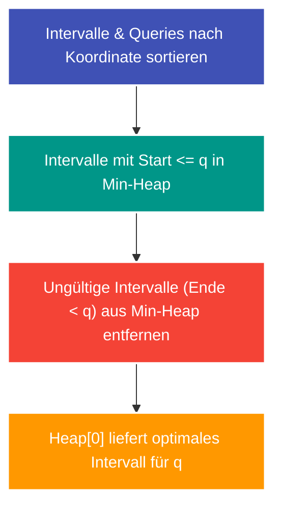

---
tags:
  - Data Structure
  - Heap
  - Priority Queue
  - Sweep Line
  - Interval
---


# Min-Heap & Sweep-Line für Intervalle

Die Kombination aus **Sweep-Line-Algorithmen** (Ereignispunkt-Verarbeitung) und **Min-Heaps** (Vorrangswarteschlangen) ist ein Standardmuster zur Beantwortung von Bereichsabfragen über dynamischen Intervallen.

---

## Intuition & Kernidee

Gegeben seien Mengen von Intervallen $[l_i, r_i]$ und Abfragen $q_j$. Eine naive Suche prüft für jede Abfrage alle Intervalle in $\mathcal{O}(|Q| \cdot |I|)$.

### Der Sweep-Line & Heap Ansatz
1. Sortiere die Intervalle aufsteigend nach ihrem linken Rand $l_i$.
2. Sortiere die Abfragen $q_j$ aufsteigend nach ihrer Koordinate (unter Beibehaltung ihres Original-Index).
3. Wandere mit der Abfragekoordinate $q$ von links nach rechts:
   - **Hinzufügen:** Alle Intervalle mit Startpunkt $l_i \le q$ werden in einen Min-Heap eingefügt.
   - **Bereinigen (Lazy Invalidation):** Alle Intervalle an der Spitze des Heaps, deren Endpunkt $r_i < q$ ist, sind für $q$ und alle künftigen Abfragen abgelaufen und werden verworfen (`heappop`).
   - **Abfrage beantworten:** Das oberste verbleibende Element im Min-Heap erfüllt automatisch die Bedingung und liefert das gewünschte Minimum (z. B. minimale Intervalllänge in [LeetCode 1851](../solutions/leetcode-1851.md)).



---

## Python-Implementierung mit `heapq`

Python stellt über das Modul `heapq` standardmäßig einen Min-Heap bereit:

```python
import heapq

# Tupel werden lexikografisch sortiert: (Länge, Endpunkt)
min_heap = []
heapq.heappush(min_heap, (right - left + 1, right))

# Ungültige Intervalle verwerfen
while min_heap and min_heap[0][1] < q:
    heapq.heappop(min_heap)

# Kleinstes gültiges Intervall abgreifen
if min_heap:
    result = min_heap[0][0]
```

---

## Komplexität

| Operation | Komplexität | Begründung |
| :--- | :--- | :--- |
| **Sortieren** | $\mathcal{O}(n \log n + k \log k)$ | Sortieren von $n$ Intervallen und $k$ Abfragen. |
| **Heap-Operationen** | $\mathcal{O}(n \log n)$ | Jedes Intervall wird maximal einmal hinzugefügt und einmal entfernt. |
| **Gesamtlaufzeit** | $\mathcal{O}((n + k) \log(n + k))$ | Deutlich überlegen gegenüber naivem $\mathcal{O}(n \cdot k)$. |
| **Speicherplatz** | $\mathcal{O}(n + k)$ | Heap und Ergebnis-Array. |
