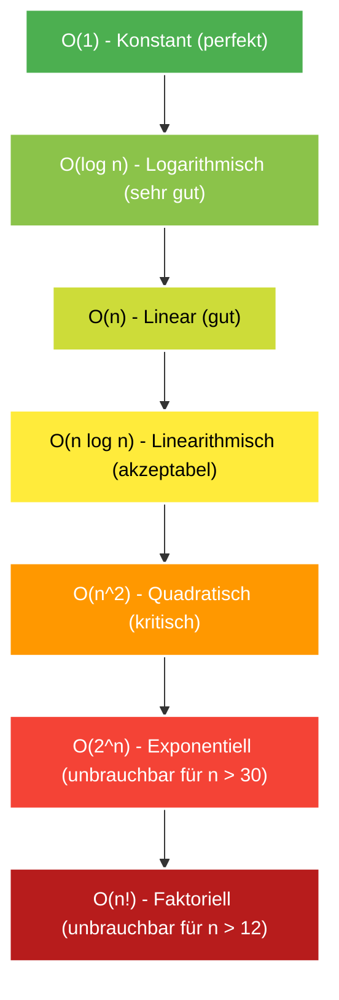

---
tags:
  - Math
  - Complexity
  - Theory
  - Big-O
---

# Landau-Symbole (Big-O Notation) & Komplexitätsanalyse

Die **Landau-Notation (Big-O)** beschreibt das asymptotische Wachstumsverhalten von Algorithmen bezüglich **Laufzeit** $\mathcal{O}(T)$ und **Speicherbedarf** $\mathcal{O}(S)$ bei wachsender Eingabegröße $n$.

---

## Übersicht der Komplexitätsklassen

---

## Die wichtigsten Klassen im Detail

### 1. $\mathcal{O}(1)$ – Konstanter Aufwand
Unabhängig von der Eingabegröße benötigt die Operation immer denselben konstanten Aufwand.
- **Beispiele:** Array-Indexzugriff (`arr[i]`), [Hash-Map](hash-map.md)-Lookup im Durchschnitt (`dict[key]`), `heapq.heappop`-Spitze ansehen (`heap[0]`), Bitweise Operationen (`x & (x - 1)`).

### 2. $\mathcal{O}(\log n)$ – Logarithmischer Aufwand
In jedem Schritt wird der Suchraum um einen konstanten Faktor (meist halbiert) verkleinert.
- **Beispiele:** [Binäre Suche](binary-search.md), [LCA mit Binary Lifting](advanced-tree-techniques.md), Einfügen/Löschen in einem [Min-Heap](min-heap-sweep-line.md), Abfragen in einem [Fenwick-Baum](advanced-tree-techniques.md).

### 3. $\mathcal{O}(n)$ – Linearer Aufwand
Jedes Element der Eingabe wird eine konstante Anzahl von Malen betrachtet.
- **Beispiele:** Lineare Suche, [Schiebefenster (Sliding Window)](sliding-window.md), [Two Sum mit Hash Map](hash-map.md), [Zyklische Permutationsprüfung](cyclic-permutations.md).

### 4. $\mathcal{O}(V + E)$ – Linear auf Graphen
Jeder Knoten $V$ und jede Kante $E$ wird höchstens eine feste Anzahl von Malen traversiert.
- **Beispiele:** [Tiefensuche (DFS) und Breitensuche (BFS)](traversierung-bfs-dfs.md), [Topologische Sortierung](topologische-sortierung.md), [Flood Fill](flood-fill.md).

### 5. $\mathcal{O}(n \log n)$ – Linearithmischer Aufwand
Typisch für vergleichsbasierte Sortierverfahren oder Algorithmen, die für $n$ Elemente jeweils eine $\mathcal{O}(\log n)$-Datenstruktur befragen.
- **Beispiele:** MergeSort, TimSort (Pythons `sort()`), [Sweep-Line](min-heap-sweep-line.md) mit Min-Heap ([LeetCode 1851](../solutions/leetcode-1851.md)).

### 6. $\mathcal{O}((V + E) \log V)$ – Kürzeste Pfade
Dijkstra mit Min-Heap / Priority Queue. Im [zustandsbasierten Dijkstra](state-space-dijkstra.md) skaliert dies zu $\mathcal{O}((E \cdot S) \log(V \cdot S))$.

### 7. $\mathcal{O}(n^2)$ – Quadratischer Aufwand
In der Regel verschachtelte Schleifen über die gesamte Eingabe.
- **Beispiele:** Naive Brute-Force-Paarsuchen, Bubble Sort, [Adjazenzmatrix-Initialisierung](adjazenzmatrix.md). Bei $n > 10^4$ führt dies im Coding-Interview fast immer zu *Time Limit Exceeded (TLE)*.

### 8. $\mathcal{O}(2^n)$ und $\mathcal{O}(n!)$ – Exponentiell / Faktoriell
- **Beispiele:** Erzeugen aller Teilmengen ($2^n$), Erzeugen aller Permutationen ($n!$), Traveling Salesperson Problem (Brute Force).

---

## Faustregel für Wettbewerbe & Interviews

In der Regel hat ein System ein Limit von ca. $10^7$ bis $10^8$ Operationen pro Sekunde:

| Eingabegröße $n$ | Maximal akzeptable Komplexität | Typische Lösungsansätze |
| :--- | :--- | :--- |
| $n \le 12$ | $\mathcal{O}(n!)$ oder $\mathcal{O}(2^n \cdot n^2)$ | Permutationen, TSP, Backtracking |
| $n \le 20$ | $\mathcal{O}(2^n)$ oder $\mathcal{O}(2^n \cdot n)$ | Bitmask-DP, Backtracking |
| $n \le 10^3$ | $\mathcal{O}(n^2)$ | 2D Dynamic Programming, Matrix-Traversierung |
| $n \le 10^5$ | $\mathcal{O}(n \log n)$ oder $\mathcal{O}(n)$ | Sortieren, Heap, Sweep-Line, [Binary Search](binary-search.md), Two Pointers |
| $n \le 10^7$ | $\mathcal{O}(n)$ oder $\mathcal{O}(\log n)$ | [Sliding Window](sliding-window.md), Prefix-Summen, [Hash Maps](hash-map.md) |
| $n \ge 10^9$ | $\mathcal{O}(\log n)$ oder $\mathcal{O}(1)$ | Reine Mathematik, Modulo-Arithmetik, Matrix-Exponentiation |
