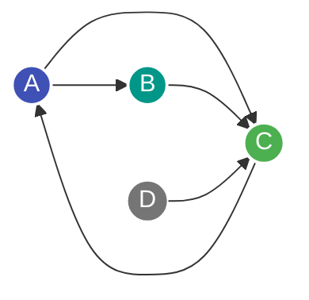

---
tags:
  - Algorithm
  - Graph
  - PageRank
  - Random Walk
  - Linear Algebra
---

# PageRank-Algorithmus

Der **PageRank-Algorithmus** ist ein Verfahren zur objektiven Bewertung der relativen Wichtigkeit (*Zentralität*) von verlinkten Dokumenten oder Knoten in einem gerichteten Graphen. Er wurde ursprünglich von Larry Page und Sergey Brin zur Sortierung von Google-Suchergebnissen entwickelt.

---

## Kernidee: Der Random Surfer

Ein Benutzer surft zufällig im Web:
1. Er folgt mit Wahrscheinlichkeit $d$ (dem **Dämpfungsfaktor**, meist $d \approx 0.85$) einem zufälligen Link der aktuellen Seite.
2. Mit Restwahrscheinlichkeit $1 - d$ springt er ("Teleportation") spontan zu einer völlig zufälligen Seite im gesamten Web.

Der PageRank einer Seite $u$ entspricht der stationären Aufenthaltswahrscheinlichkeit des Surfers auf dieser Seite im Grenzfall nach unendlich vielen Schritten.



*Intuition:* Seite C hat einen hohen PageRank, weil sie sowohl direkt verlinkt wird als auch Links von Seiten erhält, die ihrerseits wichtig sind.

---

## Mathematische Formulierung

Für einen Knoten $u$ berechnet sich der PageRank $PR(u)$ rekursiv über alle eingehenden Nachbarn $v \in \text{In}(u)$:

$$PR(u) = \frac{1 - d}{N} + d \sum_{v \in \text{In}(u)} \frac{PR(v)}{\text{deg}_{\text{out}}(v)}$$

Wobei:
- $N$: Gesamtzahl der Knoten im Graphen
- $d$: Dämpfungsfaktor (typischerweise $0.85$)
- $\text{deg}_{\text{out}}(v)$: Ausgangsgrad von Seite $v$

In Matrixform entspricht dies einem Eigenwertproblem:
$$\mathbf{p} = \left( \frac{1 - d}{N} \mathbf{E} + d \, \mathbf{M} \right) \mathbf{p}$$
wobei $\mathbf{p}$ der stationäre Wahrscheinlichkeitsvektor (Perron-Frobenius-Eigenvektor zum Eigenwert $\lambda = 1$) ist.

---

## Effiziente Berechnung mit CSR-Format & Power Iteration

Da das Web-Graph-Netzwerk extrem dünn besetzt ist ($E \ll V^2$), speichert man die Übergangsmatrix $\mathbf{M}$ im [CSR-Format](csr-format.md). Die Berechnung erfolgt über die **Power Iteration (Potenzmethode)** durch wiederholte [Matrix-Vektor-Multiplikation](scipy-matrix-vector.md):

```python
def pagerank_csr(
    row_ptr: list[int],
    targets: list[int],
    out_degree: list[int],
    n: int,
    iterations: int = 50,
    d: float = 0.85,
) -> list[float]:
    """Berechnet PageRank mittels Power Iteration auf einem CSR-Graphen.

    Args:
        row_ptr: Offset-Array des transponierten Graphen (eingehende Kanten)
        targets: Quellknoten der Kanten
        out_degree: Ausgangsgrade aller Knoten
        n: Anzahl Knoten
        iterations: Anzahl Iterationsschritte
        d: Dämpfungsfaktor

    Returns:
        PageRank-Werte für alle Knoten
    """
    pr = [1.0 / n] * n
    teleport = (1.0 - d) / n

    for _ in range(iterations):
        new_pr = [teleport] * n
        for u in range(n):
            # Summiere Beiträge aller eingehenden Nachbarn v
            incoming_sum = 0.0
            start = row_ptr[u]
            end = row_ptr[u + 1]
            for idx in range(start, end):
                v = targets[idx]
                incoming_sum += pr[v] / out_degree[v]
            new_pr[u] += d * incoming_sum
        pr = new_pr

    return pr
```

---

## Komplexität

| Dimension | Komplexität |
| :--- | :--- |
| **Zeitkomplexität pro Iteration** | $\mathcal{O}(V + E)$ unter Verwendung des [CSR-Formats](csr-format.md). Konvergiert meist in $30 \dots 50$ Schritten. |
| **Speicherkomplexität** | $\mathcal{O}(V + E)$ für die flachen Kantenarrays und zwei Wahrscheinlichkeitsvektoren. |
