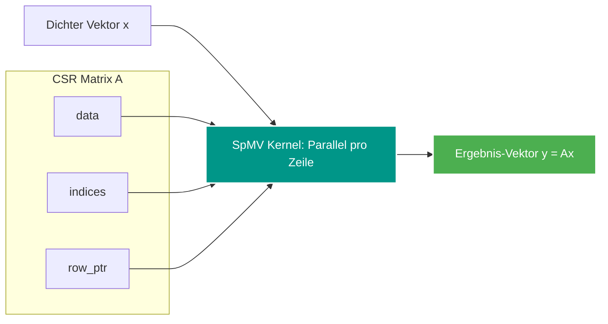

---
tags:
  - Scientific Computing
  - Python
  - Linear Algebra
  - Matrix
  - Performance
---

# SciPy & Dünnbesetzte Matrix-Vektor-Multiplikationen (SpMV)

In der numerischen Mathematik und Datenanalyse sind viele reale Matrizen **dünn besetzt (sparse)**: Über 99 % der Einträge sind Nullen. Das Python-Paket **SciPy** bietet über `scipy.sparse` spezialisierte Datenstrukturen, um solche Matrizen verlustfrei und mit minimalem Speicheraufwand zu verarbeiten.

---

## Das SciPy-Sparse-Ökosystem

SciPy unterstützt mehrere Repräsentationsformate für unterschiedliche Einsatzzwecke:

| Format | Klasse | Besonderheit & Stärke |
| :--- | :--- | :--- |
| **CSR** | `csr_matrix` | Zeilenweise komprimiert. **Optimal für Vektormultiplikationen ($\mathbf{A} \mathbf{x}$) und Slicing.** |
| **CSC** | `csc_matrix` | Spaltenweise komprimiert. Optimal für Spaltenoperationen ($\mathbf{A}^T \mathbf{x}$). |
| **COO** | `coo_matrix` | Koordinatenformat `(row, col, data)`. Optimal zum initialen Aufbau von Matrizen. |
| **LIL** | `lil_matrix` | List of Lists. Flexibel für inkrementelles Hinzufügen von Werten. |

---

## Dünnbesetzte Matrix-Vektor-Multiplikation (SpMV)

Das Produkt einer $m \times n$ Matrix $\mathbf{A}$ mit einem Vektor $\mathbf{x} \in \mathbb{R}^n$:
$$\mathbf{y} = \mathbf{A} \mathbf{x}$$

- **Dichte Matrix:** Jedes der $m \times n$ Elemente wird multipliziert $\to \mathcal{O}(m \cdot n)$ Operationen.
- **Sparse Matrix (CSR):** Nur die $E$ von Null verschiedenen Einträge (*Non-Zeros*, nnz) werden berechnet:
  $$y_i = \sum_{k \in \text{NonZeros}(i)} A_{i, k} \cdot x_k \implies \mathcal{O}(E) \text{ Operationen}$$



---

## Codebeispiel mit SciPy

```python
import numpy as np
from scipy.sparse import csr_matrix

# Erstellung einer dünn besetzten 4x4-Matrix aus Rohdaten
# (Zeilenindizes, Spaltenindizes, Werte)
row_indices = np.array([0, 0, 1, 2, 3])
col_indices = np.array([1, 2, 2, 0, 1])
data = np.array([10.0, 20.0, 30.0, 40.0, 50.0])

# CSR-Matrix instanziieren
A = csr_matrix((data, (row_indices, col_indices)), shape=(4, 4))

# Dichter Vektor x
x = np.array([1.0, 2.0, 3.0, 4.0])

# Hocheffiziente Matrix-Vektor-Multiplikation in O(E)
y = A.dot(x)

# y = [10*2 + 20*3, 30*3, 40*1, 50*2] = [80.0, 90.0, 40.0, 100.0]
print("Ergebnis-Vektor y:", y)
```

---

## Warum SpMV im CSR-Format so performant ist

1. **Keine Multiplikation mit Null:** Es wird niemals Rechenzeit für $0 \cdot x_k = 0$ verschwendet.
2. **Streaming im CPU-Cache:** Die Werte von `data` und `indices` werden sequenziell aus dem RAM in die CPU geladen (Hardware-Prefetching funktioniert optimal).
3. **Parallelisierung (OpenMP & SIMD):** Da jede Zeile $y_i$ unabhängig berechnet wird, kann eine Schleife über `row_ptr` problemlos auf mehrere CPU-Kerne verteilt werden.
