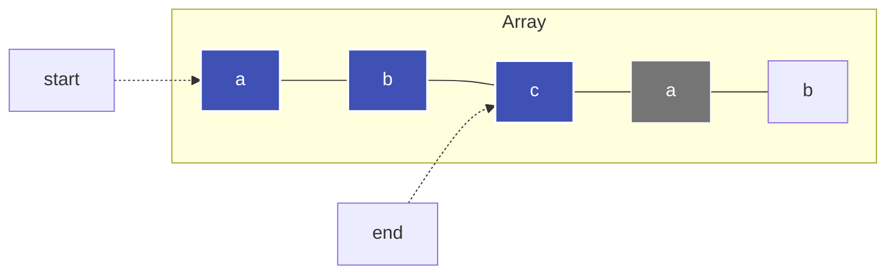

---
tags:
  - Algorithm
  - Sliding Window
  - Two Pointers
  - Array
  - String
---


# Schiebefenster (Sliding Window)

Das **Schiebefenster-Muster (Sliding Window)** ist eine hocheffiziente Technik zur Analyse zusammenhängender Teilfolgen (Subarrays oder Substrings) in Sequenzen.

---

## Intuition & Kernidee

Viele Aufgaben verlangen, über alle möglichen Teilstrings oder Subarrays eine Eigenschaft zu maximieren oder zu minimieren. Ein naiver Brute-Force-Ansatz prüft alle $\mathcal{O}(n^2)$ Fenster und benötigt dafür oft $\mathcal{O}(n^3)$ oder $\mathcal{O}(n^2)$ Zeit.

Statt jedes Fenster von Grund auf neu zu analysieren, nutzen wir zwei Zeiger:
- **`end` (rechter Zeiger):** Erweitert das Fenster nach rechts und nimmt neue Elemente auf.
- **`start` (linker Zeiger):** Verkleinert das Fenster von links, sobald eine Invariante verletzt wird (z. B. Duplikate oder Überschreiten einer Summe).



Da sich sowohl der linke als auch der rechte Zeiger jeweils nur vorwärts (nach rechts) bewegen, wird jedes Element maximal zweimal angefasst: Die Gesamtlaufzeit beträgt **$\mathcal{O}(n)$**.

---

## Zwei Varianten

### 1. Fenster mit dynamischer Größe (z. B. längster Substring ohne Duplikate)
Das Fenster wird so weit wie möglich nach rechts ausgedehnt. Taucht eine Kollision auf, zieht der Startzeiger nach.

```python
seen = {}
start = 0
best = 0

for end, char in enumerate(s):
    if char in seen:
        # Start niemals nach links zurücksetzen
        start = max(start, seen[char] + 1)
    seen[char] = end
    best = max(best, end - start + 1)
```

### 2. Fenster mit fixer Größe $k$
Ein Fenster fester Breite $k$ wandert über das Array. Beim Vorrücken wird das neue Element am rechten Rand addiert und das aus dem Fenster herausfallende Element am linken Rand subtrahiert:

$$\text{Summe}_{\text{neu}} = \text{Summe}_{\text{alt}} + \text{arr}[\text{end}] - \text{arr}[\text{end} - k]$$

---

## Optimierungen für Coding-Wettbewerbe

1. **Array statt [Hash Map](hash-map.md) bei ASCII-Strings:**  
   Bei bekanntem Zeichensatz (z. B. ASCII 128) ist `last = [-1] * 128` mit Index-Zugriff `ord(char)` um ein Vielfaches schneller als ein dynamisches `dict`.
2. **Early Pruning (Vorzeitiger Abbruch):**  
   Wenn die verbleibende Restlänge $n - \text{start}$ kleiner oder gleich dem bisherigen Bestwert `best` ist, kann die Suche vorzeitig beendet werden, da kein längeres Fenster mehr existieren kann.

---

## Komplexität

| Dimension | Komplexität |
| :--- | :--- |
| **[Zeitkomplexität](o-notation.md)** | $\mathcal{O}(n)$ – Jeder Zeiger läuft maximal $n$ Schritte. |
| **[Speicherkomplexität](o-notation.md)** | $\mathcal{O}(\min(n, |\Sigma|))$ – Begrenzt durch die Größe des Alphabets $|\Sigma|$ oder die Fenstergröße. |
