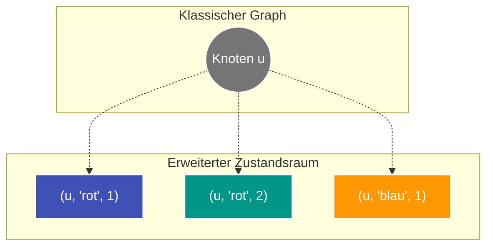

---
tags:
  - Algorithm
  - Graph
  - Shortest Path
  - Dijkstra
  - State Space
  - Dynamic Programming
---


# Zustandsbasierter Dijkstra (State-Space Dijkstra) & Zustandsraum-Reduktion

Der **zustandsbasierte Dijkstra (State-Space Dijkstra)** ist eine mächtige Erweiterung des klassischen Dijkstra-Algorithmus für kürzeste Pfade in gewichteten Graphen. Er kommt zum Einsatz, wenn die Gültigkeit eines Pfades oder dessen Kosten nicht nur vom aktuellen Aufenthaltsort (Knoten) abhängen, sondern von einer **laufenden Historie**, Nebenbedingungen oder dynamischen Ressourcen.

---

## Kernproblem des klassischen Dijkstra

Im klassischen Dijkstra-Algorithmus ist ein Zustand ausschließlich durch den Knoten $u$ definiert:
$$\text{dist}[u] = \text{kürzeste Distanz von der Quelle zu Knoten } u$$

**Das Problem:**  
Hängt der Pfad von Restriktionen ab (z. B. "maximal 3 aufeinanderfolgende Kanten derselben Farbe", "ein Budget von $K$ Schritten", "keine zwei identischen Buchstaben hintereinander" oder Treibstoffmengen), reicht $\text{dist}[u]$ nicht mehr aus. Ein Weg, der einen Knoten $u$ mit scheinbar höheren Kosten erreicht, könnte die einzige Möglichkeit sein, das Ziel zu erreichen, weil er die Nebenbedingung nicht verletzt hat.

---

## 1. State-Space Expansion (Zustandsraum-Erweiterung)

Der Paradigmenwechsel besteht darin, den Suchraum von Knoten auf **abstrakte Zustände** zu erweitern:

$$\text{Zustand} = (\text{node}, \text{context}_1, \text{context}_2, \dots)$$

Die Distanz-Tabelle merkt sich die minimalen Kosten für jeden individuellen Zustand:
$$\text{dist}[(\text{node}, \text{state})] = \text{minimale Kosten}$$



Jede Kante im Originalgraphen $(u \to v)$ wird im Zustandsgraphen zu einem Übergang zwischen zwei konkreten Zuständen:
$$(\text{cost}, u, \text{context}) \xrightarrow{\text{Kante } w} (\text{cost} + w, v, \text{neuer\_context})$$

---

## 2. Zustandsraum-Reduktion (State-Space Reduction)

Würde man die gesamte Historie des bisherigen Pfades (z. B. als String oder Liste aller besuchten Kanten) im Zustand mitschleppen, würde die Anzahl der Zustände exponentiell explodieren ($\mathcal{O}(V!)$) und zu einem Memory Limit Exceeded führen.

**Die Lösung (Zustandsraum-Reduktion):**  
Man analysiert die Aufgabenstellung und destilliert aus der Historie **nur die minimal notwendigen Zustandsvariablen**, die zukünftige Entscheidungen beeinflussen:

- Statt `pfad = "a -> b -> b -> c"`:
  - Nur `letztes_zeichen = 'c'`
  - Nur `zaehler = 1` (wie oft das Zeichen hintereinander auftrat)
- Statt Liste aller getätigten Tauschoperationen:
  - Nur `verbleibende_joker = k`
- Statt vollständige Modulo-Historie:
  - Nur `summe % k`

Damit schrumpft der Zustandsraum von unendlich/exponentiell auf ein handhabbares Produkt:
$$|\text{Zustände}| = V \times |\text{Zustandswerte}|$$

---

## 3. Algorithmus: Zustandsbasierter Dijkstra

Der Algorithmus arbeitet mit einer [Priority Queue](min-heap-sweep-line.md) ([Min-Heap](min-heap-sweep-line.md)), die stets den Zustand mit den aktuell geringsten kumulierten Kosten expandiert.

### Python-Vorlage

```python
import heapq
from typing import Dict, List, Tuple


def state_space_dijkstra(
    n: int,
    adj: List[List[Tuple[int, int, str]]],
    start: int,
    target: int,
    max_consecutive: int,
) -> int:
    """Findet den kürzesten Pfad mit Nebenbedingung:

    Höchstens 'max_consecutive' Kanten mit demselben Label hintereinander.

    Args:
        n: Anzahl Knoten
        adj: Adjazenzliste adj[u] = [(neighbor, weight, label), ...]
        start: Startknoten
        target: Zielknoten
        max_consecutive: Erlaubte Wiederholungen desselben Kanten-Labels

    Returns:
        Minimale Kosten oder -1, falls unerreichbar
    """
    # dist[(node, last_label, count)] = minimal_cost
    dist: Dict[Tuple[int, str, int], int] = {}

    # Priority Queue Einträge: (cost, node, last_label, count)
    pq = [(0, start, "", 0)]
    dist[(start, "", 0)] = 0

    while pq:
        cost, u, last_label, count = heapq.heappop(pq)

        # Ziel erreicht? Durch Min-Heap ist der erste Treffer garantiert optimal!
        if u == target:
            return cost

        # Veraltete Einträge im Heap überspringen (Lazy Deletion)
        if cost > dist.get((u, last_label, count), float("inf")):
            continue

        for v, weight, label in adj[u]:
            new_count = (count + 1) if label == last_label else 1

            # Prüfe, ob die Pfad-Regel verletzt wird
            if new_count > max_consecutive:
                continue

            new_cost = cost + weight
            state = (v, label, new_count)

            # Relaxation des Zustands
            if new_cost < dist.get(state, float("inf")):
                dist[state] = new_cost
                heapq.heappush(pq, (new_cost, v, label, new_count))

    return -1
```

---

## 4. Komplexitätsanalyse

Sei $V$ die Anzahl der Knoten, $E$ die Anzahl der Kanten und $S$ die Anzahl der möglichen Kontexte pro Knoten:

| Dimension | Komplexität | Begründung |
| :--- | :--- | :--- |
| **Knotenzahl im Zustandsgraphen** | $V' = V \cdot S$ | Jeder Basisknoten wird mit allen $S$ Kontexten multipliziert. |
| **Kantenzahl im Zustandsgraphen** | $E' = E \cdot S$ | Jeder Übergang hängt vom aktuellen Zustand ab. |
| **[Zeitkomplexität](o-notation.md)** | $\mathcal{O}(E' \log V') = \mathcal{O}((E \cdot S) \log(V \cdot S))$ | Standard-Dijkstra auf dem expandierten Graphen. |
| **[Speicherkomplexität](o-notation.md)** | $\mathcal{O}(V \cdot S)$ | Distanz-Map und [Priority Queue](min-heap-sweep-line.md). |

---

## Typische Anwendungsfälle

1. **Pfadsuche mit K-Jokern / K-Hürden:** Einen Kürzesten Pfad finden, bei dem man bis zu $K$ Hindernisse überspringen darf $\to$ Zustand: `(node, k_used)`.
2. **Wechselnde Kantenfarben:** Ein Pfad darf keine zwei gleichfarbigen Kanten hintereinander nutzen $\to$ Zustand: `(node, last_color)`.
3. **Akku-/Tank-Beschränkungen:** Kürzeste Route mit Tankstopps $\to$ Zustand: `(node, remaining_fuel)`.
4. **Modulo-Kosten:** Finde kürzesten Pfad, dessen Gesamtlänge durch $K$ teilbar ist $\to$ Zustand: `(node, cost % K)`.

---

## Stolpersteine & Best Practices

1. **Unvollständige Zustandsschlüssel:** Wenn eine Eigenschaft die Zulässigkeit oder Kosten zukünftiger Kanten beeinflusst, **muss** sie Teil des Schlüssels sein. Fehlt sie, überschreibt Dijkstra fälschlicherweise Pfade, die für das Endergebnis notwendig gewesen wären.
2. **Übermäßige Zustandsgrößen:** Vermeide es, Listen oder Zeichenketten in den Zustand aufzunehmen. Immer auf Zähler, Enums, Integers oder [Bitmasken](bit-manipulation.md) reduzieren.
3. **Lazy Deletion:** Dijkstra fügt oft mehrere Einträge für denselben Zustand in den Heap ein. Der Check `if cost > dist[state]: continue` ist essenziell, um die theoretische Laufzeitgrenze in der Praxis nicht zu sprengen.
