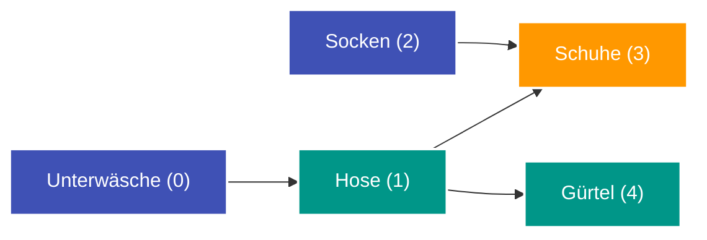

---
tags:
  - Algorithm
  - Graph
  - DAG
  - Topological Sort
---


# Topologische Sortierung (Topological Sort)

Die **topologische Sortierung** ordnet die Knoten eines **gerichteten, kreisfreien Graphen (DAG – Directed Acyclic Graph)** in einer linearen Reihenfolge so an, dass für jede gerichtete Kante $(u, v)$ der Knoten $u$ stets vor dem Knoten $v$ erscheint.

---

## Intuition & Kernidee

Man kann sich eine topologische Sortierung wie einen Ablaufplan von Aufgaben mit Abhängigkeiten vorstellen (z. B. Kursvoraussetzungen im Studium oder Makefiles beim Kompilieren von Code):
- Eine Aufgabe darf erst begonnen werden, wenn alle ihre Voraussetzungen erledigt sind.
- Gibt es einen Zyklus ($A \to B \to C \to A$), ist keine gültige Reihenfolge möglich (Deadlock).



Eine gültige topologische Reihenfolge: $[0, 2, 1, 4, 3]$.

---

## 1. Kahn-Algorithmus (BFS mit In-Degree)

Der Kahn-Algorithmus ist die intuitivste und am häufigsten genutzte Methode:

1. Berechne für jeden Knoten seinen Eingangsgrad (*In-Degree* = Anzahl eingehender Kanten).
2. Stecke alle Knoten mit $\text{In-Degree} == 0$ in eine Queue.
3. Solange die Queue nicht leer ist:
   - Nimm Knoten $u$ heraus und hänge ihn an das Ergebnis an.
   - Verringere für alle Nachbarn $v$ von $u$ deren $\text{In-Degree}$ um 1.
   - Fällt $\text{In-Degree}(v)$ auf 0, füge $v$ zur Queue hinzu.
4. Wurden am Ende weniger als $V$ Knoten besucht, enthält der Graph mindestens einen **Zyklus**.

```python
from collections import deque


def topological_sort_kahn(
    n: int, edges: list[tuple[int, int]]
) -> list[int]:
    adj = [[] for _ in range(n)]
    in_degree = [0] * n

    for u, v in edges:
        adj[u].append(v)
        in_degree[v] += 1

    queue = deque([i for i in range(n) if in_degree[i] == 0])
    order = []

    while queue:
        u = queue.popleft()
        order.append(u)

        for v in adj[u]:
            in_degree[v] -= 1
            if in_degree[v] == 0:
                queue.append(v)

    if len(order) < n:
        return []  # Zyklus erkannt!

    return order
```

---

## 2. DFS-Ansatz (Post-Order Reversal)

Mit einer [Tiefensuche](traversierung-bfs-dfs.md) und einem 3-Farben-Zustand (0 = unbesucht, 1 = im aktuellen Rekursionspfad, 2 = abgeschlossen):
- Wir starten DFS für jeden unbesuchten Knoten.
- Treffen wir auf einen Knoten im Zustand 1, liegt ein **Zyklus** vor.
- Wenn alle Nachbarn eines Knotens vollständig besucht sind (Zustand 2), fügen wir ihn einer Ergebnisliste hinzu.
- Die umgekehrte (*reversed*) Post-Order-Liste ist die topologische Sortierung.

---

## Komplexität

| Dimension | Komplexität |
| :--- | :--- |
| **[Zeitkomplexität](o-notation.md)** | $\mathcal{O}(V + E)$ – Jeder Knoten und jede Kante wird genau einmal verarbeitet. |
| **[Speicherkomplexität](o-notation.md)** | $\mathcal{O}(V + E)$ – [Adjazenzliste](adjazenzliste.md), In-Degree Array und Queue. |
