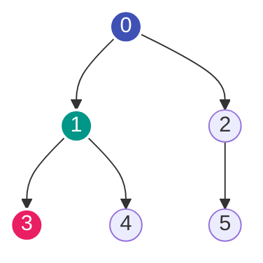
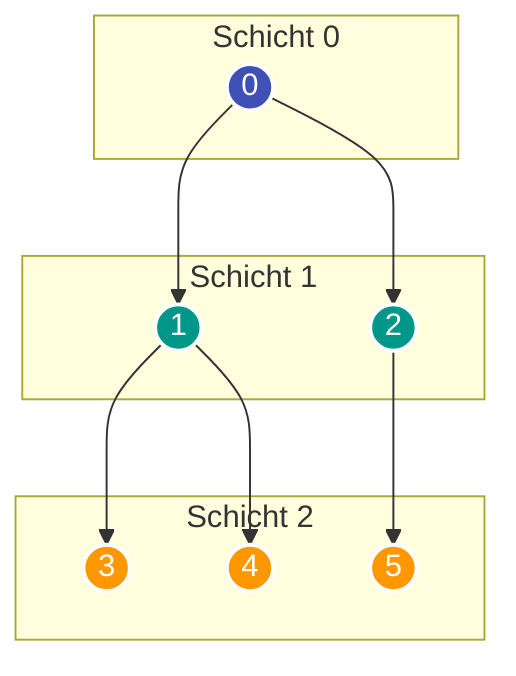

---
tags:
  - Algorithm
  - Graph
  - Tree
  - BFS
  - DFS
  - Traversal
---


# Graph-Traversierung: Breitensuche (BFS) & Tiefensuche (DFS)

Die **Breitensuche (Breadth-First Search, BFS)** und die **Tiefensuche (Depth-First Search, DFS)** sind die beiden elementaren Traversierungsstrategien, um alle Knoten und Kanten eines Graphen oder Baumes systematisch zu durchlaufen.

---

## 1. Tiefensuche (DFS – Depth-First Search)

Die Tiefensuche folgt einem Pfad so tief wie möglich in den Graphen hinein, bevor sie durch Backtracking zurückkehrt und alternative Abzweigungen untersucht.



Traversierungsreihenfolge bei DFS (Start bei 0): $0 \to 1 \to 3 \to 4 \to 2 \to 5$.

### Datenstruktur
DFS nutzt das LIFO-Prinzip (Last In, First Out) – entweder implizit über den **Call-Stack (Rekursion)** oder explizit über einen **manuellen Stack** (`list.append` und `list.pop`).

### Iterative DFS gegen Rekursionslimits
In Python liegt die maximale Rekursionstiefe bei 1000. Ein expliziter Stack vermeidet den `RecursionError`:

```python
def dfs_iterative(adj: list[list[int]], start: int) -> list[int]:
    visited = set([start])
    stack = [start]
    order = []

    while stack:
        u = stack.pop()
        order.append(u)

        for v in reversed(adj[u]):
            if v not in visited:
                visited.add(v)
                stack.append(v)

    return order
```

---

## 2. Breitensuche (BFS – Breadth-First Search)

Die Breitensuche erkundet den Graphen schichtweise (*ebenenweise*): Zuerst alle direkten Nachbarn des Startknotens (Distanz 1), danach alle Nachbarn der Nachbarn (Distanz 2) usw.



### Datenstruktur
BFS nutzt das FIFO-Prinzip (First In, First Out) über eine **Queue**. In Python verwendet man zwingend `collections.deque`, da `popleft()` in $\mathcal{O}(1)$ arbeitet (im Gegensatz zu `list.pop(0)`, was $\mathcal{O}(n)$ kostet).

```python
from collections import deque


def bfs_shortest_path(
    adj: list[list[int]], start: int, target: int
) -> int:
    queue = deque([(start, 0)])  # (knoten, distanz)
    visited = set([start])

    while queue:
        u, dist = queue.popleft()

        if u == target:
            return dist

        for v in adj[u]:
            if v not in visited:
                visited.add(v)
                queue.append((v, dist + 1))

    return -1
```

---

## Vergleich: DFS vs. BFS

| Kriterium | Tiefensuche (DFS) | Breitensuche (BFS) |
| :--- | :--- | :--- |
| **Primäre Datenstruktur** | Stack (LIFO / Rekursion) | Queue (`collections.deque`, FIFO) |
| **Kürzeste Pfade?** | Nein (ungewichtet) | Ja (garantiert kürzester Pfad in ungewichteten Graphen) |
| **Speicheraufwand** | $\mathcal{O}(\text{Tiefe})$ – optimal bei tiefen, schmalen Bäumen | $\mathcal{O}(\text{Breite})$ – kann bei hohem Verzweigungsgrad viel RAM belegen |
| **Typische Einsatzgebiete** | Zykelerkennung, [Topologische Sortierung](topologische-sortierung.md), Zusammenhangskomponenten, [Flood Fill](flood-fill.md), Backtracking | Kürzeste Wege (ungewichtet), Level-Order-Traversierung, Multi-Source BFS |
| **[Zeitkomplexität](o-notation.md)** | $\mathcal{O}(V + E)$ | $\mathcal{O}(V + E)$ |
| **[Speicherkomplexität](o-notation.md)** | $\mathcal{O}(V)$ | $\mathcal{O}(V)$ |
