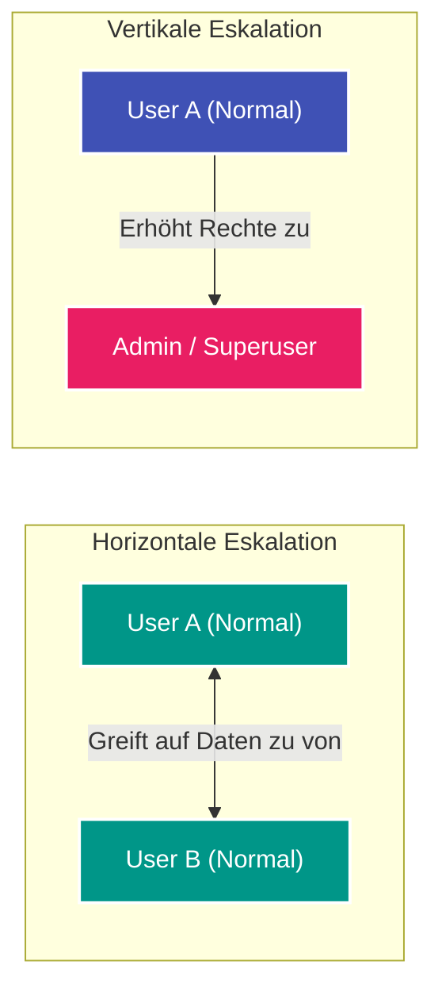

---
tags:
  - Security
  - Vulnerability
  - Web Security
  - Authorization
  - IDOR
  - OWASP
---

# Broken Access Control & IDOR

**Broken Access Control (Fehlerhafte Zugriffskontrolle)** belegt Platz 1 der **OWASP Top 10**. Sie tritt auf, wenn eine Anwendung nicht ordnungsgemäß prüft, ob ein authentifizierter Benutzer die Berechtigung besitzt, eine angeforderte Ressource einzusehen, zu verändern oder zu löschen.

Ein besonders verbreiteter Spezialfall hiervon sind **Insecure Direct Object References (IDOR)**.

---

## Was ist ein IDOR (Insecure Direct Object Reference)?

Ein IDOR entsteht, wenn eine Anwendung Datenbank-Schlüssel, Dateinamen oder interne Identifikatoren direkt in URL-Pfaden oder Parametern exponiert und der Server vor dem Zugriff **nicht verifiziert, ob das Objekt dem anfragenden Benutzer gehört**.

```mermaid
graph TD
    UserA["Benutzer A (User-ID: 100)"] -->|GET /api/documents?id=100| Server["Webserver Backend"]
    Server -->|Liefert Dokument 100| UserA

    UserA -->|GET /api/documents?id=101 (IDOR!)| Server
    Server -->|Kein Berechtigungs-Check!| DocB["Dokument 101 von Benutzer B"]
    DocB -->|Sensible Daten gestohlen| UserA

    style UserA fill:#f44336,stroke:#fff,stroke-width:2px,color:#fff
    style Server fill:#3f51b5,stroke:#fff,stroke-width:2px,color:#fff
    style DocB fill:#ff9800,stroke:#fff,stroke-width:2px,color:#fff
```

### Typische Beispiele in REST-APIs:
- **Dokument-Download:** `GET /download.php?file_id=4821` $\to$ Ändern zu `file_id=4822`
- **Profil-Update:** `PUT /api/v1/users/55` mit JSON-Body eines anderen Benutzers
- **Bestellbestätigung:** `GET /orders/invoice_9918.pdf`

---

## Horizontale vs. Vertikale Rechteausweitung

Zugriffskontrollprobleme werden in zwei Hauptkategorien unterteilt:



### 1. Horizontale Rechteausweitung (Horizontal Privilege Escalation)
Ein Benutzer greift auf Ressourcen eines **gleichrangigen Benutzers** zu (z. B. Kunde A sieht Rechnungen, private Nachrichten oder Lieferadressen von Kunde B).

### 2. Vertikale Rechteausweitung (Vertical Privilege Escalation)
Ein Benutzer mit niedrigen Rechten erlangt Zugriff auf Funktionen oder Daten, die für **höherrangige Rollen (z. B. Administratoren)** reserviert sind:
- Ungeprüfte Admin-Endpunkte: `GET /admin/deleteUser?id=5`
- Unzureichende Rollenprüfung bei HTTP-Methoden: `GET /users` ist für alle erlaubt, aber `POST /users` (Anlegen neuer Konten) prüft die Admin-Rolle nicht ab.
- Mass Assignment: Beim Registrieren sendet der Angreifer zusätzlich `{"role": "admin"}` im JSON-Body mit, und das Backend bindet das Attribut ungeprüft an das Modell.

---

## Praxistest mit Burp Suite: Die Autorize Extension

Das manuelle Testen von Hunderten Endpunkten auf IDORs ist zeitintensiv. In Bug Bounties nutzt man daher das Burp Suite Plugin **Autorize**:

1. Logge dich im Browser als **Low-Privilege User B** ein und kopiere seine Session-Cookies.
2. Trage diese Cookies in die Konfiguration von *Autorize* ein.
3. Logge dich im Haupt-Browser als **Admin / User A** ein und klicke die Anwendung normal durch.
4. *Autorize* wiederholt jeden einzelnen Request von User A automatisch im Hintergrund mit den Cookies von User B und vergleicht Statuscodes und Antwortlängen.
5. Liefert ein Request denselben Inhalt (`200 OK`) statt eines `403 Forbidden` oder `401 Unauthorized`, markiert Autorize die Schwachstelle sofort rot (*Bypassed*).

---

## Häufige Bypasses & Edge Cases

1. **Parameter-Verschleierung:**
   - GUIDs/UUIDs statt Integer-IDs: Manchmal sind UUIDs vorhersagbar (UUIDv1 basiert auf Timestamp und MAC-Adresse) oder werden an anderer Stelle (z. B. öffentlichen Profilen) geleakt.
2. **HTTP Verb Tampering:**
   - Manche Sicherheitsfilter prüfen nur `GET` oder `POST`. Durch Ändern der Methode auf `PUT`, `PATCH` oder `HEAD` lässt sich die Prüfung umgehen.
3. **Erweiterung von Dateiendungen:**
   - `/api/user/10` wird blockiert, aber `/api/user/10.json` oder `/api/user/10/` wird vom URL-Routing verarbeitet, ohne den Filter anzusprechen.

---

## Sichere Abwehr

1. **Session-Bindung (Objekt-Level Autorisierung):**
   - Lade Objekte in Datenbankabfragen niemals nur anhand der übergebenen ID, sondern binde sie zwingend an den angemeldeten Benutzer der Session:
   ```python
   # Sicherer Code:
   document = db.session.query(Document).filter_by(
       id=requested_id,
       owner_id=current_user.id  # Garantiert, dass nur eigene Dokumente geladen werden
   ).first_or_404()
   ```
2. **Role-Based Access Control (RBAC):**
   - Prüfe vor jeder kritischen Funktion explizit die Rolle des Aufrufers über Middleware oder Dekoratoren (`@require_role("admin")`).
3. **Indirekte Referenzen / Unvorhersehbare IDs:**
   - Verwende kryptografisch sichere, zufällige IDs (UUIDv4), um numerisches Durchprobieren von Identifikatoren zu verhindern.
