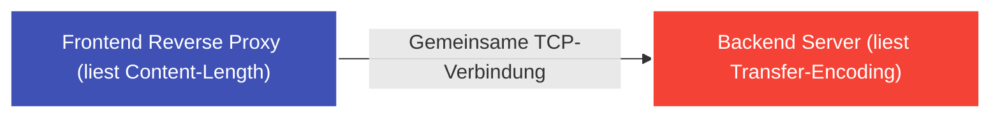

---
tags:
  - Security
  - Vulnerability
  - Web Security
  - Advanced
  - Request Smuggling
  - Race Condition
---

# Fortgeschrittene Angriffe: HTTP Request Smuggling & Race Conditions

Diese Techniken zählen zu den anspruchsvollsten Disziplinen im Bug Bounty Hunting. Sie erfordern tiefes Verständnis von Proxy-Desynchronisation und Nebenläufigkeit (Concurrency).

---

## 1. HTTP Request Smuggling

Moderne Web-Architekturen bestehen fast immer aus einer Kette von Servern: Einem **Frontend Reverse Proxy** (z. B. Cloudflare, NGINX, HAProxy) und einem oder mehreren **Backend-Applikationsservern** (Node.js, Apache, Gunicorn).

Zur Optimierung nutzen Frontend und Backend dieselbe persistente TCP-Verbindung (*HTTP Keep-Alive*), um viele Anfragen nacheinander zu pipelinen.



### Der Konflikt: Wo endet ein HTTP-Request?
Im HTTP/1.1-Standard gibt es zwei Möglichkeiten, die Länge des Request-Bodys anzugeben:
1. `Content-Length (CL)`: Gibt die Bytezahl direkt an.
2. `Transfer-Encoding: chunked (TE)`: Übermittelt Daten in Blöcken; ein Block der Größe `0` beendet den Request.

Verarbeitet das Frontend den Request nach `Content-Length`, das Backend aber nach `Transfer-Encoding` (oder umgekehrt), interpretieren die Server die Grenzen unterschiedlich:

### Die beiden Hauptvarianten:

#### CL.TE Desynchronisation (Frontend: CL, Backend: TE)
```http
POST / HTTP/1.1
Host: target.com
Content-Length: 13
Transfer-Encoding: chunked

0

SMUGGLED
```
- Das Frontend liest 13 Bytes (alles bis einschließlich `SMUGGLED`) und leitet alles an das Backend weiter.
- Das Backend sieht `Transfer-Encoding: chunked`, stoppt sofort bei `0\r\n\r\n` und betrachtet `SMUGGLED` als **Beginn des nächsten HTTP-Requests** des nächsten beliebigen Nutzers!

#### TE.CL Desynchronisation (Frontend: TE, Backend: CL)
Das Frontend nutzt Chunked Encoding, das Backend nutzt Content-Length. Der eingeschleuste Rumpf bleibt in der Backend-Warteschlange hängen und wird an die Anfrage des nächsten Nutzers angehängt.

### Was kann man damit erreichen?
- **Account Takeover:** Abgreifen von Session-Cookies fremder Benutzer, indem ihre Requests in einen Kommentar oder ein Suchfeld umgeleitet werden.
- **Bypass von Frontend-Sicherheitsregeln:** Aufrufen administrativer Endpunkte (`/admin`), die nur am Frontend blockiert werden.

---

## 2. Race Conditions (Limit Overrun & Single-Packet Attack)

Eine **Race Condition** tritt auf, wenn mehrere Threads oder Prozesse gleichzeitig auf geteilte Ressourcen zugreifen und die Korrektheit des Ergebnisses vom Timing der Ausführung abhängt.

### Das klassische Time-of-Check to Time-of-Use (TOCTOU) Problem
Ein Benutzer löst einen 20%-Gutschein ein:
1. **Check:** Prüfe, ob der Gutschein bereits verwendet wurde (`if not coupon.used`).
2. **Use:** Wende Rabatt an und markiere Gutschein als verbraucht (`coupon.used = True`).

Treffen zwei Anfragen **im selben Millisekunden-Fenster** ein, führen beide Thread 1 aus, bevor Thread 2 das Flag auf `True` setzen kann. Der Gutschein wird doppelt angewendet!

```mermaid
graph TD
    subgraph Request 1
        C1["1. Prüfe coupon.used -> False"] --> A1["3. Rabatt anwenden"]
    end
    subgraph Request 2 (Parallel!)
        C2["2. Prüfe coupon.used -> False"] --> A2["4. Rabatt nochmals anwenden!"]
    end

    style C1 fill:#009688,stroke:#fff,stroke-width:2px,color:#fff
    style C2 fill:#009688,stroke:#fff,stroke-width:2px,color:#fff
    style A1 fill:#4caf50,stroke:#fff,stroke-width:2px,color:#fff
    style A2 fill:#f44336,stroke:#fff,stroke-width:2px,color:#fff
```

### Der moderne Exploit: Single-Packet Attack via Turbo Intruder
Über normales Netzwerk-Senden haben Pakete leichten Jitter (Latenzschwankungen). Die bahnbrechende Entdeckung (PortSwigger Research):
- Mit HTTP/2 oder gezieltem TCP-Nagle-Verzögern kann man bis zu **20 oder 30 HTTP-Requests in ein einziges physisches TCP-Paket packen**.
- Alle 30 Requests kommen am Server in exakt derselben Mikrosekunde an und überwinden praktisch jede Standard-Datenbankprüfung ohne Locks!

---

## 3. Prototype Pollution (JavaScript)

In JavaScript erben Objekte Eigenschaften von ihrem Prototyp (`Object.prototype`).

Kann ein Angreifer verschachtelte JSON-Objekte über Funktionen wie `merge()` oder `clone()` injizieren:
```json
{
  "__proto__": {
    "isAdmin": true
  }
}
```
Wird `isAdmin` global an `Object.prototype` angehängt. Plötzlich hat **jedes Objekt** im gesamten Node.js-Prozess standardmäßig die Eigenschaft `isAdmin === true`!
