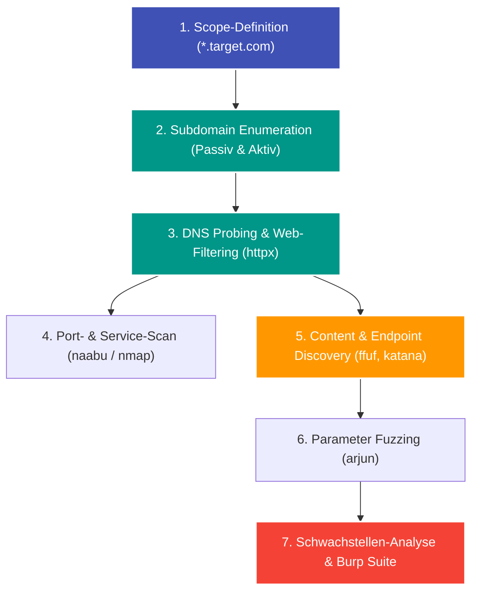

---
tags:
  - Security
  - Bug Bounty
  - Reconnaissance
  - Automation
  - Tools
  - Reporting
---

# Bug Bounty Reconnaissance, Automatisierung & Reporting

Im professionellen Bug Bounty Hunting (HackerOne, Bugcrowd) entscheidet die **Aufklärung (Reconnaissance)** über den Erfolg. Wer vergessene Entwicklungsserver oder verborgene API-Routen zuerst findet, hat die höchste Chance auf rentable Bounties.

---

## 1. Die Phasen einer professionellen Recon-Pipeline



---

## 2. Die wichtigsten Tools für jede Phase

### Phase A: Subdomain Enumeration (Asset Discovery)
- **Passiv (ohne Pakete an das Ziel zu senden):**
  - **`crt.sh` / Certificate Transparency Logs:** Zeigt alle SSL-Zertifikate, die jemals für die Domain ausgestellt wurden.
  - **`subfinder`:** Fragt Dutzende freie Quellen (SecurityTrails, AlienVault, Shodan, VirusTotal) ab:
    ```bash
    subfinder -d target.com -o subdomains.txt
    ```
- **Aktiv (DNS Brute-Forcing):**
  - **`puredns`:** Nutzt vertrauenswürdige öffentliche Resolver und Wortlisten (SecLists), um Millionen Subdomains in Sekunden aufzulösen.

### Phase B: HTTP Probing & Filterung
Nicht jede gefundene Subdomain betreibt einen Webserver. `httpx` filtert aktive Endpunkte heraus und ermittelt Statuscodes, Titel und Webtechnologien:
```bash
cat subdomains.txt | httpx -title -status-code -tech-detect -o live_hosts.txt
```

### Phase C: Content & Directory Discovery
Versteckte Admin-Panels, Backups (`.bak`, `.zip`) oder Konfigurationsdateien (`.env`, `.git`) finden:
- **`ffuf` (Fast Web Fuzzer):**
  ```bash
  ffuf -u https://target.com/FUZZ -w /usr/share/seclists/Discovery/Web-Content/raft-medium-directories.txt -mc 200,301,302,403
  ```

### Phase D: JavaScript-Analyse & Endpunktextraktion
Single-Page-Apps (React, Vue, Angular) verbergen unzählige API-Endpunkte in ihren komprimierten JavaScript-Bundles:
- **`katana` / `gau` (GetAllUrls):** Sammelt historische URLs aus der Wayback Machine.
- Extrahieren von API-Keys und Endpunkten mit Regex (`SecretFinder`, `LinkFinder`).

### Phase E: Parameter Fuzzing
Viele Schwachstellen (XSS, SSRF, SQLi) schlummern in Parametern, die im Webinterface gar nicht sichtbar sind:
- **`arjun`:** Findet versteckte GET- und POST-Parameter durch gezielte Header- und Body-Anomalien:
  ```bash
  arjun -u https://target.com/api/search -m GET
  ```

---

## 3. Schwachstellen-Scanning mit `nuclei`

`nuclei` ist der Standard für template-basierte Schwachstellenerkennung. Es führt nur exakt definierte, gutartige Requests aus, statt planlos Fuzzing zu betreiben:

```bash
# Auf bekannte kritische Fehlkonfigurationen und CVEs prüfen
nuclei -l live_hosts.txt -t cves/ -t misconfiguration/ -severity critical,high
```

---

## 4. Das perfekte Bug Bounty Report (Vulnerability Report)

Ein schlechter Report führt zu Frust oder Schließung als "Informative" oder "Not Applicable". Ein professioneller Report sollte folgende Struktur haben:

### Report-Schema:
1. **Summary:** Knappe, präzise Zusammenfassung (z. B. "Stored XSS in user profile biography leads to account takeover").
2. **Severity (CVSS 3.1):** Realistische Einschätzung (Score, Vector String).
3. **Vulnerable Endpoint:** Exakte URL und betroffene Parameter.
4. **Steps to Reproduce (PoC):** Nummerierte, unmissverständliche Schritte, die jeder Triager in 2 Minuten nachklicken kann (inklusive roher HTTP-Requests aus Burp Suite).
5. **Business Impact:** Warum ist dies für das Unternehmen gefährlich? (z. B. "Erlaubt Diebstahl von Zahlungsdaten oder Lesezugriff auf Kundendaten").
6. **Remediation:** Konstruktiver Lösungsvorschlag (z. B. "Use Prepared Statements" oder "Set HttpOnly cookie flag").
