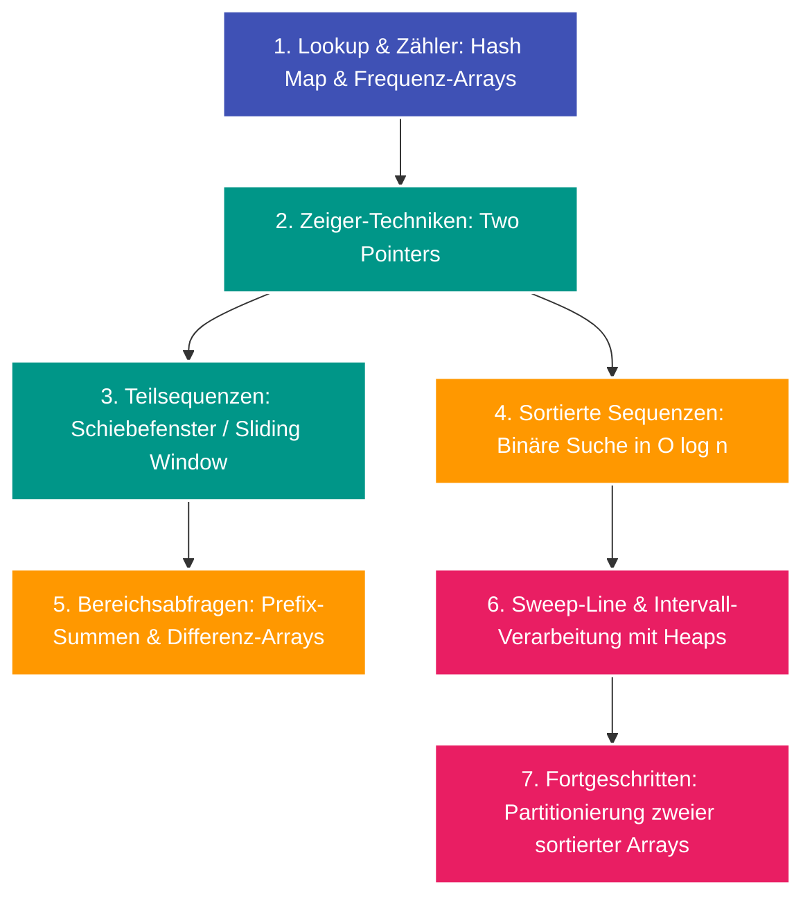

---
tags:
  - Roadmap
  - Array
  - String
  - Two Pointers
  - Sliding Window
---

# Lernpfad: Arrays, Strings & Sequenz-Muster

Arrays und Zeichenketten bilden das Rückgrat der meisten Coding-Interviews. Dieser Lernpfad vermittelt die zentralen Zeiger- und Optimierungsmuster zur sequenziellen Datenverarbeitung.

---

## Übersicht & Meilensteine

---

## Phase 1: Die Grundlagen

- [x] **[Hash Map & Hash Set](../glossary/hash-map.md):** Schnelle $\mathcal{O}(1)$-Lookups und das Two-Sum-Komplement-Muster.
- [x] **[Verkettete Liste](../glossary/linked-list.md):** ListNode-Architektur, Dummy-Head-Pattern und schriftliche Ziffern-Addition.
- [ ] **Two Pointers (Kollidierende Zeiger):** Von den Enden zur Mitte wandern (z. B. Palindrom-Prüfung, Two Sum II bei sortiertem Array).

---

## Phase 2: Fortgeschrittene Fenster- & Suchtechniken

- [x] **[Schiebefenster (Sliding Window)](../glossary/sliding-window.md):** Dynamische vs. feste Fenstergröße, vorzeitiger Abbruch und ASCII-Array-Optimierung.
- [x] **[Binäre Suche (Binary Search)](../glossary/binary-search.md):** Logarithmische Suche $\mathcal{O}(\log n)$ und Median-Partitionierung über zwei getrennte Arrays.
- [x] **[Min-Heap & Sweep-Line](../glossary/min-heap-sweep-line.md):** Koordinatensortierung, Vorrangswarteschlangen und Lazy Invalidation bei Intervallabfragen.

---

## Phase 3: Ziffern, Zeichen & Permutationen

- [x] **[Römische Zahlen & Ziffernsysteme](../glossary/roman-numerals.md):** Greedy-Zerlegung und Rückwärts-Traversierung.
- [x] **[Zyklische Permutationen & Rotationen](../glossary/cyclic-permutations.md):** Invarianz-Prüfung und minimale Sortieroperationen (Shift & Reverse).

---

## Praxisaufgaben im Algodex

- [LeetCode 1: Two Sum](../solutions/leetcode-1.md) (Easy)
- [LeetCode 2: Add Two Numbers](../solutions/leetcode-2.md) (Medium)
- [LeetCode 3: Longest Substring Without Repeating Characters](../solutions/leetcode-3.md) (Medium)
- [LeetCode 4: Median of Two Sorted Arrays](../solutions/leetcode-4.md) (Hard)
- [LeetCode 1851: Minimum Interval to Include Each Query](../solutions/leetcode-1851.md) (Hard)
- [LeetCode 3942: Minimum Operations to Sort a Permutation](../solutions/leetcode-3942.md) (Medium)
