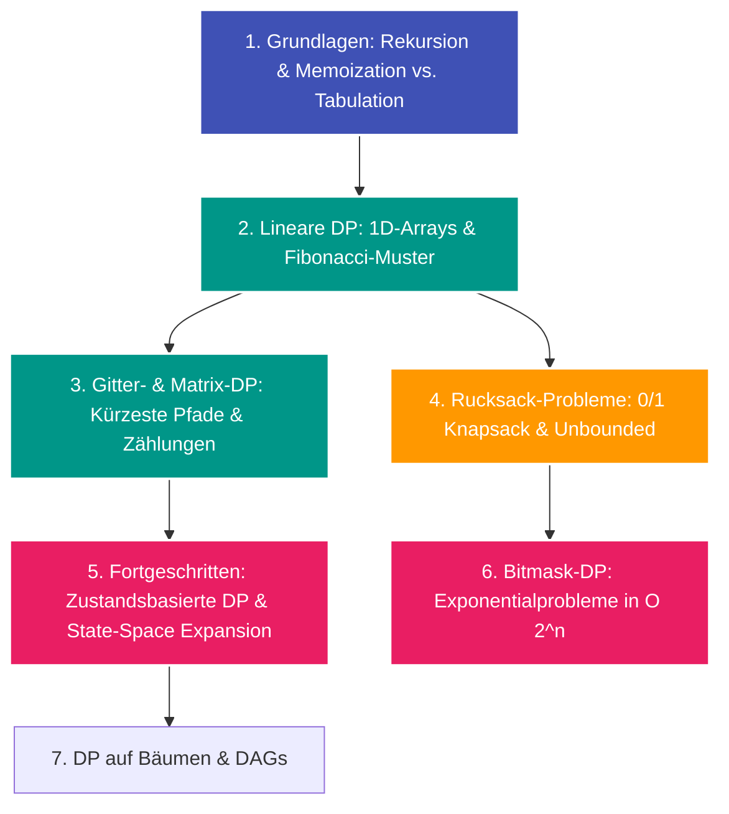

---
tags:
  - Roadmap
  - Dynamic Programming
  - DP
  - Memoization
---

# Lernpfad: Dynamische Programmierung (Dynamic Programming)

Die **dynamische Programmierung (DP)** ist eine fundamentale Problemlösungsmethode, bei der komplexe Probleme in überlappende Teilprobleme zerlegt und deren Teillösungen zur Vermeidung redundanter Berechnungen zwischengespeichert werden.

---

## Übersicht & Meilensteine

---

## Phase 1: Die Grundlagen

Bevor man tabelliert, muss die optimale Substruktur und die Rekursionsbeziehung verstanden werden:

- [ ] **Top-Down mit Memoization:** Rekursive Formulierung mit Cache (`@functools.lru_cache` oder `dict`).
- [ ] **Bottom-Up mit Tabulation:** Iterativer Aufbau der Tabelle von den Basisfällen zu den Zielzuständen.
- [ ] **Speicher-Optimierung:** Reduktion von $\mathcal{O}(n)$ auf $\mathcal{O}(1)$ Speicherplatz, wenn nur die letzten 1–2 Werte benötigt werden.

---

## Phase 2: Klassische Problemfamilien

- [ ] **1D-Teilsequenzen:** Longest Increasing Subsequence (LIS), House Robber, Coin Change.
- [ ] **2D-Gitter & Sequenzvergleich:** Edit Distance (Levenshtein), Longest Common Subsequence (LCS).
- [ ] **Rucksack-Probleme (Knapsack):** Subset Sum, Partition Equal Subset Sum, Target Sum.

---

## Phase 3: Fortgeschrittene DP & Zustandsräume

- [x] **[Zustandsbasierter Dijkstra (State-Space Dijkstra)](../glossary/state-space-dijkstra.md):** Kombination aus Kürzester-Pfad-Suche und dynamischer Zustandsraum-Erweiterung.
- [x] **[Zustandsraum-Reduktion](../glossary/state-space-dijkstra.md):** Reduktion von Pfad-Historien auf minimalistische Invarianten.
- [ ] **Bitmask-DP:** Speichern besuchter Untermengen in Ganzzahl-Bitmasken zur Reduktion von $\mathcal{O}(n!)$ auf $\mathcal{O}(2^n \cdot n)$.
- [ ] **Digit-DP & Wahrscheinlichkeits-DP:** Zählen von Zahlen mit speziellen Zifferneigenschaften im Intervall $[L, R]$.

---

## Verwandte Aufgaben im Algodex

- [LeetCode 3942: Minimum Operations to Sort a Permutation](../solutions/leetcode-3942.md) (Medium)
- [LeetCode 2791: Count Paths That Can Form a Palindrome in a Tree](../solutions/leetcode-2791.md) (Hard)
