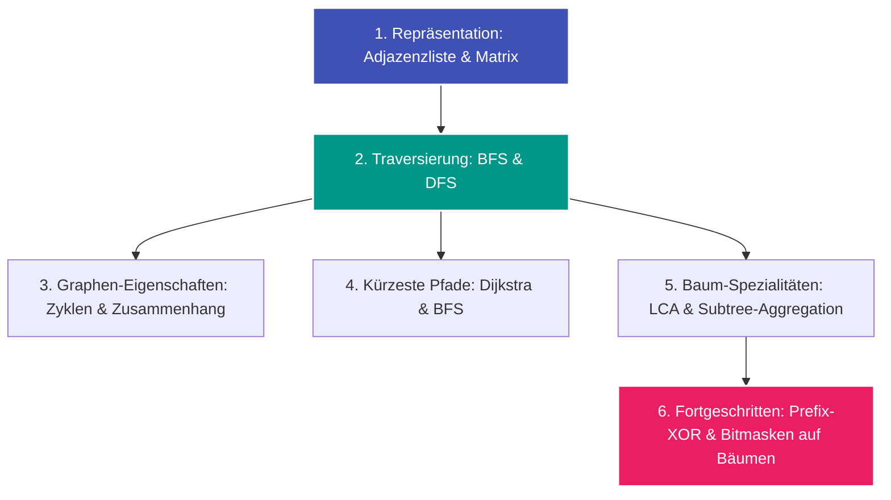

---
tags:
  - Roadmap
  - Graph
  - Tree
---

# Lernpfad: Graph- & Baum-Algorithmen

Dieser Lernpfad führt dich strukturiert von den grundlegenden Datenstrukturen bis hin zu fortgeschrittenen Baum- und Pfad-Techniken.

---

## Übersicht & Meilensteine

---

## Phase 1: Die Grundlagen

Bevor man Graphen traversiert, muss man sie effizient im Speicher abbilden:

- [x] **[Adjazenzliste](../glossary/adjazenzliste.md):** Warum $\mathcal{O}(V + E)$ Speicherplatz fast immer besser ist als eine quadratische Matrix.
- [ ] **[Tiefensuche (DFS)](../glossary/traversierung-bfs-dfs.md):** Rekursion, Call-Stack und Traversierungsreihenfolgen (Pre-, In-, Post-Order).
- [ ] **[Breitensuche (BFS)](../glossary/traversierung-bfs-dfs.md):** Queue-basierte Schicht-für-Schicht-Suche für ungewichtete kürzeste Wege.

---

## Phase 2: Bäume & Pfadprobleme

Bäume sind zusammenhängende, kreisfreie Graphen mit $n$ Knoten und $n - 1$ Kanten. Diese Eigenschaft ermöglicht clevere Abkürzungen:

- **LCA ([Lowest Common Ancestor](../glossary/advanced-tree-techniques.md)):** Der gemeinsame Vorfahre zweier Knoten teilt jeden Baum-Pfad in zwei Abschnitte.
- **Prefix-Techniken auf Bäumen:**
  - Prefix Sum / Prefix XOR entlang von Wurzel-zu-Knoten-Pfaden.
  - Subtree-Größenberechnung in Post-Order.

---

## Herausforderungen aus der Praxis

- [LeetCode 2791: Count Paths That Can Form a Palindrome in a Tree](../solutions/leetcode-2791.md) (Hard)
  - *Kombination aus [Adjazenzliste](../glossary/adjazenzliste.md) + DFS + Prefix-XOR + 26-Bit-Maske.*
- [LeetCode 3970: Shortest Path With At Most K Consecutive Identical Characters](../solutions/leetcode-3970.md) (Hard)
  - *Zustandsbasierter Dijkstra mit State-Space Expansion `(u, last_char, count)` und Min-Heap.*
