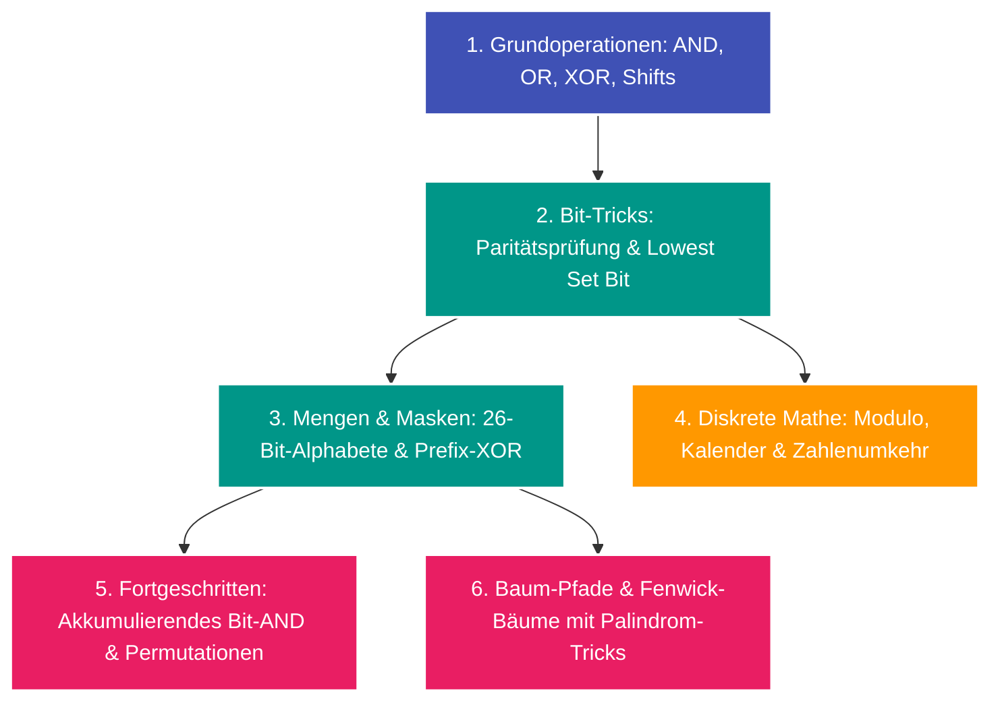

---
tags:
  - Roadmap
  - Math
  - Bit Manipulation
  - Number Theory
---

# Lernpfad: Mathematik & Bit-Manipulation

Bit-Manipulation und diskrete Mathematik ermöglichen es, scheinbar aufwendige Aufgaben in extrem wenigen CPU-Zyklen ($\mathcal{O}(1)$) und mit minimalem Speicheraufwand zu lösen.

---

## Übersicht & Meilensteine

---

## Phase 1: Diskrete Arithmetik & Zahlenzerlegung

- [x] **[Mathematische Zahlenumkehr](../glossary/math-number-reversal.md):** Ziffernextraktion über Modulo/Division ohne Allokation von Strings.
- [x] **[Datums- & Kalender-Arithmetik](../glossary/date-arithmetic.md):** Gregorianische Schaltjahres-Formeln, Epochentage und Intervall-Schnittmengen.
- [ ] **Zahlentheorie & Primzahlen:** Sieb des Eratosthenes, Euklidischer Algorithmus (GGT), Schnelle Exponentiation in $\mathcal{O}(\log n)$.

---

## Phase 2: Bitweise Operationen & Bitmasken

- [x] **[Bitweise Operationen & Bitmasken](../glossary/bit-manipulation.md):** Die Kernoperatoren (`&`, `|`, `^`, `~`, `<<`, `>>`).
- [x] **[Palindrom-Bit-Trick](../glossary/bit-manipulation.md):** Prüfung auf höchstens ein gesetztes Bit mit `mask & (mask - 1) == 0`.
- [x] **[Akkumulierendes Bit-AND](../glossary/bit-manipulation.md):** Schnittmenge von Bit-Eigenschaften fehlsortierter Elemente zur Bestimmung von Tauschrestriktionen.

---

## Phase 3: Pfad-Paritäten & dynamische Bäume

- [x] **Prefix-XOR auf Bäumen:** Wie sich Pfade von der Wurzel über den [Lowest Common Ancestor](../glossary/advanced-tree-techniques.md) im XOR-Produkt aufheben.
- [x] **[Fenwick-Bäume mit XOR](../glossary/advanced-tree-techniques.md):** Dynamische Bereichs-Updates in $\mathcal{O}(\log n)$ für Pfad-Palindrom-Abfragen.

---

## Praxisaufgaben im Algodex

- [LeetCode 9: Palindrome Number](../solutions/leetcode-9.md) (Easy)
- [LeetCode 1360: Number of Days Between Two Dates](../solutions/leetcode-1360.md) (Easy)
- [LeetCode 2409: Count Days Spent Together](../solutions/leetcode-2409.md) (Easy)
- [LeetCode 3644: Maximum K to Sort a Permutation](../solutions/leetcode-3644.md) (Medium)
- [LeetCode 2791: Count Paths That Can Form a Palindrome in a Tree](../solutions/leetcode-2791.md) (Hard)
- [LeetCode 3841: Palindromic Path Queries in a Tree](../solutions/leetcode-3841.md) (Hard)
