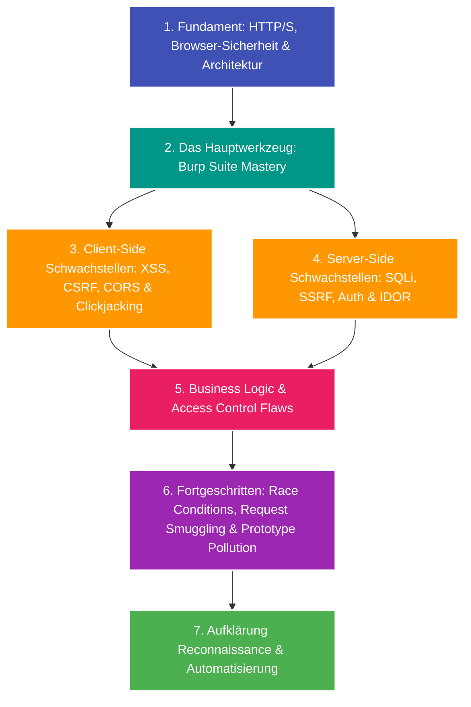

---
tags:
  - Roadmap
  - Security
  - Web Security
  - Bug Bounty
  - PortSwigger
  - OWASP
---

# Lernpfad: Web Security & Bug Bounty Hunting

Dieser Lernpfad führt dich von den absoluten Netzwerk- und HTTP-Grundlagen über den professionellen Einsatz von Burp Suite bis hin zu fortgeschrittenen Angriffstechniken und Aufklärung (Reconnaissance) bei Bug-Bounty-Programmen (z. B. auf HackerOne, Bugcrowd oder Intigriti).

Er orientiert sich didaktisch an den Laboratorien der **PortSwigger Web Security Academy**.

---

## Übersicht & Meilensteine

---

## Phase 1: Die Grundlagen (Das Fundament verstehen)

Bevor man Sicherheitslücken findet, muss man verstehen, wie das Webprotokoll und Webanwendungen auf Byte-Ebene funktionieren:

- [x] **[Web-Fundamente: HTTP & Browser-Sicherheit](../glossary/web-sec-http-sop-cors-csp.md):**
  - **HTTP/1.1 & HTTP/2:** Verben (`GET`, `POST`, `PUT`, `DELETE`), Statuscodes (2xx–5xx) und Header.
  - **State & Sessions:** Cookie-Flags (`HttpOnly`, `Secure`, `SameSite=Strict/Lax/None`), Tokens.
  - **Browser-Sicherheitsmodelle:** Same-Origin Policy (SOP), Cross-Origin Resource Sharing (CORS) und Content Security Policy (CSP).

---

## Phase 2: Das Werkzeug – Burp Suite Mastery

Burp Suite ist der De-facto-Industriestandard für Web Application Penetration Testing. Jeder HTTP-Request wird abgefangen, analysiert und manipuliert:

- [x] **[Burp Suite Grundlagen](../glossary/burp-suite-basics.md):**
  - **Proxy & Intercept:** Einrichten des CA-Zertifikats im Browser, FoxyProxy, Match-and-Replace-Regeln.
  - **Repeater:** Manuelles Modifizieren, schnelles Replayen von Requests und Header-Fuzzing.
  - **Intruder:** Automatisierte Angriffe mit den 4 Payload-Typen (Sniper, Battering Ram, Pitchfork, Cluster Bomb).
  - **Decoder & Comparer:** Byte-by-Byte Differenzen, Dekodieren von URL-, HTML- und Base64-Strings.
  - **Burp Collaborator:** Detektion von Out-of-Band (OAST) Schwachstellen (DNS- und HTTP-Pingbacks).
  - **BApp Store Extensions:** Autorize, Turbo Intruder, Param Miner und Hackvertor.

---

## Phase 3: Client-Side Schwachstellen

Angriffe, die im Browser des Opfers ausgeführt werden:

- [x] **[Cross-Site Scripting (XSS)](../glossary/web-sec-xss.md):**
  - Reflected, Stored und DOM-based XSS (JavaScript Sources vs. Sinks).
  - WAF-Evasion, Polyglot-Payloads und CSP-Bypasses.
- [x] **[CSRF, CORS-Misconfigurations & Clickjacking](../glossary/web-sec-client-side-advanced.md):**
  - Cross-Site Request Forgery: Auto-Submit PoCs, Anti-CSRF-Tokens und `SameSite`-Cookies.
  - CORS-Fehlkonfigurationen: Blind Reflection, Credentials-Leak und Null-Origin.
  - Clickjacking: Transparente iFrame-Überlagerungen, `X-Frame-Options` und CSP `frame-ancestors`.

---

## Phase 4: Server-Side Schwachstellen

Angriffe, die direkt den Server, dessen Datenbank oder das Backend-Netzwerk kompromittieren:

- [x] **[SQL Injection (SQLi)](../glossary/web-sec-sqli.md):**
  - In-Band / Union-Based: Ermittlung von Spaltenzahl und Datentypen.
  - Error-Based: Datenausgabe über erzwungene Konvertierungsfehler.
  - Blind SQLi: Boolean-based und Time-based Extraktion (`pg_sleep()`, `WAITFOR DELAY`).
  - Automatisierung mit `sqlmap` und Prepared Statements.
- [x] **[Server-Side Request Forgery (SSRF)](../glossary/web-sec-ssrf.md):**
  - Auslesen interner Cloud-Metadaten (AWS EC2 IMDSv1 unter `169.254.169.254`).
  - Filter-Bypasses: Dezimal-IPs, Hex, IPv6, DNS Rebinding und URL-Parsing-Tricks.
  - Blind SSRF mit Burp Collaborator.
- [x] **[Broken Access Control & IDOR](../glossary/web-sec-access-control-idor.md):**
  - Insecure Direct Object References (IDOR) in REST-APIs.
  - Horizontale vs. vertikale Rechteausweitung (Privilege Escalation).
  - Automatisierte Bypasses mit der *Autorize*-Extension.
- [x] **[Command Injection, Path Traversal & SSTI](../glossary/web-sec-command-injection-ssti.md):**
  - OS Command Injection: Shell-Separatoren (`;`, `&&`, `|`, Newline).
  - Path Traversal: Auslesen von `/etc/passwd` und Bypasses für naive `../`-Filter.
  - Server-Side Template Injection (SSTI): Detektion von Jinja2/Twig/FreeMarker bis zur Remote Code Execution (RCE).

---

## Phase 5: Business Logic Flaws & Authentifizierung

Schwachstellen, die nicht auf technischem Syntax-Fehlverhalten basieren, sondern auf fehlerhaften Annahmen im Entwickler-Design:

- [x] **[Business Logic Flaws & JWT-Schwachstellen](../glossary/web-sec-business-logic-jwt.md):**
  - Business Logic Flaws: Negative Mengenangaben, Überspringen von Checkout-Schritten, Coupon Stacking.
  - JWT-Angriffe: `alg: none`, Brute-Force schwacher HMAC-Secrets (`hashcat`) und Algorithm Confusion (RS256 zu HS256).

---

## Phase 6: Fortgeschrittene Web-Angriffe

Sicherheitslücken, die tiefes Verständnis von Proxies, Parsing und asynchroner Verarbeitung erfordern:

- [x] **[Request Smuggling, Race Conditions & Prototype Pollution](../glossary/web-sec-advanced-attacks.md):**
  - HTTP Request Smuggling: CL.TE und TE.CL Desynchronisation zwischen Frontend-Proxy und Backend.
  - Race Conditions: Time-of-Check to Time-of-Use (TOCTOU) und Single-Packet Attacks mit Turbo Intruder.
  - Prototype Pollution: Manipulation von `Object.prototype` in Node.js-Backends.

---

## Phase 7: Bug Bounty Hunting – Reconnaissance & Automatisierung

Bei echten Programmen (Scope: `*.target.com`) gewinnt oft derjenige, der neue oder vergessene Assets zuerst entdeckt:

- [x] **[Reconnaissance, Automatisierung & Reporting](../glossary/web-sec-recon-reporting.md):**
  - Asset Discovery: Passiv (`crt.sh`, `subfinder`) und aktiv (`puredns`).
  - HTTP Probing & Filterung: Aktive Webserver mit `httpx` ermitteln.
  - Content Discovery: Schnelles Directory-Fuzzing mit `ffuf`.
  - Endpunktextraktion aus JavaScript-Dateien (`katana`, `gau`).
  - Versteckte Parameter finden mit `arjun`.
  - Gezieltes Schwachstellen-Scanning mit `nuclei`.
  - Professionelle Report-Struktur nach CVSS 3.1 für HackerOne und Bugcrowd.
